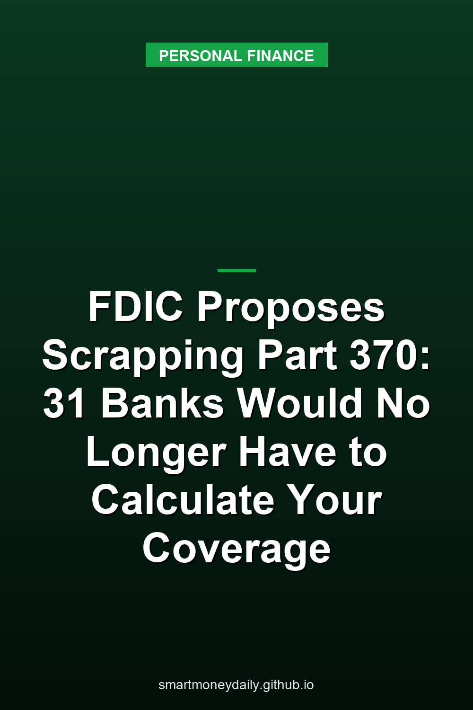

On Oct. 30, 2026, the [FDIC](https://www.fdic.gov/resources/deposit-insurance)'s board approved a proposal to scrap Part 370, the rule that since 2016 has required banks with two million or more deposit accounts to build and keep a system that can work out, account by account, how much is insured and how much isn't. Thirty-one banks are under it, based on March 31, 2026 Call Report data. If the proposal becomes final, the FDIC would run that calculation on its own systems after a failure, using data files the banks hand over.

The $250,000 limit isn't part of this. Neither are the ownership categories that decide how far coverage stretches at one bank. What would change is the machinery behind a failure at the banks with the most accounts: who does the math, which records the bank has to keep, and whether part of a large balance can be frozen for a while. The [FDIC's announcement](https://www.fdic.gov/news/press-releases/2026/fdic-board-approves-notice-proposed-rulemaking-large-bank-deposit) is short. The details are in [the proposal itself](https://www.fdic.gov/board/federal-register-npr-bank-deposit-insurance-determination-modernization.pdf), and that's what most of this post draws on.

## What Part 370 asked of the banks with the most accounts

The FDIC floated the idea in 2015, proposed it in early 2016 and published the final rule that December, then revised it in 2019. An insured bank that reaches two million deposit accounts gets three years to comply. After that, its IT systems have to be able to calculate the insured and uninsured amount in each account, by ownership right and capacity, within 24 hours after the FDIC is appointed receiver, and it has to keep the complete and accurate information the FDIC would need to determine coverage, with alternative recordkeeping allowed for certain kinds of accounts.

The reason was scale. The law says insured deposits must be paid "as soon as possible" and doesn't give a number of days. The FDIC says it expects to make most insured deposits available by the next business day after a failure. Back in 2016, its worry was that messy depositor records plus the size of the job could push a determination well past that, "particularly if a very large IDI fails with little warning." IDI is the FDIC's shorthand for an insured bank or savings institution.

These 31 aren't small by that measure. The proposal sorts them by how many checking, savings and retirement accounts they have: 13 with fewer than 6 million, 13 with 6 million to 30 million, and 5 with more than 30 million. It doesn't name them.

## Why the FDIC says it can do the math itself now

The FDIC's case fits in a few sentences. Since 2016 it has improved its own systems for calculating coverage, and it says it "can now readily process many more insurance determinations than it could in 2016." It also points to "planned expansion of those capabilities." Put together with the replacement rule, it argues, Part 370 can go "without materially impeding" its ability to calculate deposit insurance.

I couldn't find a capacity figure anywhere in the proposal. There's no accounts-per-hour number and no test result. There is an admission that cuts the other way: under Part 370, the banks "still are not able to calculate deposit insurance for all accounts promptly upon failure." That's the FDIC's stated reason for bringing back an older hold mechanism, which comes up below.

The money side is better documented. The FDIC puts each bank's yearly savings at about $625,000 in the smallest group, $875,000 in the middle one and $2.125 million in the largest, around $33 million a year across the industry, a total that also counts the setup costs it expects one newly covered bank to avoid each year. Moving to the replacement rule would cost the banks about $14 million once, plus a small yearly compliance cost. Spread over ten years at the 3.7% discount rate the FDIC used, the net comes to roughly $31 million a year.

The proposal adds that banks "may pass along some or all of the cost savings provided by the proposal to their customers through lower fees or higher deposit interest rates." I wouldn't wait for that. By the FDIC's own size bands, the 31 banks hold more than 254 million deposit accounts: 13 banks with at least 2 million, 13 with at least 6 million, and 5 with more than 30 million. Divide $33 million by 254 million accounts and you get about 13 cents per account a year. The FDIC says it expects actual savings to be "much greater" than its estimates, so treat that as a sense of scale rather than a ceiling. Even ten times the FDIC's number would be $1.30 per account a year.

## The files the banks would send instead

In place of Part 370, most of these banks would come under 12 CFR 360.9, a 2008 rule that already applies to 117 other banks with at least $2 billion in deposits and either 250,000 deposit accounts or $20 billion in total assets. Under 360.9 a bank isn't required to calculate anyone's coverage. It has to be able to give the FDIC standard data files on its depositors after the close of any business day. The FDIC expects them "as soon as practicable, but no later than the following calendar day."

The proposal creates a tier called "larger covered institutions," meaning at least $2 billion in deposits and two million or more deposit accounts. Twenty-nine of the 31 would land in it, and two wouldn't. For that tier, 26 data fields become mandatory. Twenty-one of them are already in Part 370 files. The other five are a domestic-or-foreign deposit flag, an ownership indicator for the account, the account title as the bank's records show it, a code for how each customer is related to the account, and a beneficiary code for agent, custodian and trustee accounts. If a bank in that tier is missing what it needs for those fields, it has to go and collect it.

There are exceptions, and they cover the kinds of accounts where someone else's interest can add coverage. The bank wouldn't have to chase missing details for accounts whose records show an agency, custodial or fiduciary relationship, or for formal revocable trusts and irrevocable trusts. FDIC rules already let those details come from the depositor's own records or from a third party that keeps them. For single and joint accounts, business accounts and payable-on-death accounts, the FDIC expects the bank to have the information already.

That last group deserves a second look. For a payable-on-death account, the beneficiaries count only if they're specifically named in the bank's deposit account records, under 12 CFR 330.10(d)(1). A beneficiary written down only in your own papers doesn't count for that kind of account. A living trust works differently. The account title has to identify it as a trust, and unless the beneficiaries are named in the bank's records, the FDIC has to identify them from the trust document, which comes from the trustee's side rather than the bank's file. Either way, trust coverage is $250,000 per eligible beneficiary, up to five beneficiaries per owner, and one owner's payable-on-death and living-trust deposits at the same bank count together toward that cap. The [post on ownership categories](/2026/08/21/how-fdic-ownership-categories-stack-coverage-at-one-bank/) shows how those categories add up at one bank.

## A hold on the part of a balance above a line

For anyone with a large balance at one of these banks, this is the part that matters. Since becoming Part 370 banks, the 29 haven't had to keep the provisional-hold system that 360.9 requires. The proposal brings it back for them. Once a final rule took effect, they'd get six months for everything except the holds and 18 months for the holds.

A provisional hold is "an effective restriction on access to some or all of a deposit or other liability account after the failure of an insured depository institution." Under 360.9, the bank's system has to be able to place the holds automatically, no later than 9 a.m. local time on the day after the FDIC's cutoff point. The formula is in 12 CFR 360.9(c)(4). The FDIC picks a balance threshold, which "could be any amount, including zero," and a hold percentage from zero to 100%. The hold is the part of the balance above the threshold times that percentage. Both numbers can differ across four groups: consumer checking, NOW and money market deposit accounts; other consumer accounts, which means savings and CDs; and the same two splits for non-consumer accounts.

The rule leaves both numbers to the FDIC at the time of a failure, so the inputs in this example are mine. Say the FDIC chose a $250,000 threshold and a 40% hold for consumer savings and CDs. A $500,000 savings balance sits $250,000 above the line, and 40% of that is a $100,000 hold. A $180,000 balance gets no hold at all with those inputs. The FDIC could set the line lower, though, even at zero, so a balance under $250,000 isn't automatically outside a hold.

A hold isn't a loss. It's a temporary restriction on some or all of an account while the FDIC finishes, and its size depends on the threshold and percentage the FDIC picks. When the FDIC is done, the same system has to be able to lift the holds in a batch and, in the same processing cycle, post whatever debits, credits or extra holds the FDIC directs, under 12 CFR 360.9(c)(10). It also needs a way to remove a single hold by hand. The money above your coverage is uninsured either way. The hold only decides how much of the balance you can use before the determination is final.

Part 370 banks already have a cousin of this. Their systems have to be able to restrict access to some or all of an account until the FDIC has made its determination, a feature the FDIC calls "similar to, but not the same as" a provisional hold.

## When someone else holds the account for you

Some deposits sit in an account that someone else opened for you and other customers: a deposit broker, a deposit placement service, or an app or other agent that keeps customer money in one account at a partner bank. Coverage can pass through to each customer if the records hold up, and the [earlier post on partner banks](/2026/09/08/when-fdic-insured-means-a-partner-bank-not-your-app/) goes through those conditions. The proposal deals with a narrower slice: accounts at the larger banks where the bank leans on the records exception above, so it doesn't hold the customer-by-customer detail itself, and where the account has "transactional features," which roughly means money can be sent out to other people by methods that may post on a later day.

For those accounts, a larger bank would have to do one of two things. It could make a good-faith effort to sign the account holder (the broker or app, not you) to a contract obliging it to send the FDIC a file in a new standard format, Appendix I, within 24 hours after the FDIC is appointed receiver, the timing the proposed rule ties to having access to the deposits on the next business day. Or it could give the account holder a written disclosure that lists what that file must contain and says that, if the bank fails, the account holder "might not have access to deposits" until it delivers the information in that format. Part 370 requires both. The proposal would require one.

The FDIC's reason is payments already in motion. A delay on these accounts could hold up the clearing and settlement of "in flight" transactions. Some account types are left out of the requirement: mortgage servicers' custodial accounts holding borrowers' payments, short-term real estate and title company accounts, lawyers' trust accounts (IOLTAs), employee benefit plan accounts, and accounts an agent keeps for the benefit of formal revocable or irrevocable trusts.

Either way, the arrangement runs between the bank and the account holder, which is the broker or app, not its customers. The proposal also says it "would not obligate larger covered institutions to validate data format and delivery capabilities." If I kept savings through an app tied to one of these banks, this is the section I'd ask the app about. I'd want it to say in writing whether it can produce that file within a day.

## What stays the same, and how soon any of it could start

The proposal doesn't touch the coverage amount, $250,000 per depositor, per bank, per ownership category. It doesn't change the FDIC's stated aim of making most insured deposits available by the next business day. For the 117 banks already under 360.9, the FDIC says it adds no new requirements.

Comments are due 60 days after the proposal is published in the Federal Register. It hadn't been published there as of Nov. 1, so the deadline can't come before 2027. The published notice will carry the exact date. After that the FDIC would still have to adopt a final rule, and the six- and 18-month clocks described above start only when it takes effect. The dollar thresholds that decide which banks are covered would also start rising with inflation, measured by the CPI-W, with the first adjustment on Oct. 1, 2029 and normally one every two years after that.

## Where I'd look first

For someone with less than $250,000 in each ownership category at one bank, the coverage itself doesn't change. A hold could still reach a smaller balance if the FDIC drew its line low, but the rule doesn't say how it would choose, and I wouldn't move money over that. The three cases I'd check are a balance well above the limit at a very large bank, a payable-on-death account whose beneficiaries might not be in the bank's records, and savings parked through an app or a broker. In all three, how quickly money comes back after a failure depends on records. Some of those are yours to fix, like the beneficiaries on a POD account. With an app or a broker, they sit with the middleman. The general sequence of a failure is in [what happens to your money when a bank fails](/2026/08/23/what-happens-to-your-money-when-a-bank-fails/).

The FDIC is betting that its own systems can now do what it once required the 31 banks to do. It makes that case in words rather than in published capacity figures, so I'd read "next business day" at a bank with 30 million accounts the way the FDIC itself words it: as something it expects, not something the law promises. The proposal asks whether the larger banks should face "a different hold requirement that is similar to part 370." That's question 7 of the comment request, and it's the one I'd watch.

This post is based on the FDIC's Oct. 30 press release, the proposal's text (RIN 3064-AG35) and the current wording of 12 CFR 360.9 and 330.10. The 13-cents figure is my own division of the FDIC's $33 million estimate, and the hold example uses inputs I made up.

## Further Reading

- [New I Bonds Start at 5.51%, and Their 1.40% Fixed Rate Is the Highest Since 2006](/2026/11/03/new-i-bonds-start-at-551-and-their-140-fixed-rate-is-the-highest-since-2006/)
- [TreasuryDirect Cut Off Its Old Login on Oct. 28. ID.me Is Now the Only Way to Log In](/2026/11/02/treasurydirect-cut-off-its-old-login-on-oct-28-idme-is-now-the-only-way-to-log-in/)
- [The Fed's Oct. 28 Hold at 3.75% to 4%: Two Votes for a Hike, and What Savers Earn Now](/2026/11/01/the-feds-oct-28-hold-at-375-to-4-two-votes-for-a-hike-and-what-savers-earn-now/)
- [Fraud at 60 and Over: $3 Billion Lost in 2025, Over $1 Billion by Bank Transfer](/2026/10/31/fraud-at-60-and-over-3-billion-lost-in-2025-over-1-billion-by-bank-transfer/)
- [How Much Families Keep in Bank and Cash Accounts: The Fed's 2025 Survey by Age and Income](/2026/10/30/how-much-families-keep-in-bank-accounts-the-feds-2025-survey-by-age-and-income/)

