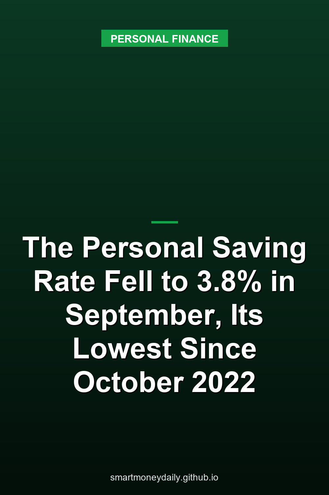

Personal saving in the U.S. ran at a pace of $911.1 billion a year in September, the Bureau of Economic Analysis reported on Oct. 29. That's 3.8% of disposable personal income, down from 4.0% in August and 5.1% in September 2025. BEA's historical comparison table, published with the [September release](https://www.bea.gov/news/2026/personal-income-and-outlays-september-2026), marks it as the lowest rate since October 2022, when it was 3.6%.

The math behind the drop fits in a few numbers. Disposable income, which is income after taxes, rose $52.7 billion in September, or 0.2%. Consumer spending rose $113.1 billion, or 0.5%. Nearly all of that was higher prices. The PCE price index, BEA's inflation gauge, went up 0.5% in the month and 3.6% from a year earlier, and spending adjusted for inflation grew by only $2.6 billion, less than 0.1%. Disposable income adjusted for inflation fell 0.3%.

One convention to keep in mind: every dollar figure in these releases is a seasonally adjusted annual rate. The $911.1 billion is a yearly pace, not what was put aside during September.

## Spending outran income for a second month

September followed a bigger gap in August. In the revised figures, after-tax income rose $80.8 billion in August while spending jumped $193.6 billion, and personal saving fell $112.6 billion. September took another $60.2 billion off. From July to September, the annual pace of spending rose $306.7 billion and the annual pace of after-tax income $133.5 billion.

BEA's spending breakdown shows where September's money went. Gasoline and other energy goods added $45.7 billion, roughly 40% of the month's increase. That one was almost entirely price. BEA's price index for gasoline and other energy goods jumped 9.2% in September, while the amount bought, adjusted for prices, slipped 0.1%. Transportation services added $18.4 billion, housing and utilities $17.8 billion, and food services and accommodations $15.5 billion. Spending on motor vehicles and parts fell $14.0 billion.

In the current data the rate has slid for most of the year: 5.6% in January, 5.3% in February, 5.1% in March, 4.4% in each month from April through June, 4.5% in July, then 4.0% and 3.8%. Since 2000 it has been this low or lower in a few months of 2000 and 2001, for most of the stretch from late 2004 to the summer of 2008, and from March to October 2022. The bottoms of those stretches were 1.4% in July 2005 and 2.4% in June 2022.

## July was 3.0% before the annual update

If 3.8% sounds high next to what was reported in late summer, that's because the history moved. When BEA [first published July's figures](https://www.bea.gov/news/2026/personal-income-and-outlays-july-2026) on Aug. 26, it put the July saving rate at 3.0%, and the comparison table that came with it listed June at 2.6%. The Sept. 30 release for August then carried the monthly results of BEA's annual update, with revisions to personal income and outlays going back to January 2021. In that release July read 4.6%. In the Oct. 29 data it's 4.5%, and June is 4.4%.

The latest release changed July and August once more, using revised employment and earnings data from the Bureau of Labor Statistics. Interest income was revised too, mostly on the monetary side, with new data from the Treasury's Bureau of the Fiscal Service.

None of this makes the number useless. I'd treat the level for any single month as a draft and give more weight to how the rate has moved over several months. On today's figures, it has been mostly downhill since January.

## What BEA counts as saving

BEA's glossary defines personal saving as personal income minus personal outlays and personal current taxes. Outlays are consumer spending plus non-mortgage interest paid plus personal transfer payments, which cover things like fees and fines paid to governments and money sent abroad. The saving rate is saving divided by disposable income.

That definition leads to a few results people don't expect:

- Retirement plan contributions show up as saving. BEA's wages include voluntary employee contributions to 401(k) plans, and an employer's 401(k) contributions count as income too. Money that stays in the plan isn't spent, so it lands in saving. (Employer-paid health insurance is also income, but the care and coverage it buys is counted in spending, so it isn't saving.)
- Paying down a loan out of this month's income counts. Interest on a credit card or car loan is an outlay. The principal isn't, so principal you pay from current income ends up on the saving side. Paying off a card with money already sitting in savings doesn't add anything; it just moves money around.
- Gains on investments aren't income. Personal income is built from wages and employer contributions, business and rental income, interest and dividends, and transfers such as Social Security, less social insurance contributions. A stock fund or a house that went up in value adds nothing to it.
- "Persons" isn't only households. In these accounts it means individuals plus nonprofit institutions that mainly serve individuals, private noninsured welfare funds and private trust funds.

So the national rate isn't the share of paychecks that went into savings accounts. It's closer to the share of after-tax income left over after spending, interest and transfers, and part of that is retirement money that may be hard to reach for years.

## Interest income kept rising anyway

One part of income has been moving the other way. Personal interest income ran at $2.53 trillion a year in September, up 4.7% from $2.42 trillion a year earlier and about 73% above the $1.46 trillion of December 2021, when the Fed's target range was still 0 to 0.25%. That income figure isn't a sum of bank statements, though. BEA's glossary says personal interest income includes both monetary and imputed interest, so it's a national-accounts measure rather than a count of what was credited to savings accounts.

Interest paid moved faster. Non-mortgage interest paid by persons ran at $618 billion a year in September, up from $275 billion in December 2021, an increase of about 125%.

What matters for a saver is where interest sits in the definition. Interest received is income, and it turns into saving only if it isn't spent. Interest paid on cards and loans is an outlay. More interest coming in while spending on fuel and housing rises faster still is how the rate can fall while interest income climbs.

## 3.6% inflation next to 0.38% on savings accounts

The [FDIC's national average rate](https://www.fdic.gov/national-rates-and-rate-caps) on savings accounts was 0.38% as of October 19, 2026. Money market deposit accounts averaged 0.63% and 12-month CDs 1.76%. That national rate is weighted by each institution's share of deposits, so the largest banks count the most, and your own account may pay a lot more or a lot less. At an unchanged 0.38%, $10,000 earns about $38 over a year before tax. If prices rise another 3.6% over that year, purchases that cost $10,000 now would cost about $10,360, so the balance would fall about $322 short.

Treasury bills pay more. The 13-week bill yielded 4.08% on Oct. 30, on a coupon-equivalent basis. That's an annualized figure for a 13-week bill, not a locked one-year return, since the money has to be rolled into new bills at whatever they pay. At a 22% federal tax rate it works out to about 3.2% after federal income tax, a little under the past year's 3.6% inflation, although bill interest is exempt from state and local income taxes. The wider yield table after the Fed's October meeting is in [the post on the Oct. 28 hold](/2026/11/01/the-feds-oct-28-hold-at-375-to-4-two-votes-for-a-hike-and-what-savers-earn-now/), and the real-return method is in [Real Return: What Inflation Does to Your Savings APY](/2026/07/23/how-to-evaluate-the-risk-of-inflation-on-your-savings-accounts/).

## A household version of BEA's math

The national rate averages everyone in the country together with the nonprofits that serve them, and because it's a total divided by a total, households with the most income count the most. The Fed's 2025 Survey of Consumer Finances shows how far an average can sit from a typical family. Among families with checking, savings and similar accounts, the median combined balance was $8,200 and the mean was $62,900. There's more on those figures in [last week's post on the survey](/2026/10/30/how-much-families-keep-in-bank-accounts-the-feds-2025-survey-by-age-and-income/).

BEA's definition still makes a decent template for your own number, because it picks up the retirement contributions and debt payments that a quick "what went into savings" count leaves out. Here's one month for a made-up worker. To keep it simple, assume no other income, no new borrowing, no other benefits or deductions, and that the withholding equals the month's income and payroll taxes.

| One month | Amount |
|---|---|
| Gross pay | $6,000 |
| Own 401(k) contribution, pre-tax | $360 |
| Employer 401(k) match | $180 |
| Income and payroll taxes withheld | $1,050 |
| Take-home pay | $4,590 |
| Purchases, not counting loan principal or the interest below | $4,100 |
| Credit card interest | $45 |
| Card principal paid down | $150 |
| Moved to a savings account | $295 |

Done BEA's way, after-tax income is gross pay plus the employer match minus the taxes: $6,000 plus $180 minus $1,050, or $5,130. That's the same as take-home pay plus both 401(k) amounts. Outlays are purchases plus the card interest, $4,145. Saving is the gap, $985, made up of the $540 going into the 401(k), the $150 off the card and the $295 in savings. That's a saving rate of 19.2%.

Count only the $295 against take-home pay and the same month comes to 6.4%.

Both numbers are right. They answer different questions. The 19.2% says how much of the month's after-tax income was left after spending and interest. The 6.4% measures this month's addition to money the worker can reach without a penalty or a new loan. For an emergency fund I'd watch that flow alongside the balance itself and how many months of essential bills it would cover.

## The October figures land Nov. 25

BEA's next release, for October, is scheduled for Nov. 25 at 8:30 a.m. Eastern. The September numbers can change with it, as July's and August's did this time.

I don't think a national rate under 4% tells any one household to change how much cash it keeps. What September does show is narrower. Higher prices, with fuel the clearest case, account for nearly all of the extra spending, and at the rates above, money earning the national average wouldn't keep up with prices rising at the past year's pace. The first is outside a saver's control. The second isn't.

This post draws on BEA's Oct. 29 release and its historical comparison table, the monthly Table 2.6 and Table 2.8 figures BEA posted the same day, the July and August releases for the earlier estimates, and BEA's glossary for the definitions. The household example uses numbers I made up.

## Further Reading

- [FDIC Proposes Scrapping Part 370: 31 Banks Would No Longer Have to Calculate Your Coverage](/2026/11/04/fdic-proposes-scrapping-part-370-31-banks-would-no-longer-have-to-calculate-your-coverage/)
- [New I Bonds Start at 5.51%, and Their 1.40% Fixed Rate Is the Highest Since 2006](/2026/11/03/new-i-bonds-start-at-551-and-their-140-fixed-rate-is-the-highest-since-2006/)
- [TreasuryDirect Cut Off Its Old Login on Oct. 28. ID.me Is Now the Only Way to Log In](/2026/11/02/treasurydirect-cut-off-its-old-login-on-oct-28-idme-is-now-the-only-way-to-log-in/)
- [Fraud at 60 and Over: $3 Billion Lost in 2025, Over $1 Billion by Bank Transfer](/2026/10/31/fraud-at-60-and-over-3-billion-lost-in-2025-over-1-billion-by-bank-transfer/)
- [Family Loans From Savings in November 2026: The 4.67% AFR and the $100,000 Rule](/2026/10/29/family-loans-from-savings-in-november-2026-the-467-afr-and-the-100000-rule/)

