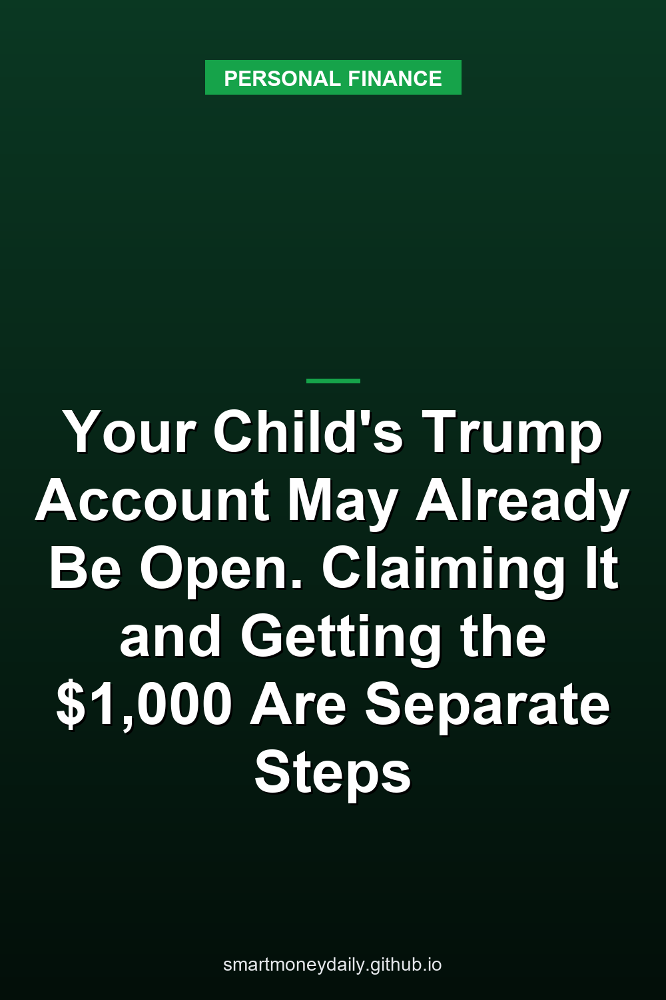

As of Oct. 29, there were nearly 70 million Trump Accounts, and over 27 million of them had money in them, nearly $9 billion in all, [according to the IRS](https://www.irs.gov/newsroom/frank-bisignano-donates-to-trump-accounts-for-children-in-brooklyn-ny). That leaves roughly three in five accounts empty, going by those two numbers. Most accounts weren't opened by a parent at all. On Oct. 1, [Treasury said it had finished automatic enrollment](https://home.treasury.gov/news/press-releases/sb0642): every eligible child under 18 with a valid Social Security number now has an account, and more than 60 million of them got one that way.

An account Treasury opened for your child isn't one you can use yet. A parent or guardian has to claim it before anyone can manage it, and before relatives or an employer can put money in. The $1,000 seed for U.S. citizen children born from 2025 through 2028 needs a separate election as well. The IRS says you must elect it on Form 4547 "even if Treasury automatically opened the account."

## What an unclaimed account can hold

The temporary rules Treasury and the IRS published Sept. 30 (TD 10056) call an account opened this way an "auto account," and until someone claims it, Treasury itself is its "responsible party," the one who runs it. During the growth period it can accept only two kinds of money: qualified general contributions, which come from eligible donors through Treasury, and the $1,000 pilot contribution once someone has elected it. Treasury's Oct. 1 release adds that the account has to be claimed before the child gets the seed. Put those together and an unclaimed account can collect donor money, while the seed and anything from you, a grandparent or an employer wait for the claim.

Donor money does reach these accounts. Those contributions come from charities and governments, and the rules say they're paid in equal amounts to every child in a class set in the donor's agreement with Treasury, counting only children still in their growth period: all account holders, children in certain states or in designated areas where at least 5,000 eligible children live, children born in certain years, or a mix of place and birth year that covers at least 5,000 children. The IRS release with the account totals described a donation from the Bisignano Family Fund: $250 for every child aged two to eight living in Brooklyn's 11234 ZIP code. The IRS said the money was "in each child's personal Trump Account today." Frank Bisignano is the Social Security commissioner, the IRS's chief executive and the official in charge of Trump Accounts.

That gift is small next to one the regulation's preamble mentions. The Michael & Susan Dell Foundation pledged $6.25 billion to children born between 2016 and 2024 who live in ZIP codes where the median household income is below $150,000.

Until a claim comes in, an auto account's only investment is its share of a pooled "master group trust," which can hold eligible index funds, limited cash and qualifying publicly traded U.S. stock that a donor contributed. On the IRS's rounded figures, contributions come to no more than about $333 per funded account. That's my arithmetic, not an IRS number, and it counts money put in, not today's balances.

## Claiming the account

Treasury's release says "a parent or guardian" makes the claim. The regulation puts it more formally, as a guardian or legal custodian with authority over the child's property or financial affairs. You do it in the official Trump Accounts app for iOS and Android, or on the web version at trumpaccount.com. Watch the spelling: the program information site is TrumpAccounts.gov, with an s, and the account site has none. The app and the website will also tell you whether an account already exists for your child. To qualify for one at all, the IRS says, a child needs a valid Social Security number and can't turn 18 before the end of the calendar year in which the account is established.

According to Treasury, the claim has three parts. You verify your identity and your relationship to the child, review the child's information and accept the account terms. The IRS suggests having these ready:

- your own name and identifying information
- the child's legal name
- the child's Social Security number
- the child's date of birth

Details that don't match Social Security Administration records cause delays, the IRS warns. You don't need Form 4547 to claim an account Treasury already opened.

Behind the scenes, claiming moves the money. Under the temporary rules, the whole balance of the auto account rolls over into a new account, either a claimed account with the trustee Treasury selected or a rollover Trump Account with a different trustee. The transfer waits until the receiving account exists, which with Treasury's trustee means activating it, and then the auto account is closed.

Until that transfer happens, someone else can file a claim too. If two authorized people claim the same child's account, the rules make whoever first activates the new account at Treasury's trustee its "responsible party," the person who manages it. Separated parents should know that before either of them opens the app.

Nothing forces a claim. If nobody ever makes one, an empty auto account closes once the child's growth period ends. That period runs through Dec. 31 of the year before the child turns 18. A funded account doesn't vanish, though. The rules let the child file the claim once they have legal capacity, and a claim made after the growth period moves the balance into an ordinary IRA rather than a Trump Account.

## The $1,000 needs its own election

The seed is for children who are U.S. citizens, were born from Jan. 1, 2025, through Dec. 31, 2028, and have valid Social Security numbers. You ask for it by filing Form 4547 and selecting the option for the pilot program contribution. The form can go in through the Trump Accounts app, the Trump Accounts website or your IRS Individual Online Account. If you already asked for it, for example with your 2025 tax return, the IRS says you don't need to do it again.

There's also a rule on who can ask. The Form 4547 instructions say the person making the election has to expect the child to be his or her qualifying child for the year of the election. IRS Publication 501 covers who counts as a qualifying child.

The instructions don't give a payment date. Treasury makes the contribution "as soon as practicable" after the election, once it can confirm with the trustee that the account is open, and they say the form "can be filed at any time." With a child born in 2025 or 2026, I'd claim the account and file the election in the same sitting rather than leave one of them for tax season.

## If a CP318 notice shows up

The IRS sends Notice CP318 when an election needs more action to be finished or corrected. Its FAQ points to two fixes, claiming the account or resubmitting Form 4547 with names, Social Security numbers and dates of birth that match Social Security records. Whatever the notice says to do is the route.

Two shortcuts don't work. Don't file an amended return (Form 1040-X) to correct Form 4547, even if the form went in with your tax return. And don't count on an IRS phone representative, because the [IRS's Trump Accounts FAQ](https://www.irs.gov/faqs/trump-accounts-frequently-asked-questions) says they "cannot correct your election by phone or help you claim the account." Changes after you've claimed go through the program's own line, **866-USA-4547** (866-872-4547).

A letter from Treasury is a different thing. The FAQ says one may go to families whose child may qualify for the $1,000, explaining the program and any steps left to take.

## Where the money sits once you claim

The IRS FAQ names BNY as the program's financial agent and Robinhood Securities as the brokerage provider and initial trustee. During the growth period, the account can hold only eligible investments. The Form 4547 instructions describe those as mutual funds or ETFs that track an index of primarily U.S. companies, and the regulation's preamble says they can't charge annual fees and expenses above 0.1%.

That makes it an investment account, not a savings account. Fund shares aren't bank deposits, so [FDIC deposit insurance doesn't cover them](/2026/08/08/how-to-understand-the-differences-between-fdic-and-sipc-coverage/), and the balance goes up and down with the market.

It's locked, too. Until Jan. 1 of the year the child turns 18, money can leave only as a rollover to another Trump Account, as an [ABLE account rollover](/2026/10/17/able-accounts-in-2026-age-46-a-20000-limit-and-ssis-100000-rule/) at 17, as a return of excess contributions, or when the child dies. After that, most traditional IRA rules apply, including the 10% additional tax on early distributions unless an exception fits, such as higher education costs or a first home. Money the family might need for the child before then belongs somewhere you can reach it, and I went through how a Trump Account compares with [a kid's savings account](/2026/10/04/trump-accounts-vs-a-kids-savings-account-1000-seed-5000-cap/) in October.

## A relative's holiday gift waits for the claim

Treasury's release is plain on this: a claim is what allows family members, friends and employers to contribute. If a grandparent wants to put something in this holiday season, the account has to be claimed first.

During the growth period, contributions from family, friends and employers then share a $5,000 annual limit. Employer contributions under section 128 are excluded from the employee's income up to $2,500 a year, and they count toward the $5,000. Qualified general contributions from charities and governments, the $1,000 seed and rollovers from another Trump Account don't count against it. Both dollar limits are set to adjust for inflation after 2027.

## Before you tap a link

When the app launched on May 28, Treasury said it and its authorized service providers could contact families by email, text message or automated phone call. The first activation emails came only from no-reply@TrumpAccounts.Treasury.gov, and later messages were to come through the app or from addresses ending in @trumpaccount.com. The same release said those providers "will never ask you to disclose passwords, one-time verification codes, or other sensitive account credentials" by email, text or phone, and it told families not to use phone numbers found in internet search results.

A text offering to release a child's $1,000 if you read back a code is one I'd delete. The real election runs through the app, the website or your IRS online account, and none of them needs you to hand a code to a caller.

The $1,000, a grandparent's deposit and any choice of a different trustee all wait on the claim. The account totals and the Brooklyn gift come from the IRS's Oct. 29 release, the claiming steps from Treasury's Oct. 1 release and the IRS Trump Accounts FAQ, and the rules for unclaimed accounts from TD 10056 (26 CFR 1.530A-1T and 1.530A-7T). The next date I'm watching is Nov. 30, when comments close on the proposed version of those rules.

## Further Reading

- [The Personal Saving Rate Fell to 3.8% in September, Its Lowest Since October 2022](/2026/11/05/the-personal-saving-rate-fell-to-38-in-september-its-lowest-since-october-2022/)
- [FDIC Proposes Scrapping Part 370: 31 Banks Would No Longer Have to Calculate Your Coverage](/2026/11/04/fdic-proposes-scrapping-part-370-31-banks-would-no-longer-have-to-calculate-your-coverage/)
- [New I Bonds Start at 5.51%, and Their 1.40% Fixed Rate Is the Highest Since 2006](/2026/11/03/new-i-bonds-start-at-551-and-their-140-fixed-rate-is-the-highest-since-2006/)
- [TreasuryDirect Cut Off Its Old Login on Oct. 28. ID.me Is Now the Only Way to Log In](/2026/11/02/treasurydirect-cut-off-its-old-login-on-oct-28-idme-is-now-the-only-way-to-log-in/)
- [The Fed's Oct. 28 Hold at 3.75% to 4%: Two Votes for a Hike, and What Savers Earn Now](/2026/11/01/the-feds-oct-28-hold-at-375-to-4-two-votes-for-a-hike-and-what-savers-earn-now/)

