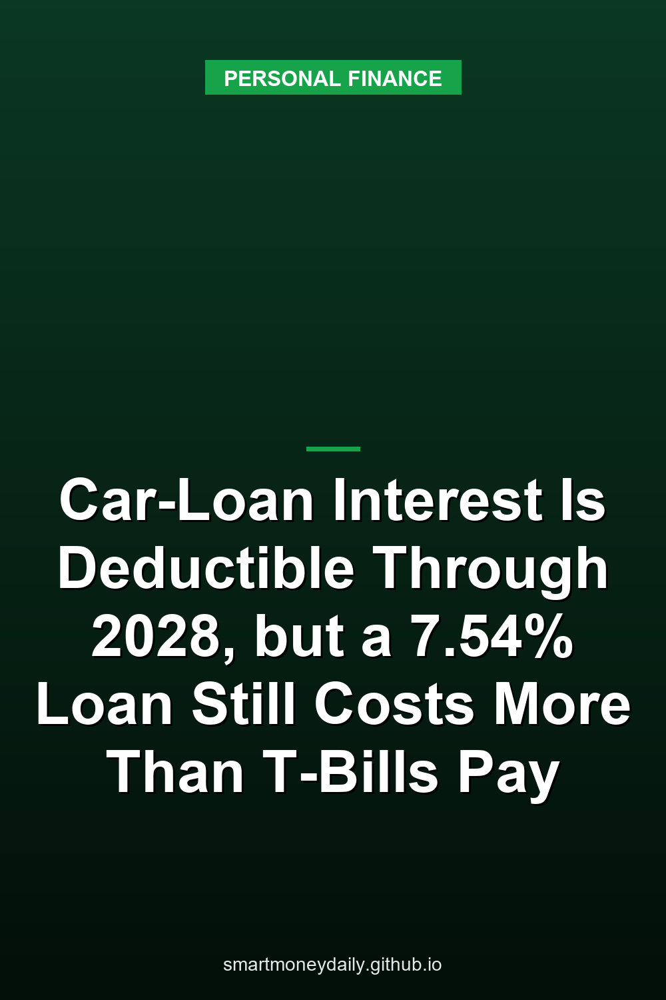

On Nov. 3 the IRS published [Tax Tip 2026-79](https://www.irs.gov/newsroom/purchasing-a-new-vehicle-car-loan-interest-could-be-eligible-for-a-tax-deduction), a reminder aimed at year-end car shopping: interest on a loan for a new vehicle that had its final assembly in the U.S. can be deducted, up to $10,000 a year, and you don't have to itemize to take it. What the tip doesn't put up front is the calendar. The tax code allows the deduction for tax years 2025 through 2028 only.

In the $40,000 example below, that end date matters more than the $10,000 cap. With payments starting in January 2027, only the interest paid in 2027 and 2028 falls inside the window, and the loan runs through 2031. So before treating the deduction as a reason to finance instead of paying from savings, run the numbers both ways.

## Which cars and loans qualify

The rules sit in [section 163(h)(4) of the tax code](https://www.law.cornell.edu/uscode/text/26/163). The vehicle has to be new, meaning its original use starts with you, and it can be a car, minivan, van, SUV, pickup or motorcycle with a gross vehicle weight rating under 14,000 pounds. Its final assembly has to have happened in the United States. The IRS says you can check that on the information label at the dealership, through the vehicle identification number, or with NHTSA's VIN decoder.

The loan has to be taken out after Dec. 31, 2024, used to buy that vehicle for personal use, and secured by a first lien on it. Leases don't count. Neither do used cars, fleet-sale loans, salvage-title vehicles or cars bought for scrap or parts. You also have to put the VIN on your return for every year you claim the deduction. On 2025 returns that happens on Schedule 1-A, in a part titled "No Tax on Car Loan Interest."

Refinancing and family loans have their own limits. A refinance keeps the deduction only up to the old loan's balance, so cash pulled out in a refi isn't covered. And debt owed to a related person doesn't qualify at all. For an individual, the tax code's family list is a spouse, brothers and sisters, ancestors and lineal descendants. If you were planning a [family loan out of savings](/2026/10/29/family-loans-from-savings-in-november-2026-the-467-afr-and-the-100000-rule/) to help a son, daughter or sibling buy a car, they'd get no deduction for the interest they pay you.

## The phase-out takes dollars, not a percentage

The deduction starts shrinking once modified adjusted gross income passes $100,000 for a single filer, or $200,000 on a joint return. For every $1,000 over the line, or any part of $1,000, the allowable amount drops by $200. It's a flat dollar cut, so it wipes out a small deduction fast.

Take a single filer who paid $2,782.67 of qualifying interest in a year, which is the first full year of the loan in the example below. At $105,000 of MAGI the cut is $1,000 and the deduction is $1,782.67. At $110,000 it's $782.67. One dollar past $113,000, the cut reaches $2,800 and nothing is left. Even a large deduction runs out quickly: at $149,000 of MAGI ($249,000 joint) the cut is $9,800, which leaves at most $200 under the $10,000 annual cap.

## What a loan signed this winter gets

The Fed's [G.19 consumer credit release](https://www.federalreserve.gov/releases/g19/current/default.htm), published Oct. 7, put the average rate on a 60-month new-car loan at commercial banks at 7.54% for August 2026. Run a $40,000 loan at that rate, with the first payment in January 2027, and the payment comes to $802.28 a month. Over five years you'd pay $8,136.71 in interest.

| Year | Interest paid | Deductible under current law |
|---|---|---|
| 2027 | $2,782.67 | Yes |
| 2028 | $2,248.37 | Yes |
| 2029 | $1,672.36 | No |
| 2030 | $1,051.38 | No |
| 2031 | $381.93 | No |

Interest is front-loaded, so the two deductible years carry $5,031.04, or 61.8% of the total. In the 22% federal bracket that's about $1,107 of tax saved over both years, as long as income stays under the phase-out. The other $3,105.67 gets paid after the deduction has expired. A loan signed in November with a December payment would pick up one month of 2026 interest too, which doesn't change the picture much. These figures assume equal monthly periods at 7.54% with no fees, so a lender's own schedule can differ because of daily interest and payment timing.

## Cash from savings against the loan, after tax

If the money for the car is already sitting in savings, the real question is what that money earns compared with what the loan costs. Treasury's daily bill rates for Nov. 3 had the 26-week bill at 4.30% (coupon equivalent). The [FDIC](https://www.fdic.gov/national-rates-and-rate-caps)'s national average for savings accounts was 0.38% as of October 19, 2026. Neither comes close to 7.54%.

The deduction narrows that gap without closing it. In the 22% bracket, a fully deductible 7.54% loan costs about 5.9% after federal tax, and a 4.30% bill keeps about 3.4% after federal tax. When every dollar of loan interest is deductible and every dollar of savings interest is taxed at the same rate, the rate cancels out, and the loan only comes out ahead if it charges less than your savings pay.

Once the phase-out wipes the deduction out, or from 2029 on, the comparison goes back to 7.54% against about 3.4%. A cheaper loan is where the deduction can matter. While it applies in full, a loan rate below your savings rate wins. Without it, the loan rate has to come in below your after-tax savings yield, which is about 3.4% in this example. And if a low rate comes in place of a cash rebate, the rebate you give up belongs in the loan's cost.

This is a snapshot at current rates. A 26-week bill rolls over twice a year, so 4.30% isn't locked in for the five years of the loan.

## What banks told the Fed on Nov. 2

The Fed's [October 2026 Senior Loan Officer Opinion Survey](https://www.federalreserve.gov/data/sloos/sloos-202610.htm), released Nov. 2, covers roughly the third quarter. Banks said standards and most terms for auto loans were basically unchanged, with one exception that matters to anyone with a thinner credit file: they tightened the minimum required credit score for auto loans. They also reported weaker demand for auto loans, and tighter credit limits on card accounts over the same quarter.

A separate set of questions covered the past year of card lending. Banks said they were more likely to approve card applications from super-prime and prime borrowers and less likely to approve subprime applicants, with small banks driving the subprime change. That matters if part of the plan was to put a down payment on a card.

## Where I'd draw the line

I'd pay from savings only with money above the [emergency fund](/2026/05/09/emergency-fund-basics-how-much-should-you-really-save/). At today's loan rates the deduction is a discount on a cost, not a source of income, and emptying the account a household leans on after a job loss just to avoid a loan isn't a trade I'd make.

If you do finance, keep the VIN and the lender's interest records, and check the vehicle, loan and MAGI rules before you count on the deduction. The rules here come from the IRS tip, IRS Publication 6126 and the statute, the rates from the Fed, Treasury and the FDIC, and the loan schedule is my own amortization at the G.19 average.

Unless Congress extends it, 2028 is the last tax year for this deduction, so a loan signed in 2028 would get one year of it at most.

## Further Reading

- [Your Child's Trump Account May Already Be Open. Claiming It and Getting the $1,000 Are Separate Steps](/2026/11/06/your-childs-trump-account-may-already-be-open-claiming-it-and-getting-the-1000-are-separate-steps/)
- [The Personal Saving Rate Fell to 3.8% in September, Its Lowest Since October 2022](/2026/11/05/the-personal-saving-rate-fell-to-38-in-september-its-lowest-since-october-2022/)
- [FDIC Proposes Scrapping Part 370: 31 Banks Would No Longer Have to Calculate Your Coverage](/2026/11/04/fdic-proposes-scrapping-part-370-31-banks-would-no-longer-have-to-calculate-your-coverage/)
- [New I Bonds Start at 5.51%, and Their 1.40% Fixed Rate Is the Highest Since 2006](/2026/11/03/new-i-bonds-start-at-551-and-their-140-fixed-rate-is-the-highest-since-2006/)
- [TreasuryDirect Cut Off Its Old Login on Oct. 28. ID.me Is Now the Only Way to Log In](/2026/11/02/treasurydirect-cut-off-its-old-login-on-oct-28-idme-is-now-the-only-way-to-log-in/)

