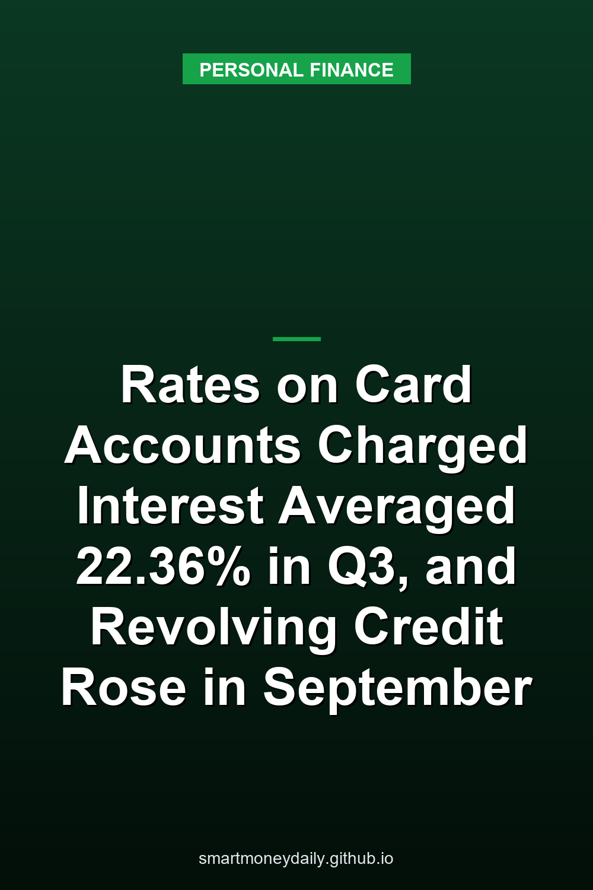

On Nov. 6 the [Federal Reserve's consumer credit release, known as G.19](https://www.federalreserve.gov/releases/g19/20261106/), put the average rate on credit card accounts that were charged interest at **22.36%** for the third quarter of 2026. That's up from 22.15% in the second quarter and 21.52% in the first. The same release shows revolving credit, most of which is credit card debt, growing at a seasonally adjusted annual rate of 14.5% in September, after it shrank at a 4.4% rate in August.

Neither number tells you what your own card charges. Together, they show revolving credit rising in September and the rate on accounts charged interest at its highest since the third quarter of 2025, when it was 22.83%. If the holidays leave a balance you can't clear with one statement, a rate near that average adds up quickly, and the federal card rules set what an issuer can do while you pay it down.

## Two card rates in the same table

The G.19 lists two credit card figures, and they measure different things. The rate for all accounts was 21.19% in the third quarter. The release's footnote describes it as the stated APR averaged across all credit card accounts at the reporting banks. The rate for accounts assessed interest was 22.36%. That one is the annualized ratio of total finance charges to the average daily balances they were charged on, and it leaves out accounts that paid no finance charges at all.

The second number is the better guide to what carrying a balance costs, because it's built from interest that was actually charged. It's still an aggregate figure from the reporting commercial banks, so any given card can sit above or below it. Your own APR is on your statement and in your card agreement.

Both rates moved up in the third quarter. The all-accounts figure was 20.94% in the second quarter. On an annual basis, the assessed-interest rate was 16.45% in 2021, 22.89% in 2024 and 22.32% in 2025.

## September's jump in revolving credit

Revolving credit stood at $1,368.5 billion at the end of September, seasonally adjusted. That's about $16.3 billion more than August's $1,352.2 billion, or roughly 1.2% in a single month. The months before it were uneven: growth at a 2.4% annual rate in July, then a 4.4% decline in August. For the third quarter as a whole, revolving credit grew at a 4.1% annual rate, and total consumer credit grew at 4.2%.

Two cautions about that September figure. Credit cards make up most of revolving credit, but the Fed's background notes on the G.19 say the category also includes other credit lines, such as prearranged overdraft plans. And the September number is preliminary. July and August were revised in this release, so the 14.5% could change when the next one comes out.

## What 22.36% does to a $2,000 balance

Suppose a card with a 22.36% APR carries a $2,000 purchase balance. The math below uses one-twelfth of the APR each month, a rate that doesn't change, no fees or new charges, and payments at the end of each month. A real card's interest depends on its terms and on when purchases and payments post, and the payments here are rounded to the cent.

One month of interest on $2,000 comes to about $37.27. Paid off in equal monthly payments, the numbers look like this:

- 3 months: $691.66 a month, $74.99 in interest
- 6 months: $355.41 a month, $132.44 in interest
- 12 months: $187.54 a month, $250.43 in interest

A fixed payment that's smaller stretches things out. At $100 a month the balance is gone in 26 months, after $525.80 of interest. At $60 a month it takes 53 months and $1,154.25, which is more than half of the original $2,000. All of these assume nothing else gets charged to the card, the same assumption behind the minimum payment warning that Regulation Z puts on card statements.

## The grace period and the 21-day rule

Interest on purchases can be avoided if the account has a grace period and a payment that meets the grace period's terms arrives in time. The rules don't require a card to have one. Where an account does, Regulation Z requires the issuer to have reasonable procedures so that statements go out at least 21 days before the grace period expires, and so that it doesn't charge interest for losing the grace period when a qualifying payment arrives within 21 days after the statement was mailed or delivered. Separately, issuers need reasonable procedures so that statements are mailed or delivered at least 21 days before the payment due date, and so that a minimum payment received within 21 days after the statement was mailed or delivered isn't treated as late.

If the account does lose its grace period, [12 CFR 1026.54](https://www.law.cornell.edu/cfr/text/12/1026.54) limits the interest in two ways. The issuer can't charge interest based on balances for days in billing cycles before the most recent one. It also can't charge interest, because of the lost grace period, on any part of a balance subject to the grace period that was repaid before the grace period ran out. So the part of that balance you paid on time can't pick up interest for the lost grace period, though interest on the unpaid part, and other charges, can still apply. The rule has exceptions for adjustments after a billing dispute or a returned payment.

## Where a payment above the minimum goes

When a card carries balances at different rates, such as a promotional balance transfer next to regular purchases, [12 CFR 1026.53](https://www.law.cornell.edu/cfr/text/12/1026.53) decides where extra money goes. Any amount paid above the required minimum has to go first to the balance with the highest APR, then to the others in descending order of rate. The rule speaks only to the amount above the minimum.

Deferred-interest deals work differently. The regulation describes them as programs where the consumer won't owe the interest that builds up on a balance if that balance is paid in full before a set period ends. During the two billing cycles right before that period expires, the excess payment has to go first to the deferred-interest balance, unless the issuer chooses instead to split extra payments the way the consumer asks. I'd ask well before those last two cycles, because missing the deadline on that kind of balance means owing the interest it built up.

## When the rate itself can change

The federal rule on rate increases, 12 CFR 1026.55, starts with a general ban. A card issuer can't increase an APR on a credit card account, except under the exceptions the rule lists. Three of them matter most for someone paying down a balance:

- A variable rate can rise when it follows a publicly available index outside the issuer's control and the increase comes from a rise in that index.
- A temporary rate, such as an introductory offer, can end and move to a higher rate, but only after a period of six months or longer. The length of that period and the rate that applies afterward have to be disclosed in writing before it starts, and balances from before the offer can't be moved to a rate higher than the one they had before it.
- A rate can go up if the issuer hasn't received the required minimum payment within 60 days after its due date. The notice then has to give the reason and say that the increase will stop applying once the issuer receives six consecutive minimum payments on time, starting with the first one due after the increase takes effect. At that point the rate has to come back down for transactions made before, or within 14 days after, the notice.

Notice rules differ by type. A penalty increase like that third one, or a significant change in account terms, generally comes with a written notice at least 45 days before it takes effect under 12 CFR 1026.9. An increase that follows the index on a variable rate, or the scheduled end of a properly disclosed promotional rate, doesn't need a new notice.

## Card debt next to the savings rate

The [FDIC's national average rate](https://www.fdic.gov/national-rates-and-rate-caps) for savings was 0.38% as of October 19, 2026. For illustration, that rate applied to $2,000 for a year earns about $7.60. The national averages for money market accounts (0.63%) and 12-month CDs (1.76%) come to $12.60 and $35.20 on the same amount. Those averages are figured from larger deposit tiers than $2,000, so a small account may see something different. On the card side, a year's interest on a steady $2,000 balance at 22.36% is about $447 at the simple rate.

The same G.19 table puts the average 24-month personal loan rate at commercial banks at 11.90% for the third quarter. Spread over 24 months, $2,000 at that rate would cost $94.05 a month and $257.29 in interest. On the card at 22.36%, the same 24 months cost $104.11 a month and $498.69 in interest. That loan average is built from each bank's most common rate in the first week of the quarter's middle month, so a real offer depends on credit and on any fees.

I'd put spare cash toward a balance like that before adding to a savings account that pays under 1%, as long as enough stays set aside for a real emergency.

## What comes out next

The New York Fed is scheduled to release its third-quarter Household Debt and Credit Report at 11 a.m. Eastern on Tuesday, Nov. 10, with data through the end of September. According to the [bank's media advisory](https://www.newyorkfed.org/newsevents/mediaadvisory/2026/1104-2026), a Liberty Street Economics post released with it will look at newly delinquent credit card borrowers and how their socioeconomic profile has changed.

If I were carrying a balance into December, though, the number I'd check first is on the statement itself. The minimum payment box shows how long the balance would take to pay off at the minimum. When that estimate is more than three years after rounding, it generally also shows the monthly payment that would clear the balance in 36 months.

## Further Reading

- [When an Account Owner Dies: A Six-Month FDIC Grace Period and a $600 Estate Filing Line](/2026/11/09/when-an-account-owner-dies-a-six-month-fdic-grace-period-and-a-600-estate-filing-line/)
- [Banks on Veterans Day 2026: The Fed Closes Nov. 11, and a Social Security Payment Moves to Nov. 10](/2026/11/08/banks-on-veterans-day-2026-the-fed-closes-nov-11-and-a-social-security-payment-moves-to-nov-10/)
- [Car-Loan Interest Is Deductible Through 2028, but a 7.54% Loan Still Costs More Than T-Bills Pay](/2026/11/07/car-loan-interest-is-deductible-through-2028-but-a-754-loan-still-costs-more-than-t-bills-pay/)
- [Your Child's Trump Account May Already Be Open. Claiming It and Getting the $1,000 Are Separate Steps](/2026/11/06/your-childs-trump-account-may-already-be-open-claiming-it-and-getting-the-1000-are-separate-steps/)
- [The Personal Saving Rate Fell to 3.8% in September, Its Lowest Since October 2022](/2026/11/05/the-personal-saving-rate-fell-to-38-in-september-its-lowest-since-october-2022/)

