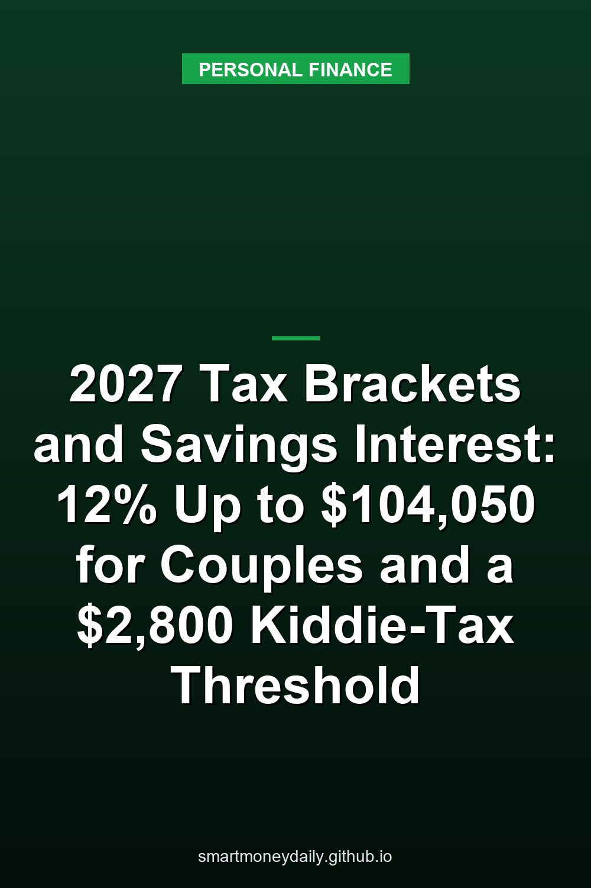

On Nov. 5 the IRS released [Revenue Procedure 2026-35](https://www.irs.gov/pub/irs-drop/rp-26-35.pdf), its yearly list of inflation-adjusted tax amounts, this time for tax year 2027. For married couples filing jointly, the 12% bracket now runs to **$104,050** of taxable income, up from $100,800 for 2026, and the standard deduction goes to **$33,200** from $32,200. Taxable income is what's left after deductions. For a couple whose only deduction is the standard one and whose income is all ordinary, such as wages, pensions and interest, that means $137,250 of adjusted gross income before the next dollar of interest is taxed at 22%. Under the 2026 numbers it's $133,000.

Interest from a savings account, a CD or a Treasury bill has no rate schedule of its own. It's taxed in whatever bracket it lands in, and since the rates stay at 10% through 37%, what changes each year is where the brackets start and end. The IRS's [news release](https://www.irs.gov/newsroom/irs-releases-tax-inflation-adjustments-for-tax-year-2027-taxpayers-continue-to-benefit-from-the-working-families-tax-cuts) says the 2027 amounts "generally apply to tax returns filed in 2028." The return due next spring is a 2026 return, and it uses the 2026 numbers.

## 2027 amounts next to 2026's

These are the amounts in Rev. Proc. 2026-35 that bear on savings interest, gifts and estates, next to the 2026 figures from [Rev. Proc. 2025-32](https://www.irs.gov/pub/irs-drop/rp-25-32.pdf). Bracket edges are in taxable income.

| Amount | 2026 | 2027 |
|---|---|---|
| Standard deduction, married filing jointly | $32,200 | $33,200 |
| Standard deduction, single | $16,100 | $16,600 |
| 12% bracket ends, joint | $100,800 | $104,050 |
| 12% bracket ends, single | $50,400 | $52,025 |
| 22% bracket ends, joint | $211,400 | $218,250 |
| 22% bracket ends, single | $105,700 | $109,125 |
| 0% rate on qualified dividends and long-term gains ends, joint | $98,900 | $102,100 |
| 0% rate on qualified dividends and long-term gains ends, single | $49,450 | $51,050 |
| Dependent's minimum standard deduction (the kiddie tax amount) | $1,350 | $1,400 |
| Annual gift exclusion, per recipient | $19,000 | $20,000 |
| Estate tax basic exclusion amount | $15,000,000 | $15,480,000 |

Most bracket edges moved up about 3.2%, and the joint and single standard deductions about 3.1%. HSA limits aren't in this revenue procedure; [the 2027 HSA limits](/2026/10/03/2027-hsa-limits-4500-and-9000-and-where-hsa-cash-is-insured/) had their own post in October.

## How much interest fits under each rate

Adding the standard deduction back turns the table's taxable income into AGI. Assuming all income is ordinary and the basic standard deduction is the only deduction, these are the 2027 points where the rate on the next dollar of interest changes:

- Married filing jointly: no income tax up to $33,200 of AGI, then 10% up to $58,800, 12% up to $137,250 and 22% up to $251,450.
- Single: no income tax up to $16,600, then 10% up to $29,400, 12% up to $68,625 and 22% up to $125,725.

Being 65 or older, or blind, adds to the standard deduction: for 2027, $1,700 per condition for each married person, or $2,100 per condition for a single filer or head of household. Those filers' points sit higher.

Take a couple with $130,000 of wages in both years and $5,000 of interest from CDs and savings. Under the 2026 numbers their taxable income before the interest is $97,800, which leaves $3,000 of room at 12%. The first $3,000 of interest is taxed at 12% and the other $2,000 at 22%, for $800. Under the 2027 numbers the same wages leave $7,250 of room, so all $5,000 is taxed at 12%. That's $600.

That comparison holds their pay flat. A raise uses up some of the new room: at 3.2%, about $3,090 would be left, close to the $3,000 they had in 2026. The extra room goes to households whose other income rises by less than $4,250, the 12% ceiling's move in AGI terms, or not at all, as with a pension that has no cost-of-living increase.

## Interest fills the 0% band first

The 0% rate on qualified dividends and long-term capital gains covers taxable income up to $102,100 on a 2027 joint return and $51,050 for single filers. Taxable savings interest doesn't get that rate. [Section 1(h) of the tax code](https://www.law.cornell.edu/uscode/text/26/1) gives the lower rates to net capital gain, which includes qualified dividend income, and IRS Topic 403 says the "dividends" credit unions and mutual savings banks pay on deposits "are actually taxable interest."

The order matters too. Section 1(h)(1)(B), read with the 0% amounts in section 1(j)(5), gives 0% only to the gains and qualified dividends that still fit under the ceiling after the rest of taxable income is counted. Ordinary income, interest included, fills the space from the bottom.

Picture a couple in their early 60s with $110,000 of fully taxable pension payments and IRA withdrawals, $10,000 of interest and $16,000 of qualified dividends in 2027. Their AGI is $136,000 and their taxable income is $102,800. Without the dividends that's $86,800, so the 0% rate covers $15,300 of the dividends and the last $700 is taxed at 15%, or $105. In that stretch, every extra $1,000 of interest costs them $270: $120 of tax at 12% on the interest itself, and $150 because it pushes another $1,000 of dividends from 0% to 15%. Under the 2026 numbers, the same income would leave $4,900 of the dividends at 15%, a $735 bill.

## The $1,400 and $2,800 thresholds for a child's interest

A child who can be claimed as someone else's dependent has a 2027 basic standard deduction capped at the greater of $1,400 or earned income plus $500. The same $1,400 drives the kiddie tax. Under section 1(g)(4), a child who doesn't itemize generally has "net unearned income" (unearned income is income other than pay for work, such as interest) only above twice that $1,400 amount, so the threshold moves to **$2,800** in 2027 from $2,700. For a child whose only income is interest, that makes three layers:

- The first $1,400 is covered by the standard deduction.
- The next $1,400 is taxed at the child's own rate.
- Interest above $2,800 is taxed at the parents' rate, if that's higher.

At a hypothetical 4%, it takes $35,000 in a child's name to earn $1,400 in a year and $70,000 to reach $2,800. A child with $3,000 of interest in 2027 would have $1,600 of taxable income: $1,400 taxed at 10%, or $140, and $200 at the parents' rate, which is $44 if it all fits in their 22% bracket.

The rule reaches a child only if a parent is alive at the end of the year and the child doesn't file a joint return. Within that, it covers children under 18 at year-end, 18-year-olds, and full-time students under 24, though for the last two only when their earned income isn't more than half of their support.

Under section 1(g)(7), a parent can instead put the child's interest on their own return. For 2027 that works when the child's income is only interest and dividends, is more than $1,400 but less than $14,000, and had no estimated tax or backup withholding in the child's name. If the parents aren't married, the custodial parent is the one who can do it, and if they're married filing separately, it's the one with more taxable income. That parent adds the child's income above $2,800 to their own and pays 10% on the part between $1,400 and $2,800, at most $140 per child. [Custodial accounts](/2026/09/17/savings-accounts-for-kids-custodial-rules-and-the-kiddie-tax/) have their own ownership and insurance rules, covered in a September post that used the 2025 thresholds.

## $20,000 per person for gifts from savings

For gifts made in 2027, the annual exclusion is **$20,000** per recipient, as long as the gift isn't a future interest in property. It was $19,000 for both 2025 and 2026, according to the IRS's gift tax FAQs. Section 2503(b) rounds the inflation-adjusted amount down to the next lowest multiple of $1,000, so it moves in $1,000 steps, and in some years not at all.

The exclusion counts per giver and per recipient. A grandparent can give each of three grandchildren $20,000 in 2027, $60,000 in all, without going over. The FAQs also say that when spouses give away property they own together, each spouse gets the exclusion, which works out to $40,000 per recipient in 2027. Gifts to a spouse who isn't a U.S. citizen have their own limit, $201,000 for 2027, up from $194,000.

The year that counts is the calendar year of the gift. Rev. Proc. 2026-35 applies its gift and estate amounts to "transactions or events occurring in calendar year 2027," so a gift made in December 2026 is still measured against $19,000.

Giving one person more than $20,000 doesn't by itself mean tax is due. Section 6019 generally requires a gift tax return for a gift the annual exclusion doesn't cover, with a few exceptions, and Rev. Proc. 2026-35 says the credit against gift tax is based on the same basic exclusion amount as the estate tax credit, $15,480,000 for 2027, up from $15,000,000. Forgoing interest on a loan to a relative can also create a gift, and [the November AFR post](/2026/10/29/family-loans-from-savings-in-november-2026-the-467-afr-and-the-100000-rule/) goes through when that happens.

## The 3.8% tax and Social Security thresholds didn't move

The 3.8% net investment income tax isn't on the list. It still starts at modified AGI above **$250,000** on a joint return, $200,000 for single filers and heads of household, and $125,000 for married people filing separately. Modified AGI adds back a few items tied to foreign income, so for a saver without any it's the same as AGI. The IRS's [questions and answers on the tax](https://www.irs.gov/newsroom/questions-and-answers-on-the-net-investment-income-tax) say it plainly: "Taxpayers should be aware that these threshold amounts are not indexed for inflation."

The brackets and that threshold now cross in a new place. For a couple whose income is all ordinary and who takes only the standard deduction, the top of the 22% bracket was $243,600 of AGI under the 2026 numbers, below $250,000. For 2027 it's $251,450, so the last $1,450 of the 22% bracket sits above the threshold, where interest can owe 3.8% on top of the 22%. For single filers the $200,000 threshold already falls inside the 24% bracket, which runs to $224,925 of AGI in 2027. [The October post on the 3.8% tax](/2026/10/15/the-38-tax-on-savings-interest-who-owes-it-and-how-it-is-figured/) walks through how it's figured on savings interest.

Social Security's base amounts didn't move either. Section 86 uses its own modified AGI, which counts savings interest and even tax-exempt interest, and part of your benefits becomes taxable once that figure plus half the benefits passes $25,000 for a single filer or $32,000 on a joint return. Those base amounts are fixed dollar figures in the statute, and [the post on savings interest and Social Security](/2026/10/11/does-savings-interest-make-your-social-security-taxable/) goes through the worksheet with two examples.

## Savings bonds for college and a parent you support

Two smaller amounts did move. Interest on Series EE and I savings bonds issued after 1989 can be left out of income when it's used to pay qualified higher education costs and the other conditions are met, according to IRS Topic 403. For 2027 that exclusion phases out between $157,600 and $187,600 of modified AGI on a joint return, and between $105,100 and $120,100 on other returns. For 2026 the ranges are $152,650 to $182,650 and $101,800 to $116,800.

If you claim a parent you support as a qualifying relative, the parent's gross income has to be under $5,500 in 2027, up from $5,300. Section 61 counts interest as gross income, so at a hypothetical 4%, $137,500 in savings would reach that limit on its own.

## Why I'd watch the $250,000 threshold

The examples are my own arithmetic from the two revenue procedures, with the basic standard deduction as the only deduction and no credits. They describe the rules, not tax advice.

Of everything here, the $250,000 threshold is the one I'd keep an eye on. The brackets move every year, and it doesn't.

## Further Reading

- [Rates on Card Accounts Charged Interest Averaged 22.36% in Q3, and Revolving Credit Rose in September](/2026/11/10/rates-on-card-accounts-charged-interest-averaged-2236-in-q3-and-revolving-credit-rose-in-september/)
- [When an Account Owner Dies: A Six-Month FDIC Grace Period and a $600 Estate Filing Line](/2026/11/09/when-an-account-owner-dies-a-six-month-fdic-grace-period-and-a-600-estate-filing-line/)
- [Banks on Veterans Day 2026: The Fed Closes Nov. 11, and a Social Security Payment Moves to Nov. 10](/2026/11/08/banks-on-veterans-day-2026-the-fed-closes-nov-11-and-a-social-security-payment-moves-to-nov-10/)
- [Car-Loan Interest Is Deductible Through 2028, but a 7.54% Loan Still Costs More Than T-Bills Pay](/2026/11/07/car-loan-interest-is-deductible-through-2028-but-a-754-loan-still-costs-more-than-t-bills-pay/)
- [Your Child's Trump Account May Already Be Open. Claiming It and Getting the $1,000 Are Separate Steps](/2026/11/06/your-childs-trump-account-may-already-be-open-claiming-it-and-getting-the-1000-are-separate-steps/)

