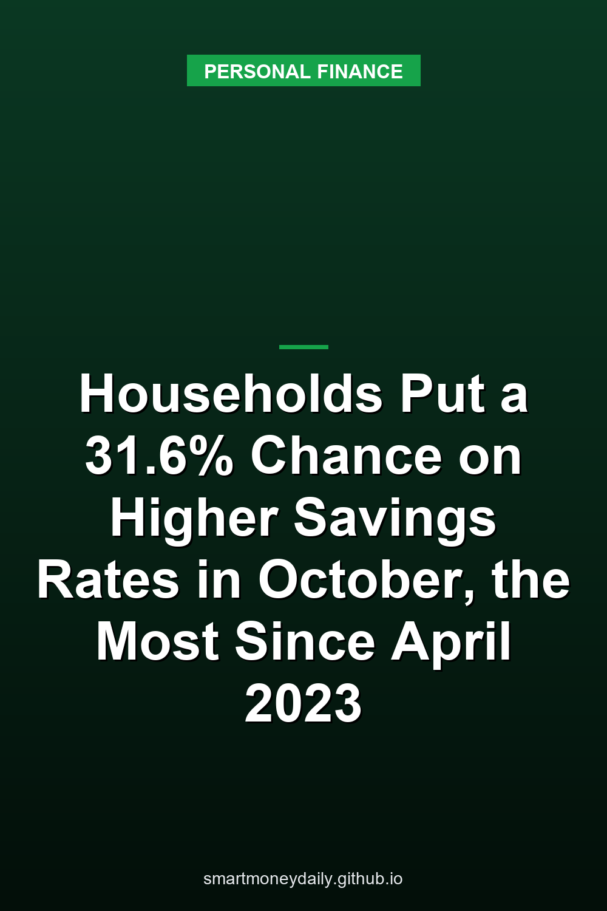

Households put the chance that savings rates will be higher a year from now at **31.6%** on average in October, up 1.3 percentage points from September and the highest since April 2023. The figure comes from the New York Fed's [October 2026 Survey of Consumer Expectations](https://www.newyorkfed.org/newsevents/news/research/2026/20261109), released Nov. 9, which asks for the percent chance that "12 months from now the average interest rate on saving accounts will be higher than it is now."

Ten months earlier it was 23.4%. That December 2025 reading is the lowest in the survey's chart data, which start in June 2013, and the average has risen five months in a row since May.

The same survey found more worry about jobs. The average chance respondents assigned to the U.S. unemployment rate being higher a year from now rose to **45.3%**, the highest since April 2020. Median expected inflation for the next 12 months held at 3.9%.

None of these numbers is a forecast from the Fed or from a bank, and nothing here is financial advice. They're what about 1,300 household heads told the New York Fed in October, a month in which two Fed policymakers dissented in favor of a rate increase. For savers, the survey is a public read on how people see deposit rates moving, and that read has shifted toward higher rates five months running.

## What the savings-rate question measures

The question doesn't ask what your bank will pay, or how far rates might move. It sits in a block of economy questions that opens with "Of course, no one can know the future. These questions have no right or wrong answers." Respondents give one number from 0 to 100, and the questionnaire tells them how to think about the scale: "18 percent or so may mean 'not much chance'," while "47 or 52 percent chance may be a 'pretty even chance'." The New York Fed then reports the mean. Its [FAQ](https://www.newyorkfed.org/microeconomics/sce/sce-faq) explains the choice: when answers are bounded between 0 and 100, as they are for probability questions, the survey reports the mean. For measures without those bounds, such as expected inflation, it reports the median.

So 31.6% doesn't mean rates will rise 31.6%, and it doesn't mean 31.6% of people expect a rise. It means the average respondent put a bit less than a one-in-three chance on higher rates, which leaves about 68% on rates being the same or lower. People still lean toward "not higher." They just lean that way less than at any time since April 2023.

The panel rotates. Respondents stay for up to 12 months, with roughly equal numbers joining and leaving each month, so the New York Fed can follow the same people's views over time. It describes the survey as nationally representative. October's answers came in from Oct. 1 through Oct. 31, so the survey period included the Fed's Oct. 28 decision.

## Ten months from a record low

Here's the average answer over the past year, from the survey's chart data:

| Survey month | Average chance of a higher savings rate in 12 months |
|---|---|
| October 2025 | 24.9% |
| December 2025 | 23.4% |
| May 2026 | 24.6% |
| June 2026 | 26.6% |
| July 2026 | 28.2% |
| August 2026 | 28.8% |
| September 2026 | 30.3% |
| October 2026 | 31.6% |

That's 6.7 points above a year earlier. It isn't high by the survey's own history, though. The series peaked at 41.8% in March 2017, and the last reading above October's was 32.0% in April 2023.

2022 makes a useful yardstick. In March of that year the Fed's committee raised the target range to 1/4 to 1/2 percent and said it "anticipates that ongoing increases in the target range will be appropriate." The survey's average answer went from 30.5% in January 2022 to a peak of 35.7% in June. It stayed below an even chance throughout 2022.

In October, the average chance was higher among younger respondents, those with higher household incomes and those with more education. Respondents with at least a bachelor's degree put the chance at 37.2%, against 26.8% for those with a high school education or less. By age, it was 35.7% for those under 40 and 28.2% for those 60 and older. By household income, it was 35.7% above $100,000 and 26.6% below $50,000. The survey also asks five numeracy questions, short percentage and probability problems, and respondents who got at least four right gave 35.0%, against 26.1% for the rest.

Each group is a slice of a roughly 1,300-person panel, so I'd read one month of these loosely, but the same ordering showed up in September.

## What savings accounts pay right now

As of October 19, 2026, the [FDIC's national rates](https://www.fdic.gov/national-rates-and-rate-caps) were 0.38% for savings accounts, 0.63% for money market accounts and 1.76% for 12-month CDs, the highest of any product in its table. Each is an average of the rates paid by insured banks and credit unions with available data, weighted by each institution's share of domestic deposits, so the places holding the most deposits count the most. The savings figure uses the $2,500 product tier. Money market and CD figures average the $10,000 and $100,000 tiers.

The agency posts new numbers on the third Monday of each month, or the next business day when that Monday is a federal holiday, using information from the last business day of the prior month. The October figures reflect Sept. 30, and the next set is due Nov. 16.

The Fed's policy committee [held](https://www.federalreserve.gov/newsevents/pressreleases/monetary20261028a.htm) the federal funds target range at 3.75% to 4% on Oct. 28 by a 10-2 vote. The two dissenters, Lisa D. Cook and Beth M. Hammack, wanted a quarter-point increase. The statement said, "Inflation remains elevated." How that decision compares with savings, CD and Treasury bill yields was [the Nov. 1 post](/2026/11/01/the-feds-oct-28-hold-at-375-to-4-two-votes-for-a-hike-and-what-savers-earn-now/).

Survey answers don't set bank rates. What the October number does show is the highest average chance of rising savings rates in about three and a half years, in the same month two Fed officials dissented in favor of a hike.

## Inflation expectations stayed at 3.9%

Median inflation expectations were unchanged in October at 3.9% for the year ahead, 3.3% for three years ahead and 3.0% for five years ahead. Even the five-year figure is a full percentage point above the 2 percent goal that the Fed's Oct. 28 statement repeats. September's one-year reading, after a 0.3-point rise, had been the highest since May 2023. The answers are spread out: a quarter of respondents expected 2.6% or less over the next year, and a quarter expected 6.1% or more. For comparison, the consumer price index for all urban consumers rose 3.7% in the 12 months through September 2026, by my arithmetic from the [BLS index](https://data.bls.gov/timeseries/CUUR0000SA0) (336.940 in September 2026 against 324.800 a year earlier).

Rent stood out among the specific prices the survey asks about, with the expected increase up 0.9 point to 7.7%. Medical care, at 9.3%, was still the highest of the group. Gas came down 0.6 point to 4.2%, and food stayed at 5.5%.

Among the questions the survey asks new respondents is this one: "Imagine that the interest rate on your savings account was 1% per year and inflation was 2% per year. After one year, how much would you be able to buy with the money in this account?" The correct choice is "Less than today," because the interest doesn't keep up with prices. The October figures fit the same setup. Every national average in that table, the 1.76% 12-month CD included, is below the 3.9% the median respondent expects for prices. If prices rose 3.9% over the next year and the money kept earning those rates, it would buy less a year from now, even before any tax on the interest.

Series I savings bonds handle this differently: TreasuryDirect says their rate "changes every 6 months, based on inflation." The rate for bonds issued from Nov. 1 is in [the Nov. 3 post on I bonds](/2026/11/03/new-i-bonds-start-at-551-and-their-140-fixed-rate-is-the-highest-since-2006/).

## Unemployment expectations hit their highest since April 2020

The 45.3% is the average chance respondents put on the U.S. unemployment rate being higher a year from now, up 1.4 points in October. The New York Fed says the increase was driven by respondents without a college degree. In its chart data, the average rose to 38.6% from 36.4% for respondents with a high school education or less, and to 44.6% from 41.0% for those with some college. College graduates still gave the highest number of the three, 51.1%, though theirs slipped.

Expectations about respondents' own jobs were mixed. Those questions go to people with a job who aren't self-employed, including those on leave or temporarily laid off. The average chance of losing that job in the next 12 months rose 0.4 point to 13.9%, still below its 12-month trailing average of 14.3%. The average chance of finding a job they'd accept, considering the pay and type of work, within three months of losing their current one rose 0.4 point to 46.5%, the highest since November 2025. That's still slightly worse than even odds. The expected chance of quitting fell to 19.4%.

The Fed's statement described the job market more calmly: "Job gains have kept pace with the workforce, and the unemployment rate has changed little."

Earlier posts cover where an emergency fund can sit, [product by product](/2026/08/17/a-beginners-guide-to-creating-an-emergency-fund-with-different-financial-products/), and the rules for [the $1,000 emergency withdrawal from a 401(k)](/2026/10/10/the-1000-emergency-401k-withdrawal-vs-your-savings-account-the-rules/).

## Income, spending and missed payments

Median expected household income growth slipped 0.1 point to 3.0%. The New York Fed says that series has stayed between 2.8% and 3.1% since June 2025. Expected earnings growth held at 2.6%, and expected household spending growth dipped 0.2 point to 5.3%, still above its 12-month trailing average of 5.0%.

Those medians come from separate questions, so I wouldn't subtract one from the other to get a budget gap. For what households actually did, the BEA put the personal saving rate at 3.8% of disposable personal income in September, which [the Nov. 5 post](/2026/11/05/the-personal-saving-rate-fell-to-38-in-september-its-lowest-since-october-2022/) goes through.

The average chance of missing a minimum debt payment over the next three months rose 1.6 points to 13.8%, the highest since December 2025. The question covers the minimum required payments on credit and retail cards, auto loans, student loans, mortgages and any other debt. The Fed's latest figures on card interest rates are in [the Nov. 10 post](/2026/11/10/rates-on-card-accounts-charged-interest-averaged-2236-in-q3-and-revolving-credit-rose-in-september/).

Asked about their finances, 42.7% of respondents said they were worse off than a year earlier and 19.8% better off, with 37.5% about the same. Even so, the net share reporting a better situation rose from September, which the New York Fed calls a slight improvement. Looking a year ahead, 35.6% expected to be worse off and 24.2% better off, roughly the same as the month before.

## Before the Fed's December meeting

The survey and the [FDIC](https://www.fdic.gov/national-rates-and-rate-caps)'s table answer different questions, one about what people expect and one about what accounts pay, and both get new numbers before the Fed meets again. On Nov. 16 the FDIC is due to post new national rates, and the New York Fed's [release calendar](https://www.newyorkfed.org/microeconomics/calendar) lists a data update for its SCE Credit Access Survey the same day.

The next monthly Survey of Consumer Expectations comes out Dec. 7. The Fed's last scheduled meeting of the year, [Dec. 8-9](https://www.federalreserve.gov/monetarypolicy/fomccalendars.htm), starts the next day.

## Further Reading

- [FinCEN Drops Its $250 Plan for Transfers Abroad: The $3,000 Wire Rule Stays, and Paying in Cash Costs 1%](/2026/11/12/fincen-drops-its-250-plan-for-transfers-abroad-the-3000-wire-rule-stays-and-paying-in-cash-costs-1/)
- [2027 Tax Brackets and Savings Interest: 12% Up to $104,050 for Couples and a $2,800 Kiddie-Tax Threshold](/2026/11/11/2027-tax-brackets-and-savings-interest-12-up-to-104050-for-couples-and-a-2800-kiddie-tax-threshold/)
- [When an Account Owner Dies: A Six-Month FDIC Grace Period and a $600 Estate Filing Line](/2026/11/09/when-an-account-owner-dies-a-six-month-fdic-grace-period-and-a-600-estate-filing-line/)
- [Banks on Veterans Day 2026: The Fed Closes Nov. 11, and a Social Security Payment Moves to Nov. 10](/2026/11/08/banks-on-veterans-day-2026-the-fed-closes-nov-11-and-a-social-security-payment-moves-to-nov-10/)
- [Car-Loan Interest Is Deductible Through 2028, but a 7.54% Loan Still Costs More Than T-Bills Pay](/2026/11/07/car-loan-interest-is-deductible-through-2028-but-a-754-loan-still-costs-more-than-t-bills-pay/)

