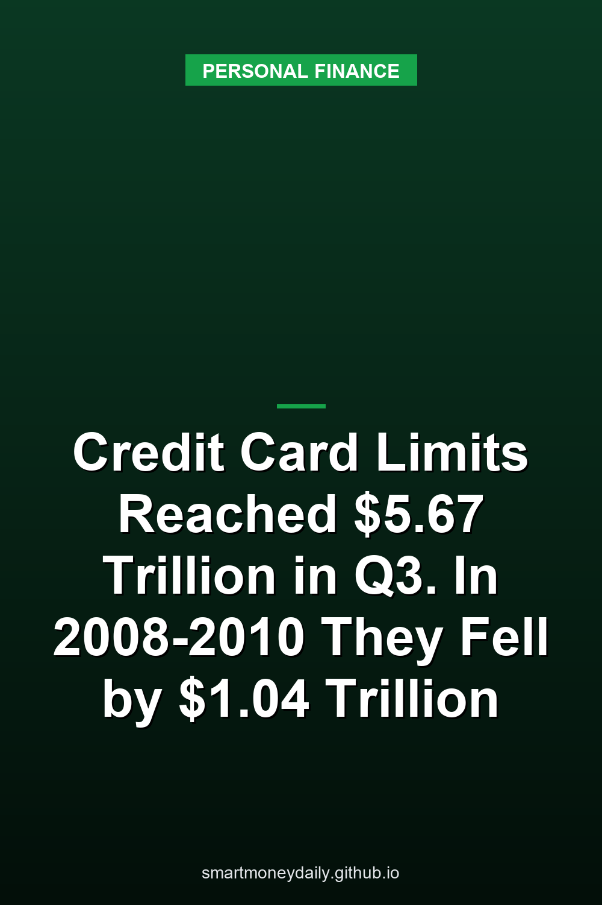

U.S. consumers had $4.389 trillion in unused credit card limits at the end of September, out of $5.674 trillion in total limits on their credit reports. Card balances made up the other $1.285 trillion.

During and after the 2008 financial crisis, those totals fell fast. Card limits went from $3.70 trillion in the third quarter of 2008 to $2.66 trillion at the end of 2010, a drop of **$1.04 trillion**, or 28%. Unused card credit fell 32% over the same stretch, and limits didn't climb back above the 2008 level until the first quarter of 2019.

The figures come from the New York Fed's [Quarterly Report on Household Debt and Credit](https://www.newyorkfed.org/microeconomics/hhdc), released Nov. 10, and the September totals for limits and unused credit are the highest nominal readings in data that start in 2003. Balances rose $22 billion in the third quarter while limits rose $115 billion, so households were using about 22.6% of their total card limits, down slightly from 23.1% a year earlier.

That history is why I don't count a credit line as savings, however big the number on a statement looks.

## The rest of the third-quarter report

Total household debt rose $334 billion, or 1.8%, to $19.1 trillion. The category figures below are from the New York Fed's [Nov. 10 press release](https://www.newyorkfed.org/newsevents/news/research/2026/20261110):

| Category | Change in Q3 | Balance at end of September |
|---|---|---|
| Mortgages | +$257 billion | $13.374 trillion |
| Home equity lines of credit | +$23 billion | $0.481 trillion |
| Auto loans | +$21 billion | $1.734 trillion |
| Credit cards | +$22 billion | $1.285 trillion |
| Student loans | +$5 billion | $1.656 trillion |
| Other | +$7 billion | $0.575 trillion |
| Total | +$334 billion | $19.105 trillion |

The category changes are shown as published. They add up to $335 billion, against the $334 billion total in the release.

About half of the mortgage increase came from balances being reported again after a reporting gap in the second quarter, the report says. HELOC balances posted their largest quarterly increase since 2005, and it was their 18th increase in a row.

Delinquency rose overall. At the end of September, 5.0% of outstanding debt was in some stage of delinquency, up 0.3 percentage point from the second quarter. For student loans, the share of balances 90 or more days past due rose to 10.9% from 10.6%.

Card delinquency eased a little. The report says the move into early delinquency improved slightly for credit cards, and its annualized rate of card balances becoming seriously delinquent, meaning 90 or more days late, was 6.87% in the third quarter, down from 7.05% a year earlier. That rate is measured against the previous quarter's balances that weren't already seriously delinquent.

## Limits grew faster than balances

Over the past year, card limits went from $5.329 trillion to $5.674 trillion, up $345 billion or 6.5%. Balances went from $1.233 trillion to $1.285 trillion, up $52 billion or 4.2%. Unused card credit, which the report calls available credit, rose $93 billion in the third quarter alone.

One caveat on the word "limit." The report counts what it calls high credit, which is either the credit limit or, when no limit is reported, the highest balance ever reported on the account. The New York Fed says the highest-balance stand-in likely understates the actual limits on those accounts.

Home equity lines grew too, though not in the same proportion. HELOC limits rose $31 billion in the third quarter, or 2.9%, which the New York Fed describes as part of an expansion that began in 2022. HELOC balances rose $23 billion, about 5%. At the end of September, HELOC limits totaled $1.097 trillion, with $481 billion borrowed and $616 billion unused.

Lenders weren't loosening across the board. In the Fed's [October 2026 Senior Loan Officer Opinion Survey](https://www.federalreserve.gov/data/sloos/sloos-202610.htm), released Nov. 2, banks said they tightened credit limits on credit card accounts over the third quarter. Asked how their card policies had changed over the past year, banks said they were more likely to approve applications from super-prime and prime borrowers and less likely to approve subprime applicants.

So the national total can rise in a quarter when some cardholders see their own limits cut, and a total built from millions of accounts can't show which ones those were.

## Card limits fell $1.04 trillion from 2008 to 2010

These are the report's figures for card credit around the 2008 financial crisis, next to the latest quarter:

| End of quarter | Card limits | Unused card credit | Card balances |
|---|---|---|---|
| Q3 2008 | $3.700 trillion | $2.842 trillion | $0.858 trillion |
| Q4 2009 | $2.870 trillion | $2.070 trillion | $0.800 trillion |
| Q4 2010 | $2.660 trillion | $1.930 trillion | $0.730 trillion |
| Q1 2019 | $3.733 trillion | $2.885 trillion | $0.848 trillion |
| Q3 2026 | $5.674 trillion | $4.389 trillion | $1.285 trillion |

From the third quarter of 2008 to the end of 2010, limits fell $1.04 trillion, or 28%, and unused credit fell $912 billion. Balances fell $128 billion over the same period, or 15%. Because limits shrank faster than balances, the share of card limits in use rose from 23.2% to 27.4%.

The published figures don't say why. A lower total can come from lenders cutting lines or from accounts closing, and the report doesn't split the two. What the totals do show is how much less unused card credit was on credit reports at the end of 2010 than in the third quarter of 2008.

Home equity lines took a slower path down. Unused HELOC credit went from $723 billion at the end of 2007 to $532 billion at the end of 2010, a 26% drop.

## What the rules say about cutting a credit line

For credit cards, the Regulation Z provision on limit decreases, [12 CFR 1026.9(c)(2)(vi)](https://www.law.cornell.edu/cfr/text/12/1026.9), doesn't prohibit a decrease. It sets a notice requirement tied to fees. If an issuer lowers the limit, it has to give notice "at least 45 days prior to imposing the over-the-limit fee or penalty rate" when that fee or rate would be charged "solely as a result of the consumer exceeding the newly decreased credit limit." The notice has to say the limit "has been or will be decreased."

For home equity lines, [12 CFR 1026.40(f)(3)(vi)](https://www.law.cornell.edu/cfr/text/12/1026.40) lists when a lender may stop further draws or reduce the limit. It's allowed during any period in which one of several conditions applies, including these three:

- the home's value "declines significantly below the dwelling's appraised value for purposes of the plan"
- the lender "reasonably believes that the consumer will be unable to fulfill the repayment obligations under the plan because of a material change in the consumer's financial circumstances"
- the borrower "is in default of any material obligation under the agreement"

These are separate grounds, and one is enough while it applies. The second turns on the lender's reasonable belief that the borrower can't make the plan's payments because of a material change in their finances. To me, the first two read like the situations in which a homeowner might want the money most, and that's what I'd keep in mind before treating an unused HELOC as a backup fund.

## How a deposit balance differs

A lower card limit doesn't touch money already sitting in a deposit account. Deposit insurance covers a different risk, a bank failure: according to the [FDIC's Deposits at a Glance](https://www.fdic.gov/resources/deposit-insurance/brochures/deposits-at-a-glance), "The standard insurance amount is $250,000 per depositor, per insured bank, for each account ownership category."

National average deposit rates are low. As of October 19, 2026, the [FDIC's national rates](https://www.fdic.gov/national-rates-and-rate-caps), which are averages weighted by each institution's share of domestic deposits, were 0.38% for savings accounts and 0.63% for money market accounts. Individual accounts can pay more or less.

On the borrowing side, the Fed's consumer credit release put the third-quarter average rate on card accounts that were charged interest at 22.36%. [Our Nov. 10 post on card rates](/2026/11/10/rates-on-card-accounts-charged-interest-averaged-2236-in-q3-and-revolving-credit-rose-in-september/) shows what that does to a $2,000 balance, and [the emergency fund guide](/2026/08/17/a-beginners-guide-to-creating-an-emergency-fund-with-different-financial-products/) compares the accounts where that cash can sit.

## Who is falling behind on cards

The New York Fed published a [Liberty Street Economics post](https://libertystreeteconomics.newyorkfed.org/2026/11/a-look-at-the-wider-divide-in-credit-card-delinquency-by-income/) alongside the report. Its authors split card borrowers by the average income of their zip code and found that the gap in new serious delinquencies between higher- and lower-income areas widened after 2022.

They also traced when the struggling accounts were opened. At the start of the pandemic, the share of new cards and new credit limits going to borrowers in the lowest-income quartile of zip codes each rose by nearly 2 percentage points, and those shares stayed elevated until 2023, which the authors call consistent with lenders easing underwriting standards. The median credit score at card issuance fell from an average of 699 in 2017-19 to 688 in 2020-22, and cards from the 2020-22 group made up a sizable share of new delinquencies in 2023 and into 2024.

The score trend reverted toward the end of 2022, the authors wrote, and cards issued since early 2023 have generally gone to borrowers with higher scores.

## Further Reading

- [Households Put a 31.6% Chance on Higher Savings Rates in October, the Most Since April 2023](/2026/11/13/households-put-a-316-chance-on-higher-savings-rates-in-october-the-most-since-april-2023/)
- [FinCEN Drops Its $250 Plan for Transfers Abroad: The $3,000 Wire Rule Stays, and Paying in Cash Costs 1%](/2026/11/12/fincen-drops-its-250-plan-for-transfers-abroad-the-3000-wire-rule-stays-and-paying-in-cash-costs-1/)
- [2027 Tax Brackets and Savings Interest: 12% Up to $104,050 for Couples and a $2,800 Kiddie-Tax Threshold](/2026/11/11/2027-tax-brackets-and-savings-interest-12-up-to-104050-for-couples-and-a-2800-kiddie-tax-threshold/)
- [When an Account Owner Dies: A Six-Month FDIC Grace Period and a $600 Estate Filing Line](/2026/11/09/when-an-account-owner-dies-a-six-month-fdic-grace-period-and-a-600-estate-filing-line/)
- [Banks on Veterans Day 2026: The Fed Closes Nov. 11, and a Social Security Payment Moves to Nov. 10](/2026/11/08/banks-on-veterans-day-2026-the-fed-closes-nov-11-and-a-social-security-payment-moves-to-nov-10/)

