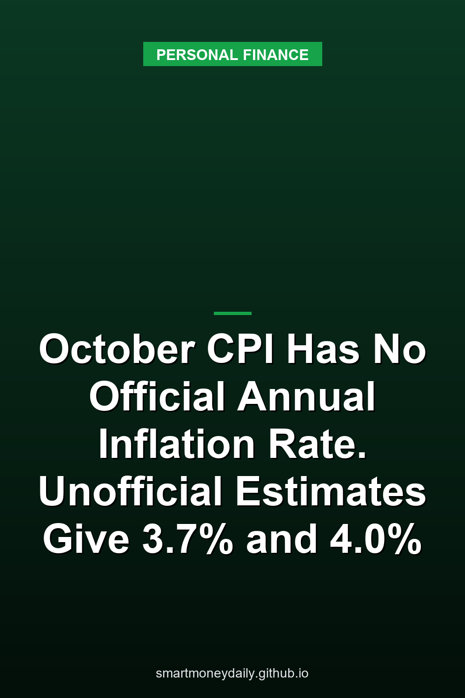

Consumer prices rose 0.4% in October on a seasonally adjusted basis, after a 0.6% rise in September. The number most people look for next, the change from a year earlier, isn't in the release. Table A has a dash where the all-items 12-month figure would normally be.

The year-ago month is missing. "BLS did not collect survey data for October 2025 because of a lapse in appropriations," the Bureau of Labor Statistics says in the [October 2026 CPI release](https://www.bls.gov/news.release/archives/cpi_11102026.htm), published Nov. 10, and it "cannot publish 12-month percent changes for October 2026 for indexes where October 2025 data are unavailable." That includes the all-items index, the index without food and energy, food, energy and shelter.

There are two published ways to stand in for the missing month, and when I run the numbers they don't land in the same place. Measured from Treasury's substitute for October 2025, the index value it uses for TIPS, prices rose 3.7%. Measured from an estimate built with the approach BLS describes for missing data, they rose 4.0%. Both are my unofficial calculations, not BLS figures. September's official rate, the last one available, was 3.7%.

If you're checking whether a 4% savings rate keeps up with prices, that gap decides it. Against 3.7% it's ahead by about a third of a point. Against 4.0% it roughly breaks even.

## What the October release still reports

Month-to-month changes compare October 2026 with September 2026, so the missing month doesn't touch them. The release's seasonally adjusted figures for October:

- All items: up 0.4%, after 0.6% in September
- All items less food and energy: up 0.3%
- Energy: up 0.7%, after 5.2% in September
- Gasoline: up 1.0%, after 9.1% in September
- Food: up 0.5%, after no change in September
- Shelter: up 0.3%, after 0.4% in September

Gasoline is one index that does have an October 2025 value, so its 12-month change appears in Table A: up 37.4%, unadjusted. The unadjusted gasoline index went from 277.021 in October 2025 to 380.510 this October, which works out the same.

## Applying the BLS method gives about 4.0%

The release points readers to a BLS fact sheet on [approximating missing data](https://www.bls.gov/cpi/factsheets/approximating-missing-data.htm). It's written for situations like a contract that calls for an index value that wasn't published: "If all parties agree, the missing data point can be approximated by taking the geometric mean of the index values." In practice you multiply the index for the month before by the index for the month after and take the square root.

Applied to the unadjusted all-items CPI-U, using values from the [BLS data series](https://data.bls.gov/timeseries/CUUR0000SA0), September 2025 was 324.800 and November 2025 was 324.122. Their geometric mean is 324.461. October 2026 came in at 337.511, which is 4.0% above that estimate.

The same steps work for the other indexes that lost their 12-month figure. These are my calculations from the published unadjusted index values:

| Index | Sept. 2025 | Nov. 2025 | Estimated Oct. 2025 | Oct. 2026 | Estimated 12-month change |
|---|---|---|---|---|---|
| All items | 324.800 | 324.122 | 324.461 | 337.511 | 4.0% |
| All items less food and energy | 330.804 | 330.425 | 330.614 | 339.921 | 2.8% |
| Food | 342.405 | 341.721 | 342.063 | 352.359 | 3.0% |
| Shelter | 418.598 | 418.593 | 418.595 | 432.745 | 3.4% |
| Energy | 283.589 | 279.588 | 281.581 | 340.061 | 20.8% |

BLS is plain about what these are. "Data calculated in this way cannot be interpreted as official CPI series," the fact sheet says, and "Percent changes based on approximated data should also be considered as unofficial estimates." It also warns that when the index moves around a lot between months, "less confidence should be placed in estimates for the missing months." Energy is the clearest case here. It dropped from 283.589 to 279.588 between September and November 2025, and the method just picks a point between the two.

Even with that caveat, energy stands out. The estimates put prices without food and energy up about 2.8%, food about 3.0% and shelter about 3.4%, while energy comes out near 20.8%. The table doesn't weight the categories, so it can't say how much each one added to the all-items figure.

## Treasury picked a different October 2025 a year ago

TIPS payments couldn't wait for a number BLS was never going to publish. Treasury's rules for the bonds, the Uniform Offering Circular in [Appendix B to 31 CFR Part 356](https://www.law.cornell.edu/cfr/text/31/appendix-B_to_part_356), cover this: "If the CPI for a particular month is not reported by the last day of the following month, we will announce an index number based on the last available twelve-month change in the CPI."

On Nov. 26, 2025, Treasury [announced](https://home.treasury.gov/news/press-releases/sb0324) that "the index number for October 2025 is 325.604" and that it "will not replace this index number even if BLS subsequently reports actual CPI for October 2025."

The formula carries the latest 12-month pace forward by one month. The CPI-U rose 3.0% from September 2024 (315.301) to September 2025 (324.800), so Treasury's October value is 324.800 multiplied by the twelfth root of the ratio 324.800/315.301. That gives 325.604, about a quarter of a percent above September. Then November 2025 came in at 324.122, below both September and Treasury's figure.

So the two substitutes start from different places. Treasury's 325.604 is 1.143 points higher than the geometric mean of 324.461, and that alone explains the gap: October 2026 is 3.66% above Treasury's number and 4.02% above the BLS-method estimate.

For TIPS holders, Treasury's number is the one that counts. The circular says "The Ref CPI for the first day of any calendar month is the CPI for the third preceding calendar month." That made 325.604 the reference value for Jan. 1, 2026, and October 2026's 337.511 becomes the reference value for Jan. 1, 2027. Between those two dates the inflation adjustment on TIPS principal comes to 3.66%.

## How savings rates look against both numbers

In the [FDIC's national rates](https://www.fdic.gov/national-rates-and-rate-caps) published October 19, 2026, which use rates available at the end of September and weight each institution's rate by its share of domestic deposits, the averages were 0.38% for savings, 0.63% for money market accounts and 1.76% for 12-month CDs. Individual accounts can pay much more or less than those averages. On Nov. 10, the day of the CPI release, Treasury's [daily bill rates](https://home.treasury.gov/resource-center/data-chart-center/interest-rates/TextView?type=daily_treasury_bill_rates&field_tdr_date_value=2026) put the coupon-equivalent yield at 4.22% for 13-week bills, 4.41% for 26-week bills and 4.54% for 52-week bills. The 52-week figure was 4.37% the day before.

Here's a rough comparison of each rate after inflation, figured as (1 + rate) divided by (1 + inflation), minus 1, using the unrounded inflation estimates. The bill yields are coupon-equivalent yields, an annualized figure that isn't quite the same as an APY, so treat that row as approximate.

| Rate | Against 3.7% (Treasury substitute) | Against 4.0% (BLS method) |
|---|---|---|
| Savings average, 0.38% | -3.2% | -3.5% |
| Money market average, 0.63% | -2.9% | -3.3% |
| 12-month CD average, 1.76% | -1.8% | -2.2% |
| A 4% savings account (example) | +0.3% | 0.0% |
| 52-week Treasury bill, 4.54% | +0.9% | +0.5% |

On $10,000 at the savings average, that's $10,038 a year later, which buys about what $9,650 bought before, using the 4.02% figure.

Two caveats. These are before tax, and interest on Treasury bills is exempt from state and local income tax while bank interest isn't. And the comparison lines up today's rates with prices over the past year. A rate you lock in now earns over the next year, and the inflation that matters for it hasn't happened yet. Our [real return guide](/2026/07/23/how-to-evaluate-the-risk-of-inflation-on-your-savings-accounts/) goes through why subtracting CPI is only a rough check.

When the two substitutes disagree, I'd test cash against the higher one. If a rate only looks positive under the friendlier number, I wouldn't count on it keeping up.

## I bonds and the 2027 COLA don't use October

The inflation part of the I bond rate is based on the unadjusted CPI-U, and it's measured over six-month windows that run from March to September or from September to March. The current rate, 5.51% with a 1.40% fixed rate for bonds issued from Nov. 1, 2026 to April 30, 2027, used March and September 2026. The next inflation-rate announcement, on May 1, 2027, will use the change from September 2026 (336.940) to March 2027. Neither calculation uses an October index value, only the March and September levels. Our [I bond post from Nov. 3](/2026/11/03/new-i-bonds-start-at-551-and-their-140-fixed-rate-is-the-highest-since-2006/) covers the rate in detail.

The 2027 Social Security cost-of-living adjustment was already set from third-quarter prices, July through September, so the missing October doesn't change it either. Our [post on the 3.6% COLA](/2026/10/18/the-2027-cola-is-36-savings-interest-the-25560-earnings-limit-and-ssi/) has the details.

## When the 12-month figure comes back

November 2025 is in the data, so the November 2026 report can show an official 12-month change again. BLS has it scheduled for Thursday, Dec. 10, at 8:30 a.m. Eastern.

Contracts that adjust on the October CPI are a different problem. The fact sheet offers the geometric mean "if all parties agree," so what a lease or other agreement says about missing data matters more than either number above.

## Further Reading

- [Credit Card Limits Reached $5.67 Trillion in Q3. In 2008-2010 They Fell by $1.04 Trillion](/2026/11/14/credit-card-limits-reached-567-trillion-in-q3-in-2008-2010-they-fell-by-104-trillion/)
- [Households Put a 31.6% Chance on Higher Savings Rates in October, the Most Since April 2023](/2026/11/13/households-put-a-316-chance-on-higher-savings-rates-in-october-the-most-since-april-2023/)
- [FinCEN Drops Its $250 Plan for Transfers Abroad: The $3,000 Wire Rule Stays, and Paying in Cash Costs 1%](/2026/11/12/fincen-drops-its-250-plan-for-transfers-abroad-the-3000-wire-rule-stays-and-paying-in-cash-costs-1/)
- [2027 Tax Brackets and Savings Interest: 12% Up to $104,050 for Couples and a $2,800 Kiddie-Tax Threshold](/2026/11/11/2027-tax-brackets-and-savings-interest-12-up-to-104050-for-couples-and-a-2800-kiddie-tax-threshold/)
- [Rates on Card Accounts Charged Interest Averaged 22.36% in Q3, and Revolving Credit Rose in September](/2026/11/10/rates-on-card-accounts-charged-interest-averaged-2236-in-q3-and-revolving-credit-rose-in-september/)

