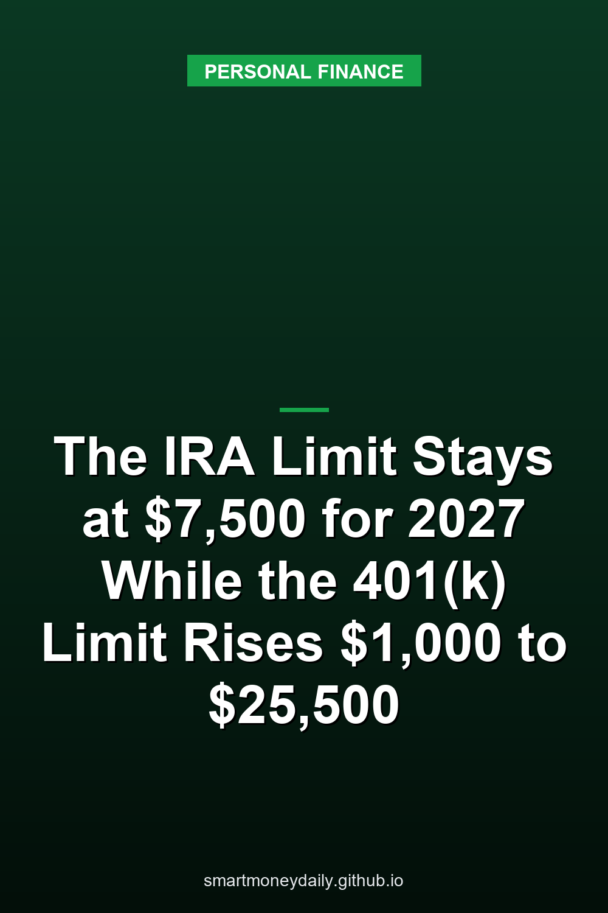

The 401(k) contribution limit goes up $1,000 next year, to $25,500. The IRA limit doesn't go up at all. It stays at $7,500 for 2027, and the extra amount people 50 and older can add to an IRA stays at $1,100. The IRS announced both on Nov. 12 in [IR-2026-136](https://www.irs.gov/newsroom/401k-limit-increases-to-25500-for-2027-ira-limit-remains-7500), with the full list of retirement figures in [Notice 2026-66](https://www.irs.gov/pub/irs-drop/n-26-66.pdf).

So the gap between the two accounts gets wider. A worker under 50 can defer $25,500 into a 401(k) in 2027 and contribute $7,500 to IRAs, and the 401(k) figure is now 3.4 times the IRA figure. If you keep part of your retirement money in bank CDs or savings deposits inside an IRA, that $7,500 (or $8,600 at 50 and older) is the cap on regular contributions for the year. Rollovers from other retirement accounts don't count against it.

## The 2027 numbers next to 2026

The individual limits below come from the notice and the IRS release. The release also states the $34,000 total for workers 50 and older in 2027; the other totals in the last two rows are my additions of the base deferral and the matching catch-up.

| Limit | 2026 | 2027 |
|---|---|---|
| Employee deferrals: 401(k), 403(b), governmental 457, Thrift Savings Plan | $24,500 | $25,500 |
| Catch-up for age 50 and over in those plans | $8,000 | $8,500 |
| Higher catch-up for ages 60 to 63 | $11,250 | $11,750 |
| IRA (traditional and Roth combined) | $7,500 | $7,500 |
| IRA catch-up for age 50 and over | $1,100 | $1,100 |
| Standard SIMPLE employee contributions | $17,000 | $17,500 |
| 401(k) deferrals plus catch-up, age 50 and over | $32,500 | $34,000 |
| 401(k) deferrals plus catch-up, ages 60 to 63 | $35,750 | $37,250 |

## Why the IRA limit didn't move

The two sets of numbers run on different formulas. Notice 2026-66 says the 401(k) deferral limit is adjusted "at the same time and in the same manner" as the section 415 pension limits, and section 415(d) calls for "adjustment procedures similar to those used to adjust benefit amounts" under the Social Security Act. The IRA amounts use "a variation of the methodology used for the cost-of-living adjustments under section 1(f)(3)." That's the inflation adjustment in the part of the [tax code](https://www.law.cornell.edu/uscode/text/26/1) that sets the income tax rate tables, the same tables behind the [2027 bracket changes](/2026/11/11/2027-tax-brackets-and-savings-interest-12-up-to-104050-for-couples-and-a-2800-kiddie-tax-threshold/).

Then there's the rounding. Under [26 U.S.C. 219(b)(5)(C)](https://www.law.cornell.edu/uscode/text/26/219), an adjusted IRA limit that isn't a multiple of $500 "shall be rounded to the next lower multiple of $500." The catch-up rounds down to the next lower multiple of $100. So the IRA limit only moves when its inflation-adjusted value reaches the next $500 step. For 2027 it didn't reach $8,000, and the result is the same $7,500 as this year.

That's why the IRA limit doesn't rise every year. The IRS's own [IRA limits page](https://www.irs.gov/retirement-plans/plan-participant-employee/retirement-topics-ira-contribution-limits) shows $6,500 for 2023, $7,000 for both 2024 and 2025, and $7,500 for 2026. Two years at the same number has happened before.

## $7,500 a year works out to $625 a month

If you spread the full IRA amount evenly over 2027, it's $625 a month. With the age-50 catch-up, $8,600 comes to about $717 a month. The 401(k) deferral limit spread the same way is $2,125 a month.

A few rules on that $7,500 trip people up:

- It's one limit for all of your traditional and Roth IRAs together, not $7,500 per account.
- It can't be more than your taxable compensation for the year. A spouse with no pay can still contribute on a joint return, based on the other spouse's compensation.
- Rollovers from other retirement accounts and qualified reservist repayments don't count against it.

Timing matters for the 2026 limit too. Section 219(f)(3) treats a contribution as made for the prior year if it's "made on account of such taxable year" and made "not later than the time prescribed by law for filing the return for such taxable year (not including extensions thereof)." [Section 6072](https://www.law.cornell.edu/uscode/text/26/6072) sets April 15 as the regular due date for calendar-year individual returns, so money designated for 2026 can still go in until April 15, 2027. A filing extension doesn't stretch that.

## Keeping IRA money at a bank

An IRA can hold bank deposits, such as a CD or a savings account, and at an [FDIC](https://www.fdic.gov/national-rates-and-rate-caps)-insured bank those deposits are insured under their own category.

The FDIC's [Certain Retirement Accounts](https://www.fdic.gov/resources/deposit-insurance/brochures/insured-deposits/index.html) category covers traditional, Roth, SEP and SIMPLE IRAs, along with self-directed defined contribution plan accounts such as a self-directed 401(k), self-directed Keogh accounts and section 457 plan accounts. "The FDIC adds together all deposits in retirement accounts listed above owned by the same person at the same insured bank and insures the total amount up to a maximum of $250,000." Naming beneficiaries doesn't raise that amount. The FDIC insures funds in different ownership categories separately, so retirement deposits don't share the $250,000 with your regular single-owner accounts at the same bank.

Once the cash is in a bank IRA, what it earns depends on the rate on that deposit. The FDIC's [national rates](https://www.fdic.gov/national-rates-and-rate-caps) published October 19, 2026, which reflect rates available at the end of September, averaged 0.38% for savings, 0.63% for money market accounts and 1.76% for 12-month CDs. As a simple illustration, $7,500 held for a full year at an unchanged rate would earn about $28.50 at the savings average, $47.25 at the money market average or $132 at the 12-month CD average. These are deposit-weighted averages across insured banks and credit unions, not IRA-specific rates, and a given institution's offer can sit well above or below them.

## Income ranges that moved

The contribution limit stayed put, but the income ranges that decide who can deduct a traditional IRA contribution or put money into a Roth went up.

The traditional IRA deduction uses adjusted gross income with a few adjustments under section 219(g)(3)(A), often called modified AGI. When you or your spouse is covered by a retirement plan at work, the phase-out ranges are:

| Filing status and coverage | 2026 phase-out | 2027 phase-out |
|---|---|---|
| Single or head of household, covered | $81,000 to $91,000 | $83,000 to $93,000 |
| Married filing jointly, contributor covered | $129,000 to $149,000 | $133,000 to $153,000 |
| Married filing jointly, contributor not covered but spouse covered | $242,000 to $252,000 | $250,000 to $260,000 |
| Married filing separately, you or your spouse covered | $0 to $10,000 | $0 to $10,000 |

If neither you nor your spouse is covered at work, these ranges don't apply and the deduction isn't phased out.

Roth IRA contributions use their own income rules under section 408A(c)(3). The phase-out for singles and heads of household moves to $158,000 to $173,000, up from $153,000 to $168,000. For married couples filing jointly it moves to $250,000 to $260,000, up from $242,000 to $252,000. The married-filing-separately range stays at $0 to $10,000, since it isn't indexed.

Both separate-return ranges have the same exception. Under section 219(g)(4), which section 408A(c)(3)(C) applies to Roth contributions too, spouses who file separately and live apart for the whole year aren't treated as married for these rules.

## Other changes in Notice 2026-66

One change in the notice touches emergency savings directly. A pension-linked emergency savings account is the small Roth side account some 401(k) plans offer, and the cap on the part of its balance that comes from your own contributions goes from $2,600 to $2,700. I covered how those accounts work in an [earlier post on the $1,000 emergency 401(k) withdrawal](/2026/10/10/the-1000-emergency-401k-withdrawal-vs-your-savings-account-the-rules/), including the rule that workers who are highly compensated can't contribute. Separately, the pay threshold used in defining a highly compensated employee rises from $160,000 to $170,000.

The starter 401(k), a deferral-only arrangement, gets a limit of $6,500, up from $6,000, plus $1,100 for people 50 and older. The 2026 wage threshold that decides whether a higher earner's 2027 catch-up contributions to a 401(k) or similar employer plan must go in as Roth rises from $150,000 to $155,000. SEP and SIMPLE IRA plans are excluded from that rule.

For older savers who give from an IRA, the yearly cap on qualified charitable distributions goes from $111,000 to $114,000.

The release's Saver's Credit limits come with a qualifier in parentheses: "(for contributions made to ABLE accounts after December 31, 2026)". The notice raises the top income limit to $83,000 for joint filers, $62,250 for heads of household and $41,500 for everyone else, and footnote 2 explains the ABLE wording: for tax years after Dec. 31, 2026, "Saver’s Match contributions under section 6433 will replace the Saver’s Credit" for contributions to retirement plans and IRAs. For a 2027 IRA contribution, the federal program is the match, which I went through in [a post on the 2027 Saver's Match](/2026/10/21/the-2027-savers-match-up-to-1000-into-your-ira-and-the-35500-line/).

## The rate still matters when the IRA limit holds steady

The IRA's dollar limits are the same as 2026, though the income ranges moved. On the 401(k) side, the base deferral limit rises $1,000, and with the catch-up increase the totals for workers 50 and older rise $1,500.

For IRA money held in bank deposits, I think the more useful number to watch is the yield on the account holding the cash. The limit won't change until the formula reaches $8,000, while the gap between the 0.38% savings average and the 1.76% CD average on $7,500 is about $100 a year. The FDIC's November national rate update is set for Nov. 16, the third Monday of the month.

## Further Reading

- [October CPI Has No Official Annual Inflation Rate. Unofficial Estimates Give 3.7% and 4.0%](/2026/11/15/october-cpi-has-no-official-annual-inflation-rate-unofficial-estimates-give-37-and-40/)
- [Credit Card Limits Reached $5.67 Trillion in Q3. In 2008-2010 They Fell by $1.04 Trillion](/2026/11/14/credit-card-limits-reached-567-trillion-in-q3-in-2008-2010-they-fell-by-104-trillion/)
- [Households Put a 31.6% Chance on Higher Savings Rates in October, the Most Since April 2023](/2026/11/13/households-put-a-316-chance-on-higher-savings-rates-in-october-the-most-since-april-2023/)
- [FinCEN Drops Its $250 Plan for Transfers Abroad: The $3,000 Wire Rule Stays, and Paying in Cash Costs 1%](/2026/11/12/fincen-drops-its-250-plan-for-transfers-abroad-the-3000-wire-rule-stays-and-paying-in-cash-costs-1/)
- [Rates on Card Accounts Charged Interest Averaged 22.36% in Q3, and Revolving Credit Rose in September](/2026/11/10/rates-on-card-accounts-charged-interest-averaged-2236-in-q3-and-revolving-credit-rose-in-september/)

