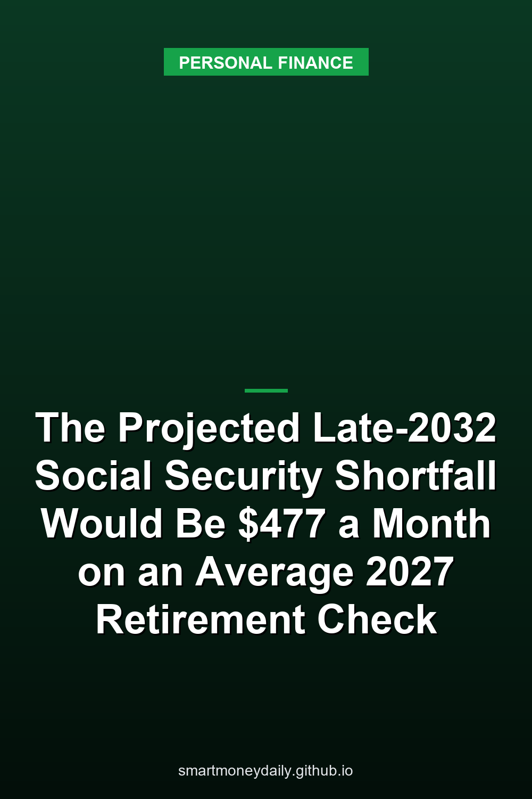

If Congress doesn't change the law, the trust fund that pays Social Security retirement and survivor benefits is projected to run out of reserves in the fourth quarter of 2032. At that point, the [2026 Trustees Report](https://www.ssa.gov/oact/TRSUM/) projects, payroll taxes and the program's other income would cover 78% of scheduled benefits. SSA's [2027 COLA fact sheet](https://www.ssa.gov/news/en/cola/factsheets/2027.html) estimates the average retired worker's check at $2,170 in January 2027. Take 22% off that and it's $477.40 a month, or about $5,729 a year.

The examples in this post hold benefits at those estimated January 2027 levels. Scheduled checks in 2032 will be whatever the law sets after the COLAs between now and then, and the shortfall would apply to those amounts. The date comes from the report the Trustees released on June 9, which is still their latest projection.

The report is blunt about why the date matters: "Under current law, however, these programs are not allowed to pay any benefits beyond what is available from annual income and trust fund reserves, and they cannot borrow." Reserves running out doesn't mean checks stop. It means the program can only pay out what keeps coming in.

## Which payments the 2032 date covers

Social Security has two trust funds, and they're in very different shape.

The Old-Age and Survivors Insurance fund, OASI, pays retirement and survivor benefits. That's the money most retirees and widows and widowers get each month, and it's the fund with the late-2032 date.

The Disability Insurance fund is projected to pay full scheduled benefits through at least 2100, the last year the report looks at. There's a catch for anyone on SSDI who's getting close to full retirement age. SSA says disability benefits "automatically change to retirement benefits when disability beneficiaries become full retirement age," and retirement benefits are what the OASI fund pays.

Supplemental Security Income isn't paid from either fund. SSA says SSI comes out of general tax revenue and that Social Security payroll taxes "do not fund the SSI program," so the trust fund dates aren't about SSI.

You may also have seen 2034. That's what you get if the two Social Security funds are treated as one: full benefits until the third quarter of 2034, then 83% payable. The Trustees point out the funds "could not actually be combined unless there were a change in the law."

Medicare's hospital fund, which pays for Part A, has its own date. Its reserves are projected to run out in the second quarter of 2033, when income would cover 89% of scheduled benefits. Parts B and D are financed differently, with premiums and federal money reset every year to cover costs.

## The 22% in dollars

The table takes SSA's estimated January 2027 averages and the maximum for someone retiring at full retirement age, then takes 22% off each. That's an illustration. The Trustees' 78% is the share of total scheduled benefits that income would cover, and the report doesn't say how a smaller payout would be divided among beneficiaries. The projection doesn't point to any reduction in 2027.

| Household (SSA estimate, January 2027) | Scheduled monthly check | At 78% | Monthly gap | Yearly gap |
|---|---|---|---|---|
| All retired workers, average | $2,170 | $1,692.60 | $477.40 | $5,728.80 |
| Aged couple, both receiving, average | $3,355 | $2,616.90 | $738.10 | $8,857.20 |
| Aged widow(er) alone, average | $2,005 | $1,563.90 | $441.10 | $5,293.20 |
| Maximum, retiring at full retirement age in 2027 | $4,188 | $3,266.64 | $921.36 | $11,056.32 |

The 78% is the projected share at the time OASI reserves run out in late 2032, and it doesn't stay there. Under current law the report has it sliding to 62% by 2100. It's measured against all scheduled benefits, including those of people already collecting.

## Your deposit can drop by more than 22%

Medicare's own payment page says most people have the Part B premium deducted automatically from their Social Security payment. That premium is a flat dollar amount, so if the benefit shrank and the premium didn't, the deposit would shrink by a bigger percentage than the benefit.

A hypothetical example, using 2026 figures on both sides since the 2027 Part B premium hadn't been announced as of Nov. 14: the fact sheet's pre-COLA estimate for retired workers is $2,095, and CMS set the 2026 standard Part B premium at $202.90. Subtracting only that premium leaves a deposit of $1,892.10. At 78%, the benefit would be $1,634.10, and after the same premium the deposit would be $1,431.20. That's $460.90 less, or 24.4% of the deposit, while the benefit itself fell 22%.

That only works this way when an unchanged premium comes out of the check. For the same benefit, a larger premium, such as the income-based one higher earners pay, makes the percentage drop in the deposit bigger. In this example, if nothing were deducted from the benefit, the deposit would fall by the same 22%.

## Claiming at 62 won't get you around it

Filing before 2032 doesn't lock in a full check for the years after it. The projection is a share of total scheduled benefits, and it doesn't single out people by when they claimed.

What early filing does change is known right now. For anyone born in 1960 or later, full retirement age is 67. On SSA's [early retirement page](https://www.ssa.gov/benefits/retirement/planner/agereduction.html), a $1,000 benefit at 67 becomes $700 when started at 62, a 30% reduction. Whatever happens with the trust fund, that reduction comes with filing early.

## Why the outlook got worse

The Trustees pinned this year's worse long-term numbers on lower assumed birth rates and immigration, and on the One Big Beautiful Bill Act. The tax law matters because the trust funds get less revenue from income tax on Social Security benefits when tax rates are lower and deductions are bigger, including the temporary extra deduction for people 65 and over.

## Covering the gap from savings

If a 22% reduction applied to the average check and stayed at that size, five years of the gap comes to $28,644 at January 2027 benefit levels. For an average couple where both receive benefits, it's $44,286. Ten years doubles both, to $57,288 and $88,572. Those figures leave out interest and any future COLAs, which pull in opposite directions.

Money set aside for that has a tax wrinkle if you're already collecting. The IRS test for taxing benefits adds half your benefits to your other income, interest included, so a bigger cushion paying a decent rate can raise the taxable share of your benefits years before 2032. I went through that test in [Does Savings Interest Make Your Social Security Taxable](/2026/10/11/does-savings-interest-make-your-social-security-taxable/).

## What I'd do with the 78% figure

I'd put it in the budget as a rough check. If your Social Security statement shows $2,400 a month at 67, run your budget for the years after 2032 with $1,872 and see how big the hole is. If it's small, you may not need to change much. If it's big, you have a savings target and a rough date to aim at.

I don't think the projection alone is a reason to change when you claim. Congress could still change taxes, benefits or both before then, and I have no way to guess which. The 2032 date and the 78% get updated in the next Trustees Report, which the law says is due by April 1, 2027. This year's arrived on June 9.

## Further Reading

- [The IRA Limit Stays at $7,500 for 2027 While the 401(k) Limit Rises $1,000 to $25,500](/2026/11/16/the-ira-limit-stays-at-7500-for-2027-while-the-401k-limit-rises-1000-to-25500/)
- [October CPI Has No Official Annual Inflation Rate. Unofficial Estimates Give 3.7% and 4.0%](/2026/11/15/october-cpi-has-no-official-annual-inflation-rate-unofficial-estimates-give-37-and-40/)
- [Credit Card Limits Reached $5.67 Trillion in Q3. In 2008-2010 They Fell by $1.04 Trillion](/2026/11/14/credit-card-limits-reached-567-trillion-in-q3-in-2008-2010-they-fell-by-104-trillion/)
- [Households Put a 31.6% Chance on Higher Savings Rates in October, the Most Since April 2023](/2026/11/13/households-put-a-316-chance-on-higher-savings-rates-in-october-the-most-since-april-2023/)
- [FinCEN Drops Its $250 Plan for Transfers Abroad: The $3,000 Wire Rule Stays, and Paying in Cash Costs 1%](/2026/11/12/fincen-drops-its-250-plan-for-transfers-abroad-the-3000-wire-rule-stays-and-paying-in-cash-costs-1/)

