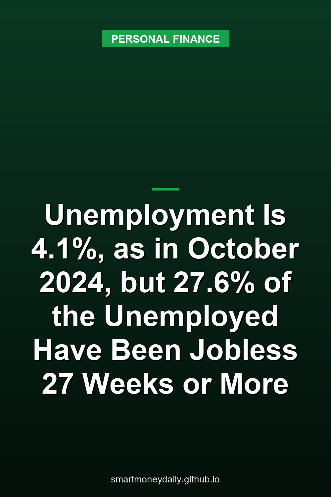

In October, 7.1 million people in the U.S. were unemployed, and 27.6% of them had been jobless for 27 weeks or more. That's the group the Bureau of Labor Statistics calls the long-term unemployed, and its share was the highest since December 2021. The unemployment rate, 4.1%, was the same as in October 2024, when the long-term share was 22.8%.

If you're deciding how big an emergency fund should be, the long-term share deserves more attention than the rate. The unemployment rate is the unemployed share of the labor force. The duration figures show how long the people counted as unemployed had been out of work, and those stretches are longer than they were in October 2024 at the same rate. The numbers here come from the BLS [Employment Situation release for October](https://www.bls.gov/news.release/archives/empsit_11062026.htm), published Nov. 6, and from the BLS database for earlier years.

## Two Octobers with the same 4.1%

There's no October 2025 household data to compare. As the release puts it, "Data for October 2025 were not collected due to the federal government shutdown." October 2024 is the most recent earlier October with the same headline rate, and I added October 2019 as a pre-pandemic reference.

| Seasonally adjusted | Oct. 2019 | Oct. 2024 | Oct. 2026 |
|---|---|---|---|
| Unemployment rate | 3.6% | 4.1% | 4.1% |
| Median weeks unemployed | 9.0 | 10.2 | 11.9 |
| Average weeks unemployed | 22.4 | 22.9 | 27.1 |
| Share unemployed 15 weeks or more | 37.5% | 40.3% | 45.1% |
| Share unemployed 27 weeks or more | 21.9% | 22.8% | 27.6% |

The 5-to-14-week share was 5.2 percentage points smaller than in October 2024, and the share at 27 weeks or more was 4.8 points larger. The share unemployed less than five weeks barely changed, 30.1% then and 30.5% now. These are snapshots of two different groups of people, not the same people moving from one bracket to the next, but a larger share of today's unemployed sits at the long end.

The averages point the same way. The last month with an average duration above 27.1 weeks was December 2021, and the median was last above 11.9 weeks in November 2021. This isn't a one-month jump, either. The long-term share has been 27% or higher in five of the last six months: 27.5% in May, 27.3% in June, 25.5% in July, 27.0% in August, 27.1% in September and 27.6% in October. From January through April of this year, it ran between 24.7% and 25.4%.

## Why 27.1 weeks isn't a typical search

It's easy to read the average as "a job search takes about six months now." That's not what it measures. On its [definitions page](https://www.bls.gov/cps/definitions.htm), BLS says duration counts the weeks unemployed people have been continuously looking for work, including the survey week, and that the average and median "reflect the still-in-progress spells of unemployment, not completed spells." For people on temporary layoff waiting to be recalled, it counts the weeks they've been on layoff instead. Someone counted in week 8 this October might start a job in week 9 or still be looking in week 40. These figures don't show how long the spells end up lasting.

The average, 27.1 weeks, is more than twice the 11.9-week median, so a group of very long spells is pulling it up. Half of the unemployed had been out 11.9 weeks or less, about 2.7 months. At the other end, 45.1%, or 3.2 million people, had been unemployed 15 weeks or more. That's past the three-month mark a lot of emergency-fund advice starts from.

At about 6.2 months, the 27.1-week average isn't a forecast for any one person's search. It's still a good reason not to size a fund only for a quick turnaround.

## Claims equal about a quarter of the jobless count

The Labor Department's [fact sheet on unemployment insurance](https://oui.doleta.gov/unemploy/docs/factsheet/UI_Program_FactSheet.pdf) says each state sets its own eligibility rules, but you usually qualify if you're "unemployed through no fault of your own," meet the state's work and wage requirements for a "base period," and meet any other state requirements. Among the common reasons for a denial, it lists quitting without good cause and being fired for misconduct.

The household survey sorts the unemployed by why they're out of work. In October, 45.2% had lost a job or finished a temporary one, 10.9% had quit, 32.8% were coming back into the labor force and 11.1% were looking for their first job. Those categories don't decide who qualifies, since states apply their own work, wage and separation rules, but they show how mixed the group is.

The weekly claims report the Labor Department released Nov. 12 put insured unemployment in regular state programs at 1,695,000, seasonally adjusted, for the week ending Oct. 17. That's the week the October household survey covered, and the survey's published estimate of unemployed people for that week was 7,068,000 (the release rounds it to 7.1 million). Regular state continuing claims came to about 24 for every 100 people the survey counted as unemployed.

That's a comparison of two totals, not a measured share of unemployed people getting benefits. The claims figure tallies weekly benefit claims rather than individual people, and it comes from state agencies, not the household survey. Even so, the gap is wide enough that I wouldn't build a plan that depends on benefits.

The fact sheet also says:

- "Benefits can be paid for a maximum of 26 weeks in most States."
- It "generally takes two to three weeks after you file your claim to receive your first benefit check," and some states have a one-week waiting period.
- Benefits are subject to federal income tax and most state income taxes.

Extended Benefits, which the fact sheet says "may be available during times of high unemployment," wasn't switched on anywhere. The weekly report said no state was triggered "on" for the program during the week ending Oct. 24. Being unemployed 27 weeks or more puts a person past the 26-week maximum most states list, though the duration figure can't tell who actually collected benefits or used them up. About 2.0 million people were in that group.

## A $4,000-a-month budget at three search lengths

Here's how those durations turn into a dollar target. Take a household that spends $4,000 a month on essentials, about $923 a week. I ran two cases. In one there are no unemployment benefits. In the other, benefits cover half of the essential costs for up to 26 weeks, after one unpaid waiting week. Both are assumptions for the example, not typical benefit amounts; a state's formula and the worker's past wages set the real figure. The table leaves out any tax owed on the benefits. (I went through how to count essential expenses in [an earlier post on sizing the fund](/2026/05/09/emergency-fund-basics-how-much-should-you-really-save/).)

| Search length | In months | Fund needed, no benefits | Fund needed, benefits cover half |
|---|---|---|---|
| 12 weeks (near October's median) | 2.8 | $11,077 | $6,000 |
| 27 weeks (near October's average) | 6.2 | $24,923 | $12,923 |
| 39 weeks | 9.0 | $36,000 | $24,000 |

Three months of essentials is $12,000 in this example. Under the benefit assumption, $12,000 covers 25 weeks, so a 27-week gap needs another $923. Without benefits, $12,000 lasts 13 weeks. Six months of essentials, $24,000, covers 39 weeks with benefits and 26 weeks without.

Search length moves the total the most. Going from 12 weeks to 39 adds $24,923 without benefits and $18,000 with them. At 27 and 39 weeks, the assumed benefits cut the amount needed from savings by $12,000, the full 26 weeks at half of essential costs. If you aren't sure you'd qualify, I'd plan from the no-benefits column.

Taxes can shrink the benefit side. Unemployment compensation is generally taxable even if nothing is withheld. The IRS lets you request federal withholding with Form W-4V, the year's total is reported on Form 1099-G, and without withholding you may need to make quarterly estimated payments. How much tax is actually due depends on the rest of the household's return, but whatever goes to tax has to be replaced from savings.

## Where I'd keep a fund that size

Even when benefits come through, the first check usually takes two to three weeks after filing. My own choice would be at least a month of essential costs in a savings account that can move money to checking the same day or the next.

In the 39-week example with benefits, the household draws about $12,923 from the fund in the first 27 weeks (the waiting week at full cost, then 26 weeks at half), and the last $11,077 isn't needed until week 28. That timing only holds under the benefit assumption. Without benefits, the same $12,923 is gone after 14 weeks.

So the later money could sit somewhere a little less liquid, as long as it stays insured. A layoff can come at any time, and a single CD bought today may mature after the money is needed. A ladder of short CDs maturing every few months can help, as long as enough cash stays available between maturities to cover the bills. A [no-penalty CD](/2026/08/28/no-penalty-bump-up-and-add-on-cds-when-the-variants-pay/) is another option. If there's a chance you'll need the cash before a CD matures, the [early withdrawal penalty](/2026/09/22/cd-early-withdrawal-penalties-the-disclosure-and-the-deduction/) is worth comparing with the extra interest. On a short CD, the penalty can take back more than the CD earned over a savings account.

The $1,000 emergency personal expense distribution from a 401(k), if your plan offers it, won't go far against a gap this long. It skips only the 10% early-withdrawal tax, not income tax, and it's limited to one a calendar year, as I explained in [October's post on that rule](/2026/10/10/the-1000-emergency-401k-withdrawal-vs-your-savings-account-the-rules/).

With the long-term share at 27% or more in five of the last six months, I'd size a fund for a search longer than the median.

## Further Reading

- [The Projected Late-2032 Social Security Shortfall Would Be $477 a Month on an Average 2027 Retirement Check](/2026/11/17/the-projected-late-2032-social-security-shortfall-would-be-477-a-month-on-an-average-2027-retirement-check/)
- [The IRA Limit Stays at $7,500 for 2027 While the 401(k) Limit Rises $1,000 to $25,500](/2026/11/16/the-ira-limit-stays-at-7500-for-2027-while-the-401k-limit-rises-1000-to-25500/)
- [October CPI Has No Official Annual Inflation Rate. Unofficial Estimates Give 3.7% and 4.0%](/2026/11/15/october-cpi-has-no-official-annual-inflation-rate-unofficial-estimates-give-37-and-40/)
- [Credit Card Limits Reached $5.67 Trillion in Q3. In 2008-2010 They Fell by $1.04 Trillion](/2026/11/14/credit-card-limits-reached-567-trillion-in-q3-in-2008-2010-they-fell-by-104-trillion/)
- [Households Put a 31.6% Chance on Higher Savings Rates in October, the Most Since April 2023](/2026/11/13/households-put-a-316-chance-on-higher-savings-rates-in-october-the-most-since-april-2023/)

