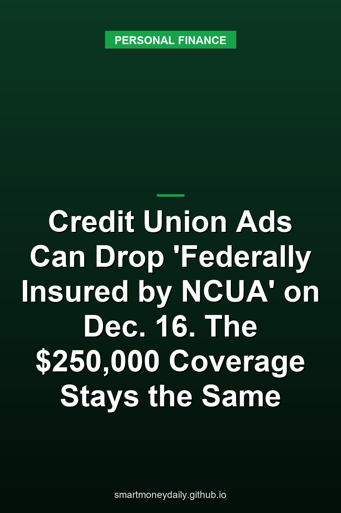

On November 16 the Federal Register published a short [final rule](https://www.federalregister.gov/d/2026-23288) from the [National Credit Union Administration](https://ncua.gov/consumers/share-insurance-coverage) that deletes one section of its advertising regulation, 12 CFR 740.5. That's the section that made every federally insured credit union put "Federally insured by NCUA," or one of its approved variants, in most of its ads. The rule takes effect 30 days after publication, which works out to Wednesday, December 16, 2026. From then on, a federally insured credit union can run a share certificate ad on a billboard, in a mailer or on social media without a word about its federal insurance.

The insurance itself stays the same. Single-ownership accounts are still covered up to $250,000 per member at each federally insured credit union, other ownership categories keep their own limits, the official NCUA sign still has to be posted at teller windows, and it still has to appear on the web pages where a credit union takes deposits or opens accounts. What changes is what an ad has to tell you. If you shop promotional certificate rates, that's worth a few minutes before December 16.

## The line that goes away, and what stays

Section 740.5 lets a credit union pick from four forms of the statement: "This credit union is federally insured by the National Credit Union Administration," "Federally insured by NCUA," "Insured by NCUA," or a reproduction of the official sign. It applies to "all of its advertisements, including on its main internet page," with a long list of exceptions. Radio and TV spots of 30 seconds or less were already exempt, and so were pens, key chains and calendars, ads that don't name the credit union, and ads about loans rather than member accounts.

The final rule deletes all of that and rewrites the scope section, 740.0, to match. The definitions in 740.1 stay, and so do the three sections that matter most to a saver.

Section 740.4 still requires the official sign "at each station or window where insured account funds or deposits are normally received" in the main office and every branch, and on the credit union's internet page "where it accepts deposits or open accounts." The preamble says the agency "treats mobile banking applications similar to internet pages," with the sign required "on the main page and the log-on screen where members identify themselves to conduct transactions online," and on a membership application page.

Section 740.2 still bars any advertising that's "inaccurate or deceptive in any particular." The Board gives an example: an ad that calls the credit union NCUA-insured while also promoting products that aren't insured should make clear which product isn't covered.

Section 740.3 still says any ad that mentions share insurance from someone other than the NCUA has to name the carrier and the type and amount of coverage, and can't suggest the carrier is tied to the NCUA or the federal government.

## Why the requirement outlived its law

The statute changed first. Before 2005, section 205(a) of the Federal Credit Union Act required every federally insured credit union to state in its advertisements that member accounts were insured by the NCUA. The Federal Deposit Insurance Reform Act of 2005 kept the sign requirement and dropped the advertising one. The NCUA's 2006 rule didn't take the advertising statement out of Part 740, so the regulation kept a requirement the statute no longer contained. Later rules in 2008, 2011, 2018 and 2020 tinkered with its wording and exemptions instead of removing it.

The NCUA proposed the deletion on December 29, 2025. When comments closed on February 27, 2026, it had 19, and the Board adopted the proposal without change. Two individuals and a banking trade group objected, arguing that dropping the line could blur the difference between insured credit unions and uninsured platforms that look like them. The Board said it "understands that there is a potential for additional consumer confusion," but that the sign at teller windows and on account pages gives members notice "at the key points of transaction and interaction." The ad statement "may contribute to some consumers' understanding of federal share insurance," it wrote, but the Board does not believe "it materially enhances member protection in a way that justifies the associated compliance costs."

Credit unions can keep using the statement if they want to, and the Board says it expects many will.

## Banks still have to say "Member FDIC"

Banks are on a different rulebook. 12 CFR 328.6 still requires the official advertising statement, "Member of the Federal Deposit Insurance Corporation" or a short form such as "Member [FDIC](https://www.fdic.gov/resources/deposit-insurance)" or "FDIC-Insured," in ads that promote deposit products or general banking services, with a list of exceptions. Separately, the FDIC's digital sign rule puts an FDIC sign on a bank's homepage, login page and first account-opening screen, with compliance due April 1, 2027. We went through that rule in [the FDIC sign on your bank's login page](/2026/09/29/the-fdic-sign-on-your-banks-login-page-what-the-2026-rule-requires/).

So after December 16, a bank's CD ad still has to carry the FDIC statement or symbol unless it fits one of the exceptions, while a federally insured credit union's certificate ad next to it may leave its insurance out. That difference says nothing about the credit union's coverage. It only tells you which rulebook the ad was written under.

## Privately insured credit unions still have to disclose

Federal law treats a missing federal guarantee differently from a present one. Under 12 U.S.C. 1831t(b), a depository institution "lacking Federal deposit insurance" has to put a notice that it's "not federally insured" in all of its advertising, with narrow exceptions, on its main internet page, and at each window where it takes deposits. Its periodic statements, signature cards and share certificates must carry the same "not federally insured" notice plus a warning that "if the institution fails, the Federal Government does not guarantee that depositors will get back their money." And a new depositor generally has to sign a written acknowledgment of both points before the institution can accept a deposit.

The NCUA's consumer site says "some deposits at state-chartered credit unions are insured by private insurers," and that this coverage isn't "backed by the full faith and credit of the United States government." Federal credit unions are insured by the NCUA. State-chartered ones "may or may not be insured by NCUA."

Put those together and reading a credit union ad after December 16 gets simpler, if less reassuring. A "not federally insured" notice is still required and still tells you what it says. An NCUA statement that a credit union chooses to keep has to be accurate under 740.2. A missing one, though, won't tell you anything, and with so many ads exempt even before the change, it never told you much.

## A check that doesn't depend on ads

1. Open the page where you'd log in or apply. The official sign is required there, and the agency reads that to include an app's log-on screen. A privately insured credit union, for its part, has to show its "not federally insured" notice on its main internet page.
2. Search the credit union in the agency's Find a Credit Union tool. The NCUA's consumer site points members there to "determine if your credit union is federally insured." Use the official charter name if the ad uses a trade name; 740.2 lets a credit union advertise under a trade name, but the charter name has to appear on certificates, account statements and signature cards.
3. Read what you signed. If an account-opening form had you acknowledge that the institution isn't federally insured, that's your answer.
4. Separate deposits from everything else on the same website. NCUA coverage doesn't extend to "stocks, bonds, mutual funds, life insurance policies, annuities or municipal securities," even when a federally insured credit union sells them, and it doesn't cover safe deposit boxes.

## Where a $250,000 balance goes over on its own

The sign tells you insurance exists. It doesn't watch your balance. The NCUA's coverage counts "principal and any posted dividends through the date of the insured credit union's closing, up to the insurance limit." Dividends that have posted count toward the $250,000.

Here's how that plays out. Say a member has $245,000 in a 12-month share certificate and $4,000 in regular savings, both in her own name at one credit union. That's $249,000, inside the single-ownership limit. If the certificate pays a hypothetical 4% APY and its dividends stay in the certificate, it's worth $254,800 at maturity. With the savings still at $4,000, her single-ownership total is $258,800, and $8,800 of it would sit above the limit if the credit union failed that week. Paying the dividends out to her checking account doesn't help if the checking account is also in her name at the same credit union; it's the same category.

The math in reverse is more useful. If a certificate is the only thing in your name at that credit union, the largest opening deposit that stays fully covered through a one-year term at 4% APY is about $240,384, which is $250,000 divided by 1.04. On a five-year certificate at the same rate, with dividends compounding inside it, the figure drops to $205,481.

There are other ways to hold more at one place. Qualifying joint accounts are insured separately from individual accounts, with each co-owner's share of all joint accounts at that credit union covered up to $250,000; to qualify, each co-owner generally has to have signed the membership or account signature card (share certificates are an exception to that part) and have the same right to withdraw. IRA shares fall in a separate retirement category with its own $250,000. Trust accounts, which include payable-on-death accounts, change on December 1, when revocable and irrevocable trust coverage merge into one category at $250,000 per beneficiary, up to five, for a cap of $1.25 million per owner at each credit union, as covered in [the credit union trust account change](/2026/10/27/credit-union-trust-accounts-change-dec-1-the-125-million-cap-at-each-credit-union/). The NCUA's Share Insurance Estimator handles individual, joint, payable-on-death, living trust and IRA accounts if you'd rather not do the category math by hand.

## The calendar from here

The rule was published in the Federal Register on November 16. The trust account change for credit unions takes effect December 1, and the advertising statement requirement ends December 16. Banks keep "Member FDIC" in their ads, and their digital sign deadline is April 1, 2027.

I don't expect many credit unions to strip the line out right away, since the Board itself expects voluntary use to continue. What I'd stop doing is treating the ad as the check. Before opening a large certificate, I'd look at the account-opening page, run the name through the NCUA's lookup, and leave enough room under $250,000 for a full term of dividends to post.

## Further Reading

- [Unemployment Is 4.1%, as in October 2024, but 27.6% of the Unemployed Have Been Jobless 27 Weeks or More](/2026/11/18/unemployment-is-41-as-in-october-2024-but-276-of-the-unemployed-have-been-jobless-27-weeks-or-more/)
- [The Projected Late-2032 Social Security Shortfall Would Be $477 a Month on an Average 2027 Retirement Check](/2026/11/17/the-projected-late-2032-social-security-shortfall-would-be-477-a-month-on-an-average-2027-retirement-check/)
- [The IRA Limit Stays at $7,500 for 2027 While the 401(k) Limit Rises $1,000 to $25,500](/2026/11/16/the-ira-limit-stays-at-7500-for-2027-while-the-401k-limit-rises-1000-to-25500/)
- [October CPI Has No Official Annual Inflation Rate. Unofficial Estimates Give 3.7% and 4.0%](/2026/11/15/october-cpi-has-no-official-annual-inflation-rate-unofficial-estimates-give-37-and-40/)
- [Credit Card Limits Reached $5.67 Trillion in Q3. In 2008-2010 They Fell by $1.04 Trillion](/2026/11/14/credit-card-limits-reached-567-trillion-in-q3-in-2008-2010-they-fell-by-104-trillion/)

