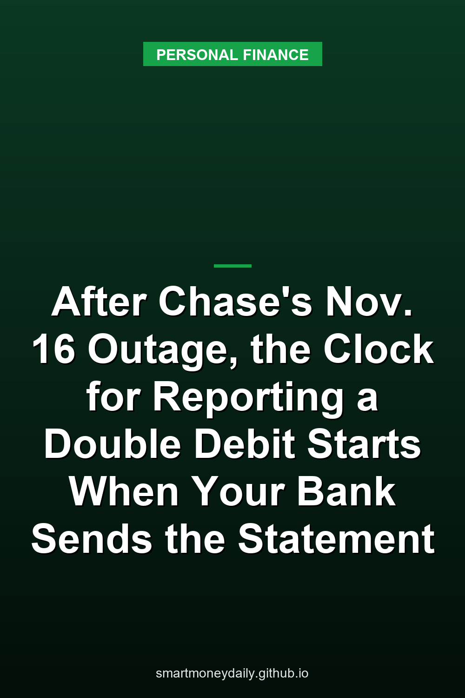

At about 6:30 p.m. Eastern on Monday, Nov. 16, a Chase spokesperson told [NBC News](https://www.nbcnews.com/business/consumer/outages-chase-banking-online-branches-rcna609673) that "Transactions are now posting normally." That ended a day in which JPMorgan Chase said it "experienced a temporary issue related to a software bug in on-premise hardware system," customers reported problems with online and branch transactions, and Zelle payments involving Chase were delayed. By 2 p.m. Eastern, nearly 4,800 people had reported problems with Chase on Downdetector, [CBS News](https://www.cbsnews.com/news/banks-online-service-outages-jpmorgan-chase-bank-of-america-wells-fargo/) reported, more than at any other bank.

Service came back that evening, but a problem from that day can take weeks to surface. The reports so far describe slow transactions, not a confirmed wave of double charges. Still, if you find a payment that went out twice, a deposit that never posted, or an overdraft fee tied to a stuck transfer, the fix runs on federal rules with deadlines. The main one is tied to your bank statement. Under Regulation E, the rule for electronic transfers, your notice generally has to reach the bank within 60 days after it sends the statement that first shows the problem. When check-deposit money becomes available is mostly a Regulation CC question, and a late fee charged by a separate company falls under the Electronic Fund Transfer Act's liability section.

## What broke on Nov. 16

A source familiar with the matter told NBC News the outage began Monday morning, and NBC reported that it affected both online and in-person branch transactions. Chase said it was not "cyber-related" and that "Other banks may have been impacted by slowness in transactions only to the extent that they were a party to a transaction with us." That was Chase's explanation for delays at other banks. Customers of Bank of America, Wells Fargo, U.S. Bank and others also reported problems on Downdetector, though Bank of America told CBS News its "systems were operating normally throughout the day yesterday."

Chase said customers still had access to their accounts and funds, but some transactions were taking longer than normal. Some Chase customers received a message that read, "Some services aren't available. We're working on them. Please try back later." A customer in Texas told CBS News he tried to deposit a check at a Dallas branch, but the transaction couldn't be completed.

Zelle's position was that it wasn't the problem. "Zelle is not down. Zelle is operating as it should," the company told NBC News. "An issue at the financial institutions may be delaying Zelle payments for some of their customers." NBC said it wasn't immediately clear how many Chase accounts were affected. The bank has about 94 million customer relationships in the U.S.

## Which leftovers count as an "error"

Regulation E covers electronic fund transfers, which [12 CFR 1005.3(b)](https://www.ecfr.gov/current/title-12/chapter-X/part-1005/subpart-A/section-1005.3) defines as transfers started "through an electronic terminal, telephone, computer, or magnetic tape" to debit or credit a consumer's account. That generally takes in debit card purchases, ATM withdrawals, direct deposits and person-to-person payments sent from a checking account, Zelle included. Coverage depends on how the money actually moved, though. Section 1005.3(c) leaves out transfers "originated by check" and transfers through Fedwire or a similar wire system used mainly between banks or businesses, so a wire sent that way falls outside these procedures. If a wire got stuck on Nov. 16, ask the bank how it was sent before deciding which rules apply. A check used only as a source of account information for a one-time electronic transfer is covered.

[Section 1005.11(a)](https://www.ecfr.gov/current/title-12/chapter-X/part-1005/subpart-A/section-1005.11) lists what counts as an error. These are the items that would fit a problem left over from an outage:

- "An incorrect electronic fund transfer to or from the consumer's account," such as a payment taken twice or for the wrong amount
- "The omission of an electronic fund transfer from a periodic statement," such as a direct deposit that never appears
- "A computational or bookkeeping error made by the financial institution relating to an electronic fund transfer"
- A request for documentation, or for clarification about a transfer, including one made to find out whether an error happened at all

You don't have to prove an error before raising it, because asking the bank to clarify a transfer you think may be wrong falls under the same section. Some requests don't count: a routine balance inquiry, a request for tax or recordkeeping information, or a request for duplicate copies of documents.

A payment that was slow but arrived in full doesn't prove an error by itself. You can still ask the bank to clarify what happened, and if the delay cost you money, the liability rule further down is the one to read.

## The 60 days start with the statement

Under [section 1005.11(b)(1)](https://www.ecfr.gov/current/title-12/chapter-X/part-1005/subpart-A/section-1005.11), the bank has to follow the error procedures if your notice is received "no later than 60 days after the institution sends the periodic statement" on which the error first appears. The count starts when the bank sends the statement, not when you open it, and your notice has to arrive within the window, not just be mailed. It can be oral or written. It has to let the bank identify your name and account number and say why you think something is wrong, with the type, date and amount if you can. If you call, the bank may ask you to confirm in writing within 10 business days, and it has to tell you that on the call and give you the address.

Banks send a statement for every monthly cycle in which an electronic transfer happened, under section 1005.9(b). The statement that counts is the first one that actually reflects the error. For a Nov. 16 problem that's usually the first statement covering that date, unless the entry posted late. A later correction doesn't restart the 60 days for an error that already appeared. When that statement goes out depends on your cycle. Counting 60 calendar days from the send date:

| Statement that first shows the problem is sent | Last day for your notice to reach the bank |
|---|---|
| Nov. 30, 2026 | Jan. 29, 2027 |
| Dec. 15, 2026 | Feb. 13, 2027 (a Saturday) |
| Dec. 31, 2026 | March 1, 2027 |

If you asked the bank for documentation or clarification about a transfer and then assert an error based on what it sends back, section 1005.11(b)(3) makes that notice timely if it arrives within 60 days after the bank sends the information. None of this means you should wait. You can report a problem the day you see it in your account history, before any statement goes out, and I'd do that. If an error did occur, the bank can't charge you for any part of the error-resolution process, according to the official interpretation of the rule (comment 11(c)-3).

## What your bank has to do, and how fast

Once the bank receives your notice, section 1005.11(c) gives it 10 business days to investigate and decide whether an error occurred. Two more deadlines run separately: it has to report the result within three business days after finishing the investigation, and it has to correct an error within one business day after determining that one occurred.

If it needs more time, it can generally take up to 45 calendar days from receiving your notice, as long as it provisionally credits your account for the disputed amount, "including interest where applicable," within those first 10 business days. It has to tell you about the credit within two business days and let you use the money while it investigates. One catch: if you reported by phone and the bank asked for written confirmation, it doesn't have to provisionally credit you if that confirmation doesn't arrive within 10 business days. The investigation still has to happen. The 10 business days become 20 for transfers made within 30 days after the first deposit to a new account, and the 45 days become 90 for those, for point-of-sale debit card transactions and for transfers not initiated within a state.

The official interpretation (comment 11(c)-6) also covers fees. When the bank finds an error, it must correct it "including, where applicable, the crediting of interest and the refunding of any fees imposed by the institution." An overdraft fee charged only because a payment was debited twice would be a fee the bank imposed because of the error. The same comment says the bank "need not refund fees that would have been imposed whether or not the error occurred," so a monthly service fee you'd have paid anyway stays.

If the bank decides there was no error, or a different one, it has to give you a written explanation and, if you ask, copies of the documents it relied on. If it reverses a provisional credit, it has to tell you and, for five business days after that, honor checks and preauthorized payments without overdraft fees, but only the items it would have paid if the provisional credit hadn't been taken back.

## When the damage is a late fee from someone else

Regulation E's refund duty covers fees your own bank charged. A late fee from a separate landlord or card issuer is a different problem, and the law that speaks to it is the Electronic Fund Transfer Act itself. [15 U.S.C. 1693h(a)](https://www.law.cornell.edu/uscode/text/15/1693h) makes a financial institution liable "for all damages proximately caused by" its failure to make a transfer "in accordance with the terms and conditions of an account, in the correct amount or in a timely manner when properly instructed to do so." There are exceptions, such as insufficient funds. But a transfer that failed for lack of funds is still on the bank if the bank didn't credit a deposit that would have covered it, under subsection (a)(2).

Subsection (b) gives the bank two defenses that could come up after an outage, and the bank has to prove either one by a preponderance of the evidence. The first covers a failure caused by "an act of God or other circumstance beyond its control," if the bank also shows it took reasonable care to prevent it and acted with the diligence the circumstances required. The second covers "a technical malfunction which was known to the consumer at the time he attempted to initiate" the transfer, or, for a preauthorized transfer, at the time it should have happened. If the failure wasn't intentional and came from a bona fide error despite reasonable procedures, subsection (c) limits the bank to "actual damages proved."

How that plays out depends on the facts. If you saw an error message and tried a payment anyway, the bank may point to the known-malfunction defense. Its accepting your instruction doesn't by itself rule that defense out either. Whether a bug in the bank's own system counts as beyond its control, or as a malfunction you knew about, is something the bank would have to prove, not something you have to disprove. Asking the payee to waive the fee and sending the bank a written reimbursement request, with dates and amounts, are both open to you, and neither rules out the other.

## Check deposits run on a separate rule

When a check is deposited and collected as a check, how soon you can use the money falls under Regulation CC. The Dallas customer's attempt, as reported, never went through, and the availability clock starts only once a deposit is actually made. Normally an ordinary local check has to be available by the second business day after the banking day of deposit, under [12 CFR 229.12(b)](https://www.ecfr.gov/current/title-12/chapter-II/subchapter-A/part-229/subpart-B/section-229.12).

[Section 229.13(f)](https://www.ecfr.gov/current/title-12/chapter-II/subchapter-A/part-229/subpart-B/section-229.13) lets a bank set those deadlines aside for check deposits during "an interruption of communications or computer or other equipment facilities," if it "exercises such diligence as the circumstances require." The funds still have to be released no later than a reasonable period after the emergency ends or the normal deadline, whichever is later. For an ordinary local check, the rule defines that reasonable period as an extension of up to five business days, and the bank has the burden of showing a longer one is reasonable. The notice for this exception has to come "in a reasonable form and within a reasonable time given the circumstances," with the reason and the date the funds will be available. The bank can leave the date out if, in good faith, it doesn't know how long the emergency will last, and it doesn't have to send a notice at all if the money becomes available before one would be due.

Direct deposits work differently. Under 12 CFR 229.10(b), an electronic payment has to be available by the next business day after the banking day the bank receives it, and "receives" means the bank has both the money in final form and the account information. If a direct deposit hasn't posted, ask the payer when it was sent and ask the bank whether it arrived. If the bank received it and it's missing from your statement, that's an omission under Regulation E's error process, not a check-hold question.

## What I'd do this week

Go through the account history for Nov. 16 and 17 now rather than waiting for the statement. Match each entry by date, amount, payee and status. A pending hold sitting next to a posted debit doesn't prove a double charge by itself, but you don't have to wait for both to post before asking the bank to clarify a suspected duplicate. Save screenshots of anything odd, along with any error messages you got that day.

Before retrying a payment that still shows as pending, confirm what happened to the first one. If both instructions go through, you've made two payments, and two payments you authorized aren't the same thing as one payment the bank ran twice. When a bill was due on Nov. 16 and the transfer still hasn't landed, I'd call the payee and then the bank before sending it again.

For an error in an electronic transfer, I'd report it in writing through the channel the bank names for disputes, with your name, account number, the date, amount and payee, and why you think it's wrong. Keep proof of when the bank received it, since the investigation clock (usually 10 business days, 20 for a transfer within 30 days of a new account's first deposit) runs from that day. Regulation E counts business days as days the bank's offices are open to the public for substantially all business, so at a bank that's closed on Thanksgiving, Nov. 26 doesn't count. Once the 10 or 20 business days from the bank's receipt have passed, ask whether it has finished its investigation or made any required provisional credit.

Keep a copy of whatever you send and the bank's confirmation that it arrived. If the statement that first shows the problem goes out on Nov. 30, Jan. 29 is the date I'd have on the calendar, and I'd want the notice in well before it.

## Further Reading

- [Non-Itemizers Can Deduct Up to $1,000 of 2026 Cash Gifts, $2,000 Jointly. Donor-Advised Funds Don't Count](/2026/11/20/non-itemizers-can-deduct-up-to-1000-of-2026-cash-gifts-2000-jointly-donor-advised-funds-dont-count/)
- [Credit Union Ads Can Drop 'Federally Insured by NCUA' on Dec. 16. The $250,000 Coverage Stays the Same](/2026/11/19/credit-union-ads-can-drop-federally-insured-by-ncua-on-dec-16-the-250000-coverage-stays-the-same/)
- [Unemployment Is 4.1%, as in October 2024, but 27.6% of the Unemployed Have Been Jobless 27 Weeks or More](/2026/11/18/unemployment-is-41-as-in-october-2024-but-276-of-the-unemployed-have-been-jobless-27-weeks-or-more/)
- [The Projected Late-2032 Social Security Shortfall Would Be $477 a Month on an Average 2027 Retirement Check](/2026/11/17/the-projected-late-2032-social-security-shortfall-would-be-477-a-month-on-an-average-2027-retirement-check/)
- [The IRA Limit Stays at $7,500 for 2027 While the 401(k) Limit Rises $1,000 to $25,500](/2026/11/16/the-ira-limit-stays-at-7500-for-2027-while-the-401k-limit-rises-1000-to-25500/)

