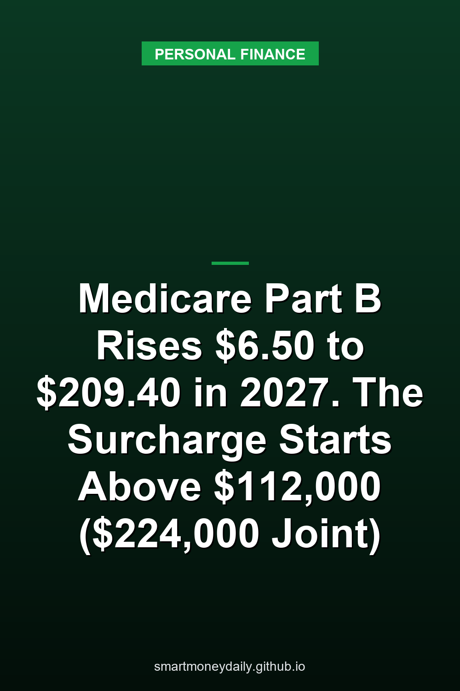

On November 17, CMS set the standard Medicare Part B premium for 2027 at $209.40 a month, up $6.50 from $202.90. The yearly Part B deductible goes from $283 to $292. Both figures are in the agency's [2027 premiums fact sheet](https://www.cms.gov/newsroom/fact-sheets/2027-medicare-parts-b-premiums-deductibles) and in the formal notice, [CMS-8094-N](https://public-inspection.federalregister.gov/2026-23601.pdf), filed at the Federal Register the same day. Next to the 3.6% Social Security raise announced in October, the increase is small. On SSA's estimate for the average retired worker, the benefit goes from $2,095 to $2,170, and the amount left after Part B is $68.50 a month higher, before SSA's rounding and any other deductions.

For people with higher incomes the numbers get bigger. For 2027, the income-related surcharge, which CMS says affects roughly 9% of people with Part B, starts above $112,000 of modified adjusted gross income on an individual return and $224,000 on a joint return. That income figure generally comes from 2025 tax returns, and taxable interest from savings accounts, CDs and Treasury bills reported for 2025 is part of it.

## The 2027 numbers next to 2026

| | 2026 | 2027 |
|---|---|---|
| Standard Part B premium, monthly | $202.90 | $209.40 |
| Part B deductible, yearly | $283 | $292 |
| Part A hospital deductible, per benefit period | $1,736 | $1,776 |
| Surcharge starts above (individual / joint return) | $109,000 / $218,000 | $112,000 / $224,000 |
| First Part B surcharge tier, monthly | $81.20 | $83.70 |
| Part B enrollees paying a surcharge (CMS estimate) | roughly 8% | roughly 9% |

CMS says the increase is "mainly due to projected increases in healthcare spending." The standard premium is set at half of the monthly actuarial rate for enrollees 65 and older. That rate rose to $418.70 from $405.40, and half of it is $209.35, published as $209.40. The deductible moves by the same ratio: $283 times $418.70 divided by $405.40 is $292.28, rounded to $292. At 3.2%, the 2027 increase is about a third of the 2026 one, when the premium rose $17.90, or 9.7%.

The 2027 premium also drops a small add-on. Since 2016 the premium had carried a repayment amount to pay back Treasury money that kept the 2016 and 2021 premiums lower. The 2026 notice set it at $0.20 and called that the final amount, and the 2027 notice adds no repayment amount to the premium.

## What changes in a January Social Security deposit

Most people have the Part B premium taken out of their Social Security payment, according to Medicare's [premium payment page](https://www.medicare.gov/basics/costs/pay-premiums). The notice explains the timing. Social Security pays each month's benefit in the following month, and the premium taken out of a payment is the one for the month it arrives. So the first payment in January 2027 is the December benefit, already raised by the 3.6% COLA, with January's $209.40 premium subtracted. Both changes land in the same deposit.

The table below is a simple subtraction from the averages in SSA's [2027 COLA fact sheet](https://www.ssa.gov/news/en/cola/factsheets/2027.html). It assumes each person pays the standard premium, and it comes before SSA's rounding and any other deductions.

| Household (SSA estimate) | Benefit before COLA | Benefit after COLA | Before COLA, minus $202.90 each | After COLA, minus $209.40 each | Monthly change |
|---|---|---|---|---|---|
| Average retired worker | $2,095 | $2,170 | $1,892.10 | $1,960.60 | +$68.50 |
| Aged couple, both receiving benefits (both assumed on Part B) | $3,238 | $3,355 | $2,832.20 | $2,936.20 | +$104.00 |

These are averages, not anyone's check. Part D or Medicare Advantage premiums, tax withholding and other deductions also come out of some payments. SSA's October release says the 2027 premium amount will show up in the my Social Security Message Center starting in late November, and people who haven't signed up for online notices get their COLA letter by mail in December. Your own figures are in that notice.

## Who the hold-harmless rule protects

[Section 1839(f) of the Social Security Act](https://www.law.cornell.edu/uscode/text/42/1395r), which the notice calls the hold-harmless provision, keeps a premium increase from shrinking a person's net Social Security payment. SSA compares the December benefit after January's premium with the November benefit after December's premium, and it uses the premium you actually paid in December. If your COLA raise in dollars is smaller than the premium increase, the premium goes up only as far as the raise allows. For someone paying the standard $202.90 now, that rarely binds: the full increase is $6.50, and the average retired worker's raise is $75.

It matters more for people who were already paying less than the standard premium because of this rule in an earlier year. Leaving aside any late-enrollment penalty, their January premium can rise by more than $6.50, but not by more than their COLA raise, and not past $209.40.

The protection has conditions. Under the statute and the notice, you have to be entitled to Social Security benefits, or to a Railroad Retirement annuity, for November and December, with your Part B premiums for December and January deducted from those payments. It doesn't cover anyone who pays an income-related surcharge. People who pay Medicare by bill, or whose premiums aren't yet coming out of their benefits, aren't covered by it either.

## The surcharge looks at 2025, and interest counts

SSA decides who pays the surcharge, often called IRMAA, using modified adjusted gross income from your federal return. [20 CFR 418.1010](https://www.law.cornell.edu/cfr/text/20/418.1010) defines that as adjusted gross income plus certain tax-exempt income, beginning with tax-exempt interest. Taxable interest from savings accounts, CDs and Treasury bills held outside retirement accounts is already in adjusted gross income for the year it's reported. Tax-exempt municipal bond interest gets added back. Under [20 CFR 418.1135](https://www.law.cornell.edu/cfr/text/20/418.1135), SSA uses the tax year two years before the premium year, so 2027 premiums generally follow 2025 income. If 2025 information isn't available from the IRS, SSA may temporarily use 2024 information, and when the 2025 figures come in, a revised determination can apply back to January 2027.

The tiers are cliffs. A dollar over a line brings the whole amount for the next tier.

| 2025 MAGI, individual return | 2025 MAGI, joint return | Part B total, monthly | Part D add-on, monthly |
|---|---|---|---|
| $112,000 or less | $224,000 or less | $209.40 | $0 |
| Over $112,000 to $141,000 | Over $224,000 to $282,000 | $293.10 | $15.40 |
| Over $141,000 to $177,000 | Over $282,000 to $354,000 | $418.80 | $39.70 |
| Over $177,000 to $212,000 | Over $354,000 to $424,000 | $544.40 | $64.00 |
| Over $212,000 and under $500,000 | Over $424,000 and under $750,000 | $670.00 | $88.30 |
| $500,000 or more | $750,000 or more | $711.80 | $96.40 |

The Part D add-on is paid on top of the drug plan's own premium. Married people who lived with their spouse at any time during the 2025 tax year but file separately have a shorter scale: over $112,000 goes straight to $670.00 for Part B, and $388,000 or more to $711.80. The notice also says the top lines, $500,000 and $750,000, start rising with inflation in 2028.

Take a hypothetical single retiree with $106,500 of 2025 income from a pension, IRA withdrawals and the taxable part of her Social Security, plus $6,000 of interest from CDs and a high-yield savings account. Her MAGI is $112,500, which puts her $500 into the first surcharge tier. For 2027 that adds $83.70 a month to Part B and, if she has a Part D plan, $15.40 a month for drug coverage. Over the year it's $1,189.20, more than twice what the $500 of income above the line brought in. For a couple with joint 2025 MAGI above $224,000 but no more than $282,000, the combined surcharge is $2,378.40 for 2027 if both have Part B and Part D all year.

## When 2025 doesn't look like your income now

If 2025 was a high-income year and your income has since dropped, SSA can use a more recent year, but only for listed reasons. Under [20 CFR 418.1201](https://www.law.cornell.edu/cfr/text/20/418.1201), you need a major life-changing event that cuts your MAGI enough to lower or remove the surcharge, a request, and evidence. [Section 418.1205](https://www.law.cornell.edu/cfr/text/20/418.1205) lists the events:

- your spouse dies, you marry, or your marriage ends in divorce or annulment
- you or your spouse stop working or cut your hours
- you or your spouse lose income-producing property, when the loss wasn't your choice and wasn't the ordinary risk of investing (a declared disaster, arson, or fraud or theft by a third party, for example)
- you or your spouse are affected by the scheduled end, termination or reorganization of an employer's pension plan
- you or your spouse get a settlement from an employer or former employer because it closed, went bankrupt or reorganized

Retiring counts as stopping work. If your 2025 return still has most of a year's salary on it and you've since retired, that's the situation this rule covers. SSA's website lists the process under "Request to lower IRMAA."

Nothing outside that list qualifies. [Section 418.1210](https://www.law.cornell.edu/cfr/text/20/418.1210) says SSA won't treat other events as life-changing, and names two that don't count: events that change your expenses but not your income, and dividend income lost to the ordinary risk of investment. Savings interest that shrank because rates fell, or because you spent the balance down, isn't on the list either. That's my reading of a closed list rather than a line the regulation spells out, but I wouldn't build a plan on getting an exception for it.

## Paying the premium from a bank account

If you're on Medicare but don't get Social Security or Railroad Retirement Board benefits yet, maybe because you're waiting to claim at 70, Medicare bills you directly. A bill for Part B only, including any Part B surcharge, comes every three months. Part A premiums and the Part D surcharge are billed every month. At the standard rate a quarterly Part B bill is $628.20. In the first surcharge tier it's $879.30.

Medicare Easy Pay takes the premium out of a checking or savings account each month, on the 20th or the next business day, and Medicare's page says the amount "will update automatically when your premium changes." Automatic deductions can take up to 6 to 8 weeks to start, and until they do you pay another way. A payment from a checking or savings account made through your online Medicare account takes about 5 business days to process.

If you have money in a health savings account from your working years, IRS [Publication 969](https://www.irs.gov/publications/p969) lets you use it tax-free for Medicare premiums once you're 65, with one exception: premiums for a Medicare supplement policy such as Medigap. Medicare's payment page lists an HSA card as a way to pay the bill. I covered where HSA cash sits and how it's insured in the [2027 HSA limits post](/2026/10/03/2027-hsa-limits-4500-and-9000-and-where-hsa-cash-is-insured/).

## The deductibles worth keeping cash for

Medicare's [costs page](https://www.medicare.gov/basics/costs/medicare-costs) puts the 2027 Part B deductible at $292 a year. After that you usually pay 20% of the cost of each covered service, as long as the provider accepts assignment. The Part A hospital deductible is $1,776 per benefit period, and the same page notes you can pay it more than once in a year. Under Original Medicare with no supplemental coverage, one Part A deductible plus the full Part B deductible comes to $2,068 in 2027, before any coinsurance. A Medigap policy or a Medicare Advantage plan changes that math, so the plan's own documents are the place to check.

For people with limited income and savings, states run Medicare Savings Programs that can pay the Part B premium. The 2026 asset limits are in [my post on the $9,950 resource limit](/2026/10/06/medicare-savings-programs-the-9950-resource-limit-and-what-counts/).

For most readers, I'd say the $6.50 matters less than where your income sits against those lines. The $112,000 and $224,000 thresholds apply to 2027 premiums. The 2028 thresholds, generally based on 2026 income, haven't been announced. If you're near either line, I'd check which year your interest will be reported in before adding a Roth conversion or a large IRA withdrawal; the [post on T-bills and short CDs](/2026/10/16/t-bills-and-short-cds-bought-now-which-tax-year-gets-the-interest/) walks through the timing. The first date to watch is late November, when the 2027 premium appears in the my Social Security Message Center.

## Further Reading

- [After Chase's Nov. 16 Outage, the Clock for Reporting a Double Debit Starts When Your Bank Sends the Statement](/2026/11/21/after-chases-nov-16-outage-the-clock-for-reporting-a-double-debit-starts-when-your-bank-sends-the-statement/)
- [Non-Itemizers Can Deduct Up to $1,000 of 2026 Cash Gifts, $2,000 Jointly. Donor-Advised Funds Don't Count](/2026/11/20/non-itemizers-can-deduct-up-to-1000-of-2026-cash-gifts-2000-jointly-donor-advised-funds-dont-count/)
- [Credit Union Ads Can Drop 'Federally Insured by NCUA' on Dec. 16. The $250,000 Coverage Stays the Same](/2026/11/19/credit-union-ads-can-drop-federally-insured-by-ncua-on-dec-16-the-250000-coverage-stays-the-same/)
- [Unemployment Is 4.1%, as in October 2024, but 27.6% of the Unemployed Have Been Jobless 27 Weeks or More](/2026/11/18/unemployment-is-41-as-in-october-2024-but-276-of-the-unemployed-have-been-jobless-27-weeks-or-more/)
- [The Projected Late-2032 Social Security Shortfall Would Be $477 a Month on an Average 2027 Retirement Check](/2026/11/17/the-projected-late-2032-social-security-shortfall-would-be-477-a-month-on-an-average-2027-retirement-check/)

