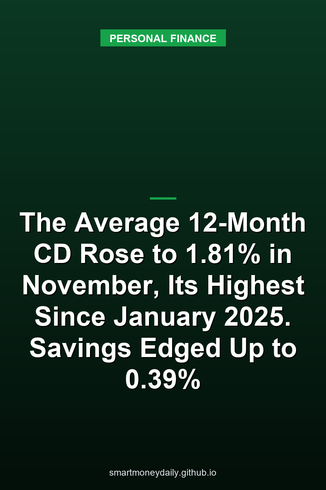

The [FDIC](https://www.fdic.gov/national-rates-and-rate-caps) posted its monthly national rates on November 16, 2026, and the average 12-month CD came in at 1.81%. That's up from 1.76% in October and 1.52% in March, and it's the highest reading since January 2025, when the table showed 1.82%. It has gone up in eight straight monthly releases. Savings accounts averaged 0.39% in the same table, money market accounts 0.64% and interest checking 0.07%.

Savings and checking are essentially where they were a year ago, when the November 2025 table showed 0.40% and 0.07%, and money market accounts are up six hundredths of a point from 0.58%. So the two halves of a bank's deposit menu have been doing different things. CD averages have been climbing since spring, while the savings average has barely moved through a stretch in which the federal funds rate fell and then, after the Fed's [September 16 increase](https://www.federalreserve.gov/newsevents/pressreleases/monetary20260916a.htm), rose again.

## Where the FDIC's averages come from

The national rate isn't a survey of the best offers. The FDIC defines it as "the average of rates paid by all insured depository institutions and credit unions for which data is available, with rates weighted by each institution's share of domestic deposits." Savings and interest checking rates are taken at the $2,500 tier. Money market and CD rates are the average of the $10,000 and $100,000 tiers, and the underlying data comes from S&P Capital IQ Pro.

Two details matter for reading it. Because each bank counts in proportion to its deposits, a bank holding a large share of the country's deposits moves the average far more than a small bank paying a higher rate does. And the figures are already a couple of weeks old when they come out. The FDIC says all published rates and yields "are based on information available on the last business day of the prior month end," so the November 16 table describes rates as of October 30.

## CDs moved, savings didn't

These are the FDIC's figures for selected releases over the past 14 months. The last column is the 12-month Treasury yield the FDIC prints beside the CD average, taken from the same month-end date.

| FDIC release | Savings | Money market | 12-month CD | 12-month Treasury yield |
|---|---|---|---|---|
| Sept. 15, 2025 | 0.40% | 0.59% | 1.70% | 3.83% |
| Jan. 20, 2026 | 0.39% | 0.56% | 1.61% | 3.48% |
| March 16, 2026 | 0.39% | 0.56% | 1.52% | 3.48% |
| June 15, 2026 | 0.38% | 0.61% | 1.65% | 3.79% |
| Sept. 21, 2026 | 0.37% | 0.63% | 1.73% | 4.16% |
| Oct. 19, 2026 | 0.38% | 0.63% | 1.76% | 4.54% |
| Nov. 16, 2026 | 0.39% | 0.64% | 1.81% | 4.36% |

The savings average stayed between 0.37% and 0.40% in every release from September 2025 through November 2026. Over the same releases, the federal funds rate the FDIC uses to set its savings cap went from 4.33% down to as low as 3.62% and then up to 3.88%. A drop of roughly seven-tenths of a point and a quarter-point climb back never pushed the savings average more than three hundredths of a point from where it started.

The CD average behaved differently. It kept sliding until March even though the Treasury yield in the table had stopped falling in January. Both turned up in April, and the CD average hasn't missed a monthly increase since, but the Treasury yield climbed faster. The 60-month CD average tells a similar story at 1.44%, the highest in the FDIC's series since the current weighted method began in April 2021.

## The gap between CDs and Treasury yields

Subtract the CD average from the Treasury yield and you get a gap that widened through most of this year. In March 2026 it was 1.96 percentage points (3.48% against 1.52%). By October it had grown to 2.78 points, the widest since August 2024. In November it narrowed to 2.55 points, mostly because the Treasury yield in the table slipped to 4.36% while the CD average kept rising.

This isn't new behavior. In the November 2022 release, deep into the last run of rate increases, the same table showed a 12-month CD average of 0.90% against a 4.66% Treasury yield. CD averages rose for more than a year after that before they stopped.

My read is that a deposit-weighted average is slow on the way up because the banks holding the most deposits move their posted rates slowly. That's my inference from the weighting and from 2022, not something the FDIC says. It does mean the average is a poor guide to what a bank competing for new CD money will pay this week.

## The Fed's minutes point up

The minutes of the October 27-28 meeting, [released November 18](https://www.federalreserve.gov/monetarypolicy/fomcminutes20261028.htm), explain why CD rates may keep drifting up. Most participants supported holding the target range at 3-3/4 to 4 percent, and two members voted for a quarter-point increase. Looking ahead, "almost all participants judged that, under their baseline outlooks for inflation and the labor market, further action to raise the target range for the federal funds rate ... would likely be appropriate." A couple of participants said an increase of more than 25 basis points "could warrant consideration at the next meeting if incoming inflation data were unfavorable."

The next meeting is December 8-9. Even if rates go up then, the FDIC averages won't show it right away. The December table, due December 21, will describe rates as of November 30. The January table is the first one built on data from after the December meeting, so it's the first that could reflect a December decision. It should come out January 19, 2027, because the third Monday that month is the Martin Luther King Jr. holiday and the FDIC publishes on the next business day when that happens.

## The averages in dollars

Treat each figure as an annual yield and $20,000 left alone for a year earns about $78 at the 0.39% savings average, $128 at the 0.64% money market average and $362 at the 1.81% 12-month CD average. At a hypothetical 4%, the same $20,000 earns $800. The FDIC's number is a deposit-weighted average, not a ceiling, which is why that last line is worth writing out.

Treasury yields aren't directly comparable to those dollars. A Treasury bill quotes its return differently from a bank's APY, and its interest is [exempt from state and local income tax](https://www.treasurydirect.gov/marketable-securities/treasury-bills/), which can change the comparison for someone in a high-tax state. The [Treasury bills vs CDs comparison](/2026/09/23/treasury-bills-vs-cds-the-tax-break-that-changes-the-comparison/) goes through that math.

## The cap column most savers skip

The same FDIC page has a "National Rate Cap" for every product. It's the higher of the national rate plus 75 basis points or 120% of the comparable Treasury yield plus 75 basis points. For savings, money market and checking, the second test uses the federal funds rate plus 75 basis points instead. November's caps are 4.63% for savings and money market accounts, 5.98% for a 12-month CD and 6.40% for a 60-month CD.

Those caps only bind banks that are less than well capitalized, which may not offer rates that "significantly exceed" the market. Such a bank can use a local rate cap instead for deposits gathered in its own market area, if it gives the FDIC evidence of the highest local rate. A well-capitalized bank can pay more. So an offer below the cap tells you nothing about a bank's health, and an offer above it isn't a red flag by itself. What protects the money is [deposit insurance](https://www.fdic.gov/resources/deposit-insurance/understanding-deposit-insurance), which the FDIC describes as covering "at least $250,000 per depositor, per ownership category at each FDIC-insured bank," and that coverage doesn't depend on the bank's capital level.

## What I'd take from November's table

I wouldn't read 1.81% as the going rate for a 12-month CD. It's a deposit-weighted average of the 12-month rates banks were quoting at the end of October, so it sits below what the banks competing hardest for new money pay. If I had a CD coming up for renewal, an offer near the average would be my cue to compare before the grace period runs out, which is the point of [the CD rollover trap](/2026/09/26/the-cd-rollover-trap-your-renewal-rate-is-not-the-market-rate/).

For savings accounts, the last 14 months give me no reason to expect the national average to follow the Fed in either direction. The dates I'm watching are December 8-9 for the Fed, December 21 for the next FDIC table and January 19, 2027 for the first one that could reflect a December decision.

## Further Reading

- [Medicare Part B Rises $6.50 to $209.40 in 2027. The Surcharge Starts Above $112,000 ($224,000 Joint)](/2026/11/22/medicare-part-b-rises-650-to-20940-in-2027-the-surcharge-starts-above-112000-224000-joint/)
- [After Chase's Nov. 16 Outage, the Clock for Reporting a Double Debit Starts When Your Bank Sends the Statement](/2026/11/21/after-chases-nov-16-outage-the-clock-for-reporting-a-double-debit-starts-when-your-bank-sends-the-statement/)
- [Non-Itemizers Can Deduct Up to $1,000 of 2026 Cash Gifts, $2,000 Jointly. Donor-Advised Funds Don't Count](/2026/11/20/non-itemizers-can-deduct-up-to-1000-of-2026-cash-gifts-2000-jointly-donor-advised-funds-dont-count/)
- [Credit Union Ads Can Drop 'Federally Insured by NCUA' on Dec. 16. The $250,000 Coverage Stays the Same](/2026/11/19/credit-union-ads-can-drop-federally-insured-by-ncua-on-dec-16-the-250000-coverage-stays-the-same/)
- [Unemployment Is 4.1%, as in October 2024, but 27.6% of the Unemployed Have Been Jobless 27 Weeks or More](/2026/11/18/unemployment-is-41-as-in-october-2024-but-276-of-the-unemployed-have-been-jobless-27-weeks-or-more/)

