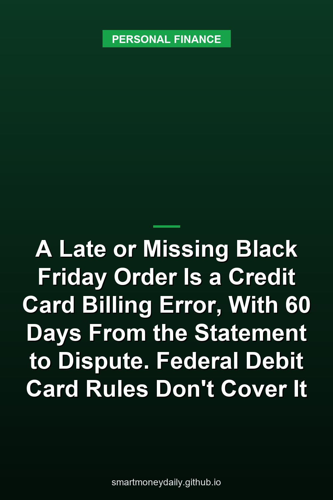

If a TV you order on Black Friday, Nov. 27, never arrives, or shows up three weeks after the date the store promised, the card you paid with decides what happens next. On a credit card, federal rules treat that charge as a billing error. The card issuer has to receive your written notice within 60 days after it sends the first statement showing the charge, and while it investigates, you don't have to pay that amount. On a debit card, the same missing package generally isn't an "error" under the federal rules for electronic transfers. The money has already left your checking account, and if the store won't refund it, getting it back depends on your bank and the card network.

Pay-in-4 plans sit somewhere else again. In 2024 the [Consumer Financial Protection Bureau said many of these lenders owed their customers credit card-style dispute rights, then withdrew that position on May 12, 2025](https://www.federalregister.gov/documents/2025/05/12/2025-08286/interpretive-rules-policy-statements-and-advisory-opinions-withdrawal). So three people who buy the same $600 TV can end up with three very different processes if it never comes.

## What a card issuer has to treat as a billing error

The [billing error section of Regulation Z](https://www.ecfr.gov/current/title-12/chapter-X/part-1026/subpart-B/section-1026.13) lists a charge "for property or services not accepted by the consumer or the consumer's designee, or not delivered to the consumer or the consumer's designee as agreed." The official commentary gives examples: you refused delivery because the goods didn't match the deal, you got something different from what you ordered, you got the wrong quantity, it came late, or it went to the wrong address. Late delivery is on that list, which matters for holiday orders with a promised delivery date.

You also don't have to go to the store first. For a charge on goods that weren't accepted or weren't delivered as agreed, the commentary says the consumer isn't required to contact the merchant and try to settle it before sending the billing error notice.

A checkout through a third-party payment service, such as a person-to-person payment service, can still count. If the service charges your credit card at the moment you buy, for the full price including taxes and fees, the rule looks through the payment service to the thing you bought. It doesn't reach a card charge that only loaded money into a balance, or a purchase you split between the card and other funds.

Quality complaints about something you accepted aren't billing errors. A sweater that arrives on time and pills after two washes falls under a different rule, covered further down.

Once you claim something wasn't delivered, the issuer can't simply side with the store. Under the commentary, it can't deny the claim unless a reasonable investigation shows the goods were actually delivered, mailed or sent as agreed. That cuts both ways. A tracking record showing delivery to your address as agreed is the kind of evidence an issuer can use to deny the claim, even if the box later disappeared from your porch.

## The 60 days start with the statement, not the delivery date

The notice has to be in writing, it has to reach the address the issuer gives for billing errors, and it has to arrive no later than 60 days after the issuer sent the first statement that shows the charge. If your issuer takes disputes through an online form, that counts as written notice when the issuer's billing rights statement says it accepts electronic notices and explains how to send one. A phone call by itself isn't a billing error notice under the rule, so I'd use whatever written route the statement names. The notice needs your name and account number, and as far as you can, the date and amount of the charge and why you think it's wrong.

Here's how the dates fall for a Nov. 27 purchase.

| Statement sent | Issuer must receive your notice by |
|---|---|
| Dec. 8, 2026 | Feb. 6, 2027 |
| Dec. 20, 2026 | Feb. 18, 2027 |
| Dec. 28, 2026 | Feb. 26, 2027 |

The catch is a backorder. If a store charges your card when you place the order and promises delivery in mid-January, a good part of the window can be gone before you know the box is late. The order confirmation with the promised date is what shows the item wasn't delivered as agreed, so it's worth keeping.

Both of the issuer's deadlines count from the day your notice arrives. It has 30 days to send a written acknowledgment, unless it resolves the dispute sooner, and two complete billing cycles to finish, never more than 90 days. Those are full cycles after the notice, so a notice that lands mid-cycle gives the issuer the rest of that cycle plus the next two, still within the 90-day cap.

## While the issuer investigates, the cash can stay in savings

This is the part of the rule I think matters most for a household budget in December. Until the dispute is resolved, you don't have to pay the disputed amount or any finance or other charges tied to it, and the issuer can't try to collect it. It also can't report you as delinquent for not paying that amount.

Say your statement shows $1,450, and $600 of it is the TV that never came. You can pay $850 by the due date. If your account has a grace period, the commentary says withholding the disputed amount can't cost you that grace period on the rest of the bill, even if the issuer later decides there was no error. So the other $850 of purchases doesn't start collecting interest just because you held back the $600.

If you're on the issuer's autopay from your bank account, there's a timing rule. The issuer can't deduct the disputed amount if it receives your billing error notice at least 3 business days before the scheduled payment date. Autopay set up through your bank's bill pay instead of the card issuer isn't covered by that part.

The issuer can still keep the $600 on your statements, as long as it notes you don't have to pay it yet, and it can count it against your credit limit. If the investigation goes against you, it has to tell you in writing how much you owe and when it's due. If you had a grace period when you filed, you get that same window to pay before more interest is added.

So the $600 can sit in savings for as long as the investigation runs, up to 90 days. Even at 4%, 90 days of interest on $600 comes to about $6, so the yield isn't the point. Having the $600 in your own account in December, while a store sorts out a lost package, is.

## When the order arrives but isn't right

For goods you accepted, the credit card rule is narrower. If the store won't fix a problem with something you bought with the card, you can raise against the card issuer the same claims and defenses you'd have against the store, other than tort claims, and withhold payment up to the amount of credit still outstanding for that purchase, plus any finance or other charges on it. The issuer can't report that withheld amount as delinquent until the dispute is settled or a court rules.

It comes with conditions:

- You made a good-faith attempt to resolve it with the store. The commentary says this doesn't require special letters or procedures.
- You charged more than $50 for it on the card.
- The purchase happened in the same state as your current address on file with the issuer, or within 100 miles of it.

For mail, phone and internet orders, where the purchase took place is left to state or other applicable law. The $50 and distance limits drop away when the store and the issuer are the same company, one controls the other, or both are controlled by the same third party, and in a couple of narrower cases, such as an order that came through a mail offer the issuer took part in. A store simply putting the card's logo on its door doesn't count. Whether your complaint about the product is valid at all is also a matter of state or other applicable law. The federal rule only lets you bring it to the card issuer.

Timing matters here in a different way than with billing errors. The amount you can assert is capped at the credit still outstanding for that purchase when you first tell the issuer or the store about the problem. The commentary says that if you pay a disputed balance, you have no further right to assert claims and defenses, though a billing error notice sent in time still works. So if you paid the statement in full before telling the store or the issuer, this rule has nothing left to work on. The two rules run separately, so an unpaid charge for a missing package that meets those conditions can qualify under both.

## A debit card covers a double charge, not a missing package

Regulation E's list of errors is about the transfer itself. It includes transfers you didn't authorize (the [debit card fraud post](/2026/09/14/the-60-day-line-where-debit-card-fraud-stops-being-capped/) covers that side), incorrect transfers such as a charge for the wrong amount, transfers missing from a statement, a bank's math or bookkeeping mistakes, the wrong cash from an ATM, and some requests for documentation or clarification about a transfer. A 2016 Consumer Compliance Outlook article from the Philadelphia Fed put it directly: "Regulation E does not define an error to include the right to dispute a transaction with a merchant because of a problem with goods or services." A dispute about the goods themselves "would generally not qualify," it said.

A wrong amount is different. The article's example is a store charging a debit card twice, which counts as "an incorrect electronic fund transfer," so the bank has to investigate it under the federal error timeline. That works much like the clock in the [Chase outage post](/2026/11/21/after-chases-nov-16-outage-the-clock-for-reporting-a-double-debit-starts-when-your-bank-sends-the-statement/): 60 days from the statement that first shows the error, and a deadline for the bank to decide or put the money back provisionally while it keeps looking.

For a TV that never arrives, your bank may still try to recover the money through the card network's dispute process, and it may have duties under state law or network rules. Those aren't the federal error rules, though. Federal law doesn't set a resolution deadline for that or require a provisional credit while the bank works on it. The Regulation Z rule on claims and defenses doesn't help either. It covers purchases made with a credit card, and its commentary says it doesn't apply even when an ordinary debit card dips into an overdraft line of credit. The practical result is that the $600 is gone from checking on the day of the purchase and stays gone until someone decides in your favor.

The store does have a federal duty of its own if the delay is that it hasn't shipped, whether you paid with a debit card or a credit card you already had. Under the FTC's rule for mail, internet and phone orders, a seller that can't ship within the time it stated, or within 30 days of receiving your completed order if it didn't state one, has to offer you the choice of accepting the delay or canceling for a refund. If you cancel an order you paid for by debit card, the store has 7 working days to send that refund. The rule is about shipping, though. Once the box is in a carrier's hands, it counts as shipped, so a package that goes missing after that falls outside it.

## Pay-in-4 plans and the rule the bureau took back

The Fed's [survey of household finances in 2025](https://www.federalreserve.gov/publications/2026-economic-well-being-of-us-households-in-2025-credit.htm) found 16% of adults had used a buy now, pay later plan in the prior 12 months, up from 10% in 2021, when the survey first asked. The survey describes these as a small number of equal payments, usually four. Slightly more than a quarter of users, 26%, had paid late, and 64% of those late payers said they were charged extra. Most users have to sign up for autopay to use these plans, and many of those payments come out of a checking account. In the survey, 11% of users said one of these payments had triggered an overdraft or non-sufficient funds fee from their bank in the prior year.

The bureau's 2024 interpretive rule, applicable from July 30, 2024, said lenders that give people a digital account to take out these loans are "card issuers" under Regulation Z. That put them under the credit card dispute and refund rules, including the billing error process described above, though generally not under the separate credit card rules on penalty fees or ability to repay. The 2025 notice withdrew it along with many other guidance documents and said the bureau wouldn't enforce or rely on them during its review. The regulation's text didn't change. But with the bureau no longer standing behind that reading, the provider's own terms are what you'd be leaning on in a dispute.

That matters most for the autopay. With a credit card you can hold back a disputed amount and the issuer has to stop collecting it. With a pay-in-4 loan, whether the next installment still comes out of checking during a dispute is up to the provider. Paying the installments with a credit card doesn't clearly bring back the credit card protection either. The commentary's test for payment services needs the card charge to happen at the purchase and match the full price. No single installment covers the full price, and the later ones don't happen at checkout either. If a pay-in-4 plan pulls from checking, the chance that autopay keeps running during a dispute, on top of the Fed's 11% overdraft figure, is a reason to keep a buffer in that account.

## Returns that leave a credit on your card

Credit card refunds have their own clock. When a store accepts a return that's going back to your card, it has 7 business days to send the credit to the issuer. The issuer then has to credit your account as of a date within 3 business days of receiving it.

That rule doesn't make a store give refunds for returns at all, and it doesn't stop a store from offering an exchange instead. That's store policy. There's one twist: if a store that isn't also your card issuer routinely gives cash refunds to customers who paid cash, it has to give credit or cash refunds to credit card customers too, unless it disclosed otherwise at the time of the sale.

A refund can also land after the bill is paid. Say you pay a $1,450 statement in full in late December, and a $300 refund for a returned gift posts in January. Your card now shows a $300 credit balance. Once a credit balance is over $1, the issuer has to refund it within 7 business days of receiving a written request from you. If it sits on the account for more than 6 months, the issuer has to make a good-faith effort to send it back by check, cash, money order or a deposit to your bank account. Issuers are allowed to refund faster, or on a phone or online request. If you don't plan to run up new charges on that card soon, asking for the $300 back to put in savings beats leaving it there for months.

## How I'd pay for Black Friday orders

For anything that ships with a promised date, or anything over $50 I might have to argue about, I'd use a credit card I already pay in full each month and keep the order confirmation. I'd save the debit card for small things I can check before I leave the store, and I'd skip pay-in-4 for anything I might send back, since I couldn't count on a federal rule to stop the installments while I sort out a problem with a store.

The date that starts the clock isn't Black Friday or the delivery date. It's the day the card statement goes out.

## Further Reading

- [A Judge Won't Stop the Move Off the SAVE Student Loan Plan. On the New RAP Plan, Crossing $60,000 in Income by $1 Can Raise the Bill $600 a Year](/2026/11/26/a-judge-wont-stop-the-move-off-the-save-student-loan-plan-on-the-new-rap-plan-crossing-60000-in-income-by-1-can-raise-the-bill-600-a-year/)
- [Parking Cash From a Stock Loss in Savings Won't Trigger a Wash Sale. Buying the Same Stock Within 30 Days Before or After Can](/2026/11/25/parking-cash-from-a-stock-loss-in-savings-wont-trigger-a-wash-sale-buying-the-same-stock-within-30-days-before-or-after-can/)
- [The $6,000 Senior Deduction Ends After 2028. Inside Its Phase-Out, $1,000 of Interest Cuts at Least $60 Per Person](/2026/11/24/the-6000-senior-deduction-ends-after-2028-inside-its-phase-out-1000-of-interest-cuts-at-least-60-per-person/)
- [The Average 12-Month CD Rose to 1.81% in November, Its Highest Since January 2025. Savings Edged Up to 0.39%](/2026/11/23/the-average-12-month-cd-rose-to-181-in-november-its-highest-since-january-2025-savings-edged-up-to-039/)
- [Medicare Part B Rises $6.50 to $209.40 in 2027. The Surcharge Starts Above $112,000 ($224,000 Joint)](/2026/11/22/medicare-part-b-rises-650-to-20940-in-2027-the-surcharge-starts-above-112000-224000-joint/)

