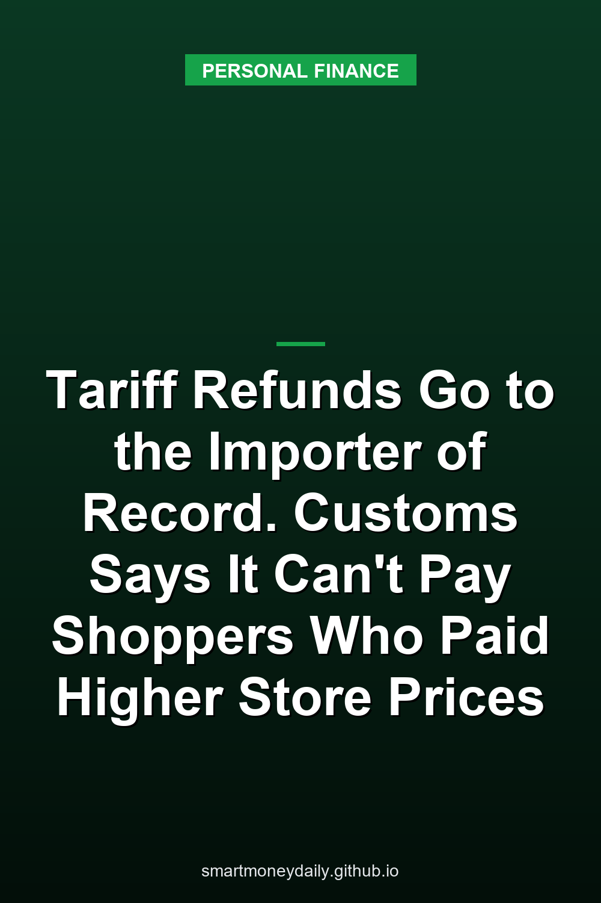

Customs and Border Protection has a one-sentence answer for shoppers hoping to get back what tariffs added to their bills. Asked in its [refund FAQ](https://www.cbp.gov/trade/programs-administration/trade-remedies/ieepa-duty-refunds) whether it is sending refunds directly to consumers who may have paid more because of an IEEPA duty, the agency says it "is only able to refund IEEPA duties to the Importer of Record or the Notify Party (designated on CBP Form 4811) who have their U.S. bank account information in their ACE Portal account."

The refunds themselves are real and large. On Feb. 20, 2026, the Supreme Court held in Learning Resources, Inc. v. Trump that the International Emergency Economic Powers Act doesn't authorize the president to impose tariffs. CBP estimates the IEEPA tariffs it assessed from Feb. 3, 2025, to Feb. 24, 2026, at about $166 billion, spread over more than 53 million entry summaries. Since April 20 it has taken refund requests for eligible entries through a system built for the job, and it pays the refunds with interest. For most households the honest answer is that there's nothing to file. The exceptions are a package you had shipped from abroad where a duty bill came to you, and a small business that brought in goods under its own name.

## Why the money stops at the importer of record

Tariffs are charged on the customs entry, not on the store receipt. The importer of record is the party named on that entry, the one the law makes responsible for depositing the estimated duties. Customs regulations say a refund of excess duties is prepared "in the name of the person to whom the refund is due" and paid electronically. CBP's refund notice says that means the importer of record or a "notify" party the importer designated on Form 4811 or in the ACE Portal. CBP's refund process runs on entry numbers and the importer named on each one. A store's price increase isn't on any of them.

So whether a retailer that gets money back shares any of it with customers is the retailer's call. Nothing in CBP's refund process requires it.

Prices didn't lose every tariff, either. CBP's FAQ points out that the general duty rate and other duties, "such as Section 232, 301, and/or 201, were and are still applicable." Only the IEEPA layer comes off an entry.

## A duty bill on your own package is where to look

If you ordered from a shop overseas, the package came into the U.S. between Feb. 3, 2025, and Feb. 24, 2026, and a carrier billed you for duties, part of that bill may have been IEEPA duty. That's the one place an ordinary shopper could have a refund coming, and it turns on whose name went on the entry.

Ask the carrier or broker that billed you for two things: the entry number, which CBP's system takes as 11 characters without dashes, and who was listed as importer of record.

- If the carrier or its brokerage arm was the importer of record, the refund goes to it. CBP has no way to route that money to you, so whether you see any of it depends on the carrier.
- If the price you paid already included duties and nobody billed you separately, the same rule applies. The refund goes to whoever is named as importer on the entry, and the seller or carrier is the only one who can tell you who that was.
- If you're listed as the importer of record yourself, the steps in the next section apply to you just as they would to a business.

Goods from Europe and Japan have a wrinkle. Under the framework deals with the European Union, Japan, South Korea and Switzerland/Liechtenstein, the regular duty and the IEEPA duty had to add up to 15%, and the whole 15% could show up as a single line on the entry. CBP's own example: if the regular duty rate was 5%, the IEEPA share was 10%, and only that 10% comes back.

Low-value packages that used to come in duty-free are a separate question. When the Court of International Trade ordered the refunds in March, it added that "nothing in this order addresses issues concerning duty free de minimis treatment," an issue it has before it in another case.

## Steps for an importer of record

CBP pays these refunds by direct deposit, "with rare exceptions," not by paper check. So the first step is an account in the ACE Portal, CBP's online system for importers, which has its own application for an importer account with a single importer of record number. Inside it, refund bank details go under an importer sub-account. That enrollment is separate from any bank information used to pay CBP, and if it's missing, CBP holds the refund until you add it.

The request itself is called a CAPE declaration. It's a CSV file listing entry numbers, and CBP doesn't ask for anything else in it. Only the importer of record or the licensed customs broker that filed those entries can upload one. CBP says an attorney can't. Once a declaration is accepted it can't be amended or canceled, and each entry can appear on only one accepted declaration, so it pays to check the list before you upload. CBP prohibits asking for an IEEPA refund through a post summary correction instead.

What CAPE will take is limited. It accepts entries that haven't liquidated yet, entries whose liquidation is suspended, extended or under review, and entries liquidated within the previous 80 days, though entries not filed in ACE, entries under an open protest and entries on a drawback claim are among those it turns away. CBP says the 80 days leave it time to reliquidate by the 90th day, the legal limit for doing that on its own. Liquidation is the final assessment of duties on an entry. One liquidated more than 80 days earlier gets rejected with the message "Entry Summary is in Final Liquidation Status," and CBP's Nov. 4 notice lists entries whose liquidation is final among those CAPE doesn't currently accept. For entries in the first phase, those not yet liquidated or still inside the 90-day window, CBP says you don't need to file a case at the Court of International Trade to get the refund. For any other entries, it "offers no legal guidance on whether a case needs to be filed with the CIT."

## How long it takes, and what the interest adds

CBP tells importers to expect valid refunds generally within 60 to 90 days after a declaration is accepted, unless a compliance concern needs more review. Entries that are extended, suspended or under review are the exception: they keep that status, and a validated refund comes when they finally liquidate. Once an entry liquidates or reliquidates, most refunds reach the bank account in 3 to 5 weeks. CBP doesn't email status updates. You check reports in the portal, or ask the broker that filed for you.

Interest is included. It generally runs from the date the duty was deposited to the date the entry liquidates or reliquidates, at a rate the IRS sets each quarter and CBP publishes in the Federal Register. For anyone other than a corporation, CBP's Sept. 22 notice lists 7% from January 2025 through March 2026, 6% from April through June 2026, and 7% from July 1 through Dec. 31, 2026. Corporations get one percentage point less.

On a small duty bill that works out like this. Say you deposited $500 of IEEPA duty on Oct. 1, 2025, and the entry reliquidated on Oct. 1, 2026. At the non-corporate rates the interest comes to about $34 to $35, depending on how it compounds. The same $500 at the [FDIC](https://www.fdic.gov/national-rates-and-rate-caps)'s national average savings rate of 0.39% in its November 16, 2026, table would earn about $2 in a year.

The deposit can still come in under the IEEPA line on your paperwork. CBP nets the refund against any other duty it finds owed on the same entry, and an entry that was underpaid elsewhere can even produce a bill. It can also divert the refund to cover legally fixed, undisputed debts the importer owes the United States. An open CBP bill for IEEPA duties doesn't block a declaration, though. CBP has paused collecting those, while any non-IEEPA amounts on the same bill are still due. If you think the amount is wrong, the route is a protest, which has to be filed within 180 days after the liquidation or reliquidation date.

## Texts and mailers about tariff refunds

CBP has put out a fact sheet about "suspicious mailers, flyers, and notices" aimed at importers. It says submitting a CAPE declaration in ACE "is the only way to submit a request for an IEEPA refund," and the FAQ adds that CBP doesn't charge any fees for refunds. The agency will generally not ask for Social Security numbers, bank account details or passwords by email or text. Real CBP email addresses end in "@cbp.dhs.gov" or "@associates.cbp.dhs.gov," and suspicious messages can be reported to IEEPAFraud@cbp.dhs.gov.

For a shopper who never imported anything, the test is simpler still. CBP pays only importers of record or the party they designated, by direct deposit to a bank account enrolled in its portal, so a message offering you a tariff refund in exchange for a fee, a login or your bank details isn't coming from CBP.

## Tariff rebate checks are still bills in Congress

The checks people keep searching for exist only as proposals. The [Tariff Refunds for Working Families Act, S. 4093](https://www.govinfo.gov/app/details/BILLS-119s4093is), introduced March 12, would give a credit of $600, or $1,200 on a joint return, plus $600 for each qualifying child, with advance payments due within 40 days of enactment. It cuts off completely above adjusted gross income of $180,000 on a joint return, $120,000 for a head of household and $90,000 for other filers. Two House bills, the Payback Act (H.R. 7646, introduced Feb. 23) and the American Consumer Tariff Rebate Act of 2026 (H.R. 7865, introduced March 9), would also pay direct refunds for tariff costs, one to consumers and the other to taxpayers. The last recorded action on all three is the referral to committee on the day each was introduced. Until something like them becomes law, there's no tariff rebate for the IRS to send.

## What I'd do with a duty bill

If I'd paid a carrier's duty invoice on an overseas order that entered the U.S. between Feb. 3, 2025, and Feb. 24, 2026, I'd dig it out this weekend and ask the carrier for the entry number and the importer of record. CAPE checks each entry's liquidation date, and the 80-day window keeps closing on older entries. If I came back listed as importer of record, I'd ask whether the broker that filed the entry will submit the CAPE declaration before that window closes, and I'd set up the ACE account and refund bank details right away, since without them CBP holds the money.

For anything I bought from a store in the U.S. at a posted price, there's nothing to file. A text offering to file it for me is the one tariff refund I'd be sure is fake.

## Further Reading

- [A Late or Missing Black Friday Order Is a Credit Card Billing Error, With 60 Days From the Statement to Dispute. Federal Debit Card Rules Don't Cover It](/2026/11/27/a-late-or-missing-black-friday-order-is-a-credit-card-billing-error-with-60-days-from-the-statement-to-dispute-federal-debit-card-rules-dont-cover-it/)
- [A Judge Won't Stop the Move Off the SAVE Student Loan Plan. On the New RAP Plan, Crossing $60,000 in Income by $1 Can Raise the Bill $600 a Year](/2026/11/26/a-judge-wont-stop-the-move-off-the-save-student-loan-plan-on-the-new-rap-plan-crossing-60000-in-income-by-1-can-raise-the-bill-600-a-year/)
- [Parking Cash From a Stock Loss in Savings Won't Trigger a Wash Sale. Buying the Same Stock Within 30 Days Before or After Can](/2026/11/25/parking-cash-from-a-stock-loss-in-savings-wont-trigger-a-wash-sale-buying-the-same-stock-within-30-days-before-or-after-can/)
- [The $6,000 Senior Deduction Ends After 2028. Inside Its Phase-Out, $1,000 of Interest Cuts at Least $60 Per Person](/2026/11/24/the-6000-senior-deduction-ends-after-2028-inside-its-phase-out-1000-of-interest-cuts-at-least-60-per-person/)
- [The Average 12-Month CD Rose to 1.81% in November, Its Highest Since January 2025. Savings Edged Up to 0.39%](/2026/11/23/the-average-12-month-cd-rose-to-181-in-november-its-highest-since-january-2025-savings-edged-up-to-039/)

