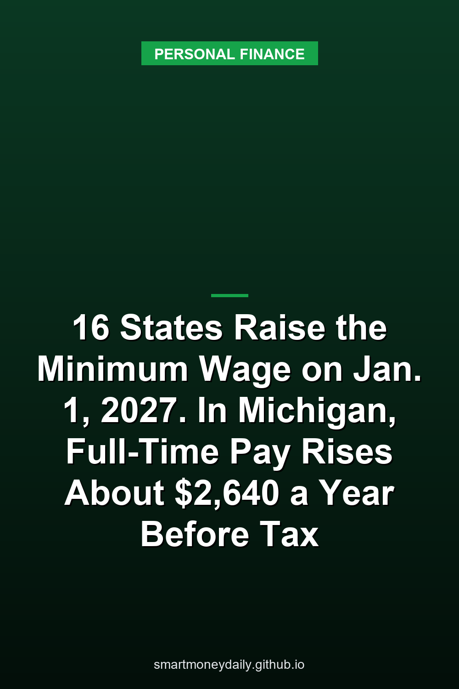

On Jan. 1, Michigan's minimum wage rises from $13.73 to $15.00 an hour. That $1.27 is the largest increase among the 16 states lifting their wage floors on New Year's Day, and for someone on the clock 40 hours a week all year, it comes to $2,641.60 more in gross pay. Washington's new $17.73 becomes the highest rate of any state (Washington, D.C., is already at $18.40). The federal minimum isn't moving. It's $7.25, the same as on July 24, 2009.

The Economic Policy Institute, a Washington research group that tracks these laws, estimates that the Jan. 1 increases will lift pay for more than 6.6 million workers. Michigan's [Department of Labor and Economic Opportunity](https://www.michigan.gov/leo/bureaus-agencies/ber/wage-and-hour/min-wage) lists $15.00 as the last step set by Senate Bill 8, the 2025 law that sped up the state's schedule. From 2028 on, Michigan's rate follows inflation. The state treasurer works out each adjustment in October and publishes it by Nov. 1, so the 2028 rate should be out by Nov. 1, 2027.

## Every new rate, side by side

| State | 2026 rate | From Jan. 1, 2027 | Change per hour | Change over a full-time year |
|---|---|---|---|---|
| Washington | $17.13 | $17.73 | +$0.60 | +$1,248 |
| Connecticut | $16.94 | $17.48 | +$0.54 | +$1,123 |
| California | $16.90 | $17.40 | +$0.50 | +$1,040 |
| Rhode Island | $16.00 | $17.00 | +$1.00 | +$2,080 |
| New Jersey | $15.92 | $16.48 | +$0.56 | +$1,165 |
| Colorado | $15.16 | $15.71 | +$0.55 | +$1,144 |
| Maine | $15.10 | $15.70 | +$0.60 | +$1,248 |
| Arizona | $15.15 | $15.65 | +$0.50 | +$1,040 |
| Nebraska | $15.00 | $15.26 | +$0.26 | +$541 |
| Michigan | $13.73 | $15.00 | +$1.27 | +$2,642 |
| Vermont | $14.42 | $14.91 | +$0.49 | +$1,019 |
| Virginia | $12.77 | $13.75 | +$0.98 | +$2,038 |
| South Dakota | $11.85 | $12.30 | +$0.45 | +$936 |
| Minnesota | $11.41 | $11.87 | +$0.46 | +$957 |
| Ohio | $11.00 | $11.40 | +$0.40 | +$832 |
| Montana | $10.85 | $11.20 | +$0.35 | +$728 |

The last column is the hourly change times 2,080 hours (40 hours a week for 52 weeks), rounded to the nearest dollar, before any tax. If you work 20 hours a week, halve it. These are the standard statewide rates. Each state has its own exemptions and special rates (some are listed below). Nebraska's law, for one, covers employers with four or more workers. Every rate comes from the state agency that sets or enforces it, except Connecticut's, which comes from the governor's announcement.

Twelve of these states tie a yearly adjustment to an index. Eleven use an inflation measure: Arizona, California, Colorado, Maine, Minnesota, Montana, New Jersey, Ohio, South Dakota, Vermont and Washington. Connecticut uses the employment cost index, which tracks what employers pay for labor and rose 3.2% in the 12 months ending June 30, 2026. The formulas explain the odd cents. Montana's 3.4% inflation figure took its $10.85 to $11.22, and its law rounds to the nearest nickel, so the new rate is $11.20.

Michigan, Rhode Island and Virginia have fixed dollar steps written into law. Virginia's $13.75 comes from a 2026 law that also schedules $15.00 for Jan. 1, 2028.

Nebraska is the odd one out. Voters approved $15 by 2026 in a 2022 initiative, with cost-of-living raises to follow. In 2026 lawmakers replaced those with a flat 1.75% a year, and the state's posted schedule shows the results: $15.26 in 2027, $15.53 in 2028, $15.80 in 2029 and $16.08 in 2030. That's why Nebraska's raise is the smallest on the list.

## How much of Michigan's raise is left after federal taxes

Take a single Michigan worker earning $15.00 for 2,080 hours in 2027, with no other income, the basic standard deduction and no credits. Their pay comes to $31,200, against $28,558.40 for the same hours at the 2026 rate. To keep the comparison clean, both are run through the 2027 federal tax rules. Here's where the $2,641.60 difference goes:

- Social Security (6.2%) and Medicare (1.45%) take 7.65% of these wages, which is $202.08 of the raise.
- Federal income tax: a single filer with only the standard deduction owes nothing on the first $16,600 of income, then 10% up to $29,400 and 12% from there up to $68,625. The raise carries this worker past $29,400, so the first $841.60 of it is taxed at 10% and the last $1,800 at 12%. That's $300.16.
- What's left is $2,139.36, or about $41.14 a week. Before tax, it was $50.80 a week.

Michigan's state income tax, and a city income tax where one applies, come out of that $41 too. I've left them out. Workers whose income falls in the phase-out range of the earned income tax credit can also lose part of that credit as pay rises, which makes the net gain smaller still. A raise alone doesn't mean you need a new W-4, since payroll figures withholding from your pay and the W-4 already on file. If your credits or household change, that's the time to look at it again.

## When the new rate shows up on a paycheck

What counts is when the work was done, not when you're paid. Hours worked from Jan. 1 on are owed the new rate. A paycheck dated in January can cover only December days, some of each, or only January days. With a pay period of Dec. 21 through Jan. 3, for example, the December days are still paid at the 2026 rate.

Once a check covers January hours, look at the hourly rate printed next to regular hours on the stub. If it's below the minimum that applies to you, ask payroll to check it. If that doesn't fix it, the state agency that enforces the minimum wage takes unpaid-wage complaints.

Overtime moves with it. For workers covered by federal overtime rules, hours past 40 in a week must be paid at least one and a half times the regular rate, so a Michigan worker whose regular rate is the $15.00 minimum gets at least $22.50 for those hours. The extra $7.50 is the part that qualifies for the federal "no tax on overtime" deduction. It's an amount you may be able to deduct, not $7.50 of tax saved. The deduction is capped at $12,500 a year ($25,000 on a joint return) for 2025 through 2028, covers only the overtime federal law requires, and phases out above $150,000 of modified adjusted gross income ($300,000 joint). It also requires a work-eligible Social Security number and, if you're married, a joint return. Income tax is still withheld from overtime pay, and Social Security and Medicare still come out of it. The deduction is claimed on the tax return.

Local rates sit on top of all this. California's labor department reminds employers that where a city or county sets a higher minimum, the higher one applies. Minnesota's labor agency points out that Minneapolis and St. Paul have their own, higher ordinances. In those places the state number in the table isn't your floor.

## Tipped, teen and small-employer rates

Several states also raise separate rates for tipped workers, younger workers and smaller employers.

**Tipped workers.** These are the cash wages employers can pay before tips. New Jersey's goes from $6.05 to $6.61, Maine's from $7.55 to $7.85 and Vermont's from $7.21 to $7.46, which is half the full rate. Ohio's rises from $5.50 to $5.70, and South Dakota's from $5.925 to $6.15. Colorado's tipped rate will be $12.69. Arizona lets employers pay tipped staff up to $3.00 less than the minimum, which works out to $12.65. If tips don't bring the hourly total up to the full minimum, the employer owes the difference. Nebraska's cash wage for tipped work stays at $2.13.

**Teens and trainees.** Washington lets employers pay 14- and 15-year-olds 85% of the adult rate, or $15.07. Nebraska has allowed a $13.50 rate for 14- and 15-year-olds since July 18, 2026, and that figure doesn't change in 2027. Minnesota's 90-day training wage for workers under 20 goes to $9.68.

**Smaller employers.** New Jersey's rate for seasonal employers and for those with fewer than six employees rises from $15.23 to $16.25, and the farm-work rate from $14.20 to $15.00. Ohio's $11.40 applies to businesses with more than $419,000 in annual gross receipts, up from a $405,000 threshold. At businesses with $419,000 or less in receipts, and for 14- and 15-year-olds, Ohio's state rate stays tied to the federal $7.25.

## New York holds still, and 20 states have no minimum above $7.25

New York's rate was set to start rising with inflation in 2027. It won't on Jan. 1. The state Department of Labor says the conditions for one of the law's "off-ramps" were met, so "the minimum wage will not receive an inflation-based increase on January 1, 2027." It stays $17.00 an hour in New York City, Long Island and Westchester and $16.00 in the rest of the state. Home care aides are the exception. Their minimum rises to $20.00 in New York City, Long Island and Westchester and $19.00 elsewhere.

At the federal level, the Labor Department's [state minimum wage table](https://www.dol.gov/agencies/whd/mw-consolidated), current as of Sept. 30, 2026, puts 30 states and D.C. above $7.25. In 13 more, the state minimum equals $7.25: Idaho, Indiana, Iowa, Kansas, Kentucky, New Hampshire, North Carolina, North Dakota, Oklahoma, Pennsylvania, Texas, Utah and Wisconsin. Seven have no minimum of their own or one below it: Alabama, Georgia, Louisiana, Mississippi, South Carolina, Tennessee and Wyoming. In those 20 states, covered nonexempt employees generally must get at least the federal $7.25, apart from lawful tip credits and other special rates. A full-time year at $7.25 comes to $15,080. None of the 20 raises its rate on Jan. 1, and neither do the other states above $7.25 that aren't in the table.

Several places above $7.25 run on other calendars. Alaska is scheduled to go from $14.00 to $15.00 on July 1, 2027, under its 2024 ballot measure, and Oregon and D.C. adjust their rates each July. Florida already rose to $15.00 on Sept. 30, 2026, so nothing changes there on Jan. 1.

## Where I'd put the difference

For the Michigan worker above, the raise is about $41 a week after federal taxes, a little less once state tax comes out. Sums that size tend to blend into everyday spending unless they're moved on purpose. If the bills were already covered at the old rate and it were my paycheck, I'd set up an automatic transfer of about that amount into savings starting with the first check that reflects the raise, while it's still money the budget hasn't gotten used to.

The account's rate makes a small but real difference. The [FDIC's national average](https://www.fdic.gov/national-rates-and-rate-caps) for savings accounts was 0.39% as of November 16, 2026. Assuming that rate holds and a deposit of $41.14 goes in at the end of each of 52 weeks, the account earns about $4 in interest over the year. At 4%, the same deposits earn about $42. Either way, the 52 deposits themselves add up to $2,139.28, eight cents short of the yearly figure above because of rounding to the cent each week.

Even at the national average, that's most of a month's gross pay at Michigan's new rate sitting in an insured account by the end of 2027.

## Further Reading

- [Tariff Refunds Go to the Importer of Record. Customs Says It Can't Pay Shoppers Who Paid Higher Store Prices](/2026/11/28/tariff-refunds-go-to-the-importer-of-record-customs-says-it-cant-pay-shoppers-who-paid-higher-store-prices/)
- [A Late or Missing Black Friday Order Is a Credit Card Billing Error, With 60 Days From the Statement to Dispute. Federal Debit Card Rules Don't Cover It](/2026/11/27/a-late-or-missing-black-friday-order-is-a-credit-card-billing-error-with-60-days-from-the-statement-to-dispute-federal-debit-card-rules-dont-cover-it/)
- [A Judge Won't Stop the Move Off the SAVE Student Loan Plan. On the New RAP Plan, Crossing $60,000 in Income by $1 Can Raise the Bill $600 a Year](/2026/11/26/a-judge-wont-stop-the-move-off-the-save-student-loan-plan-on-the-new-rap-plan-crossing-60000-in-income-by-1-can-raise-the-bill-600-a-year/)
- [Parking Cash From a Stock Loss in Savings Won't Trigger a Wash Sale. Buying the Same Stock Within 30 Days Before or After Can](/2026/11/25/parking-cash-from-a-stock-loss-in-savings-wont-trigger-a-wash-sale-buying-the-same-stock-within-30-days-before-or-after-can/)
- [The $6,000 Senior Deduction Ends After 2028. Inside Its Phase-Out, $1,000 of Interest Cuts Up to $60 Per Person](/2026/11/24/the-6000-senior-deduction-ends-after-2028-inside-its-phase-out-1000-of-interest-cuts-at-least-60-per-person/)

