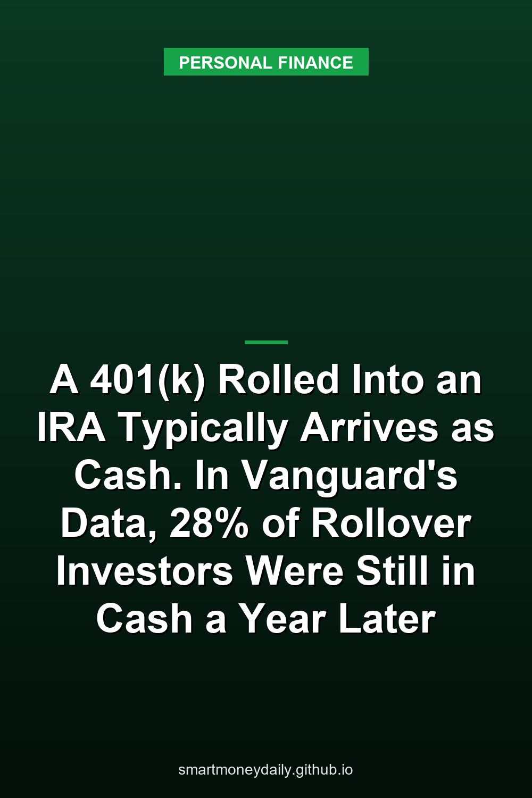

When a 401(k) moves into an IRA, the money usually arrives as cash, and in a self-directed IRA it stays cash until the owner picks an investment. In research published in July 2024, Vanguard looked at rollovers into its own IRAs during 2022 and found that 12 months later, 28% of the investors in that sample who'd rolled money over still had it in cash or cash equivalents. The money that was still uninvested after a year mostly stayed put. In a separate group of about 68,000 rollovers from 2015, the ones still in cash after the first year tended to stay there through the full seven years Vanguard tracked.

A Nov. 24 article in TheStreet set Vanguard's warning next to Fidelity's view. Vanguard calls IRA cash "a billion-dollar blind spot." Fidelity's rollover guidance treats the moment the money lands as a "planning checkpoint," and the article notes that cash in a Fidelity IRA's core position earns interest while it waits. The two firms frame it differently, but they're describing the same fact: an IRA has no automatic investment the way a 401(k) does.

## Why rollover money waits in cash

Inside a 401(k), federal rules let the plan put your contributions into a default investment if you never choose one. The Labor Department's rule on qualified default investment alternatives (29 CFR 2550.404c-5) covers funds that shift from stocks toward bonds based on your age or target retirement date. That's why so many workplace accounts end up in a target-date fund without anyone filling out a form.

IRAs have no equivalent. Vanguard's [research summary on the IRA cash trap](https://corporate.vanguard.com/content/corporatesite/us/en/corp/articles/sticky-ira-cash-trap.html) says IRAs "are typically funded with cash, whether through direct contributions or through rollovers, and stay in cash or cash equivalents absent a reallocation by the account holder." Fidelity's Kenny Davin, quoted in TheStreet's piece, described the part many people miss: "In reality, most of your investments may have been sold and you're starting fresh."

In a separate 2024 report, Vanguard surveyed 556 people who rolled a 401(k) into a Vanguard IRA in 2023 and left the money in a money market fund through June 2024. Two-thirds didn't know how their IRA was invested. Only a third said they were holding cash on purpose. They weren't beginners, either. Seventy-seven percent already owned other investment accounts before the rollover, and close to half believed IRA contributions get invested automatically.

New contributions behave the same way. In Vanguard's 2022 sample, 55% of investors who put fresh money into an IRA still had it in cash a year later. Regular contributions for 2026 can generally be made until the April 15, 2027, filing deadline, and unless you've set the account up to invest incoming money automatically, a deposit made that week lands in cash like any other.

## What the cash is earning right now

"Cash" in an IRA isn't one thing. Depending on the firm and the account's settings, it's usually one of these:

| Where IRA cash can sit | How the rate is set | What protects it |
|---|---|---|
| A money market fund used as the core or settlement position | The fund's yield, after expenses, moves with short-term market rates | Not FDIC-insured; it's a security held in your brokerage account |
| A bank sweep program | The brokerage and its partner banks set it under the program's terms | FDIC insurance at the program banks, up to the limits |
| A product chosen for a small balance the old plan moved without your consent | Depends on the product the plan's agreement calls for: set by the bank, credit union or insurer, or moving with short-term market rates in a registered fund | FDIC insurance for a bank deposit, NCUA share insurance for a credit union, a state guaranty association for an insurer, no deposit insurance for a registered fund |

Yields on government money market funds generally move with short-term market rates such as Treasury bill yields, though each fund's holdings and expenses make a difference, and those rates are high right now. On Nov. 25, Treasury's daily bill rates put the four-week bill at a 4.19% coupon-equivalent yield and the 13-week bill at 4.26%. The Fed held its target range at 3.75% to 4% on Oct. 28, with two officials voting for an increase, and its next meeting is Dec. 8 and 9.

Bank deposits look very different. The [FDIC's national averages](https://www.fdic.gov/national-rates-and-rate-caps) as of November 16, 2026, were 0.39% for savings, 0.64% for money market deposit accounts and 0.07% for interest checking. Sweep rates depend on each program's terms, so some pay more than those averages and some pay less.

For illustration, $40,000 earning a steady 4.19% for a year would make $1,676 in simple interest. At 0.39% it would make $156. Those are benchmarks, not the quoted rate on anyone's IRA cash. Fund yields change daily, and sweep rates change whenever the firm decides to change them. The gap still shows why the label on the cash matters, even if you decide to keep holding it.

## The cost Vanguard puts on staying in cash

Over one year the difference is interest. Over decades it's the difference between cash and whatever else the money could have been in, and that's where Vanguard's numbers get large. For investors under 55, it estimates that putting rollover money into a target-date fund at the time of the rollover could mean at least $130,000 more in retirement wealth at age 65. Across all rollovers, it says defaulting the money into a diversified investment such as a target-date fund, instead of cash, "could generate over $170 billion in additional retirement wealth for American workers each year from rollovers alone."

Those are modeled estimates. The assumptions are laid out in Vanguard's July 2024 policy paper making the case for a default investment in IRAs, and stock and bond funds can lose value in a given year in a way a money market fund isn't designed to. Vanguard's ask is a policy change that would let IRAs have a diversified default the way 401(k) plans do. For now, in a self-directed IRA, choosing nothing means cash.

The age detail is the part of Vanguard's data that stuck with me. Investors in their 20s were the least likely to move out of cash over the long run, and they have the most years for returns to compound. Picture a hypothetical $15,000 rollover from a first job sitting in a money market fund for years. A steady balance makes the decision nobody made easy to miss.

## Small balances the plan moves for you

Some rollovers happen without the account owner doing anything at all. If your plan has a cash-out provision, it can pay out a departing worker's vested balance without consent when that balance is at or below the plan's threshold, which can be as high as $7,000. That ceiling was $5,000 until the SECURE 2.0 Act raised it for distributions made after Dec. 31, 2023. Plans may leave out money you previously rolled into the plan, and the earnings on it, when they apply that limit, so an account worth more than $7,000 can still be pushed out.

What happens next depends on the size. Under 26 U.S.C. 401(a)(31)(B), when one of these forced distributions is over $1,000 and you don't choose where it goes, the plan has to send it to an IRA in your name instead of mailing you a check. For that $1,000 line, the IRS has said the earlier rollover money does count. At $1,000 or less, the plan can simply pay you, in most cases minus 20% income tax withholding, and you'd still have 60 days to roll it over.

The Labor Department offers plan fiduciaries an optional safe harbor for these automatic rollovers, [29 CFR 2550.404a-2](https://www.ecfr.gov/current/title-29/subtitle-B/chapter-XXV/subchapter-F/part-2550/section-2550.404a-2). To use it, the plan's written agreement with the IRA provider has to require that the money be invested "in an investment product designed to preserve principal and provide a reasonable rate of return, whether or not such return is guaranteed, consistent with liquidity." The product has to come from a regulated bank, credit union, insurance company or registered fund, and all fees and expenses, investment expenses included, can't exceed what the provider charges for comparable IRAs opened for other reasons.

That's a cap measured against other IRAs, not against the interest. When the Government Accountability Office studied these forced-transfer IRAs in a 2014 report, it found that fees outpaced returns in most of the accounts it analyzed, so balances tended to shrink. The Fed's target range was 0 to 0.25% at the end of 2014, so the interest side of that math is very different today. The fee comparison in the rule is the same.

If you've changed jobs a few times, the trail starts with the old plan. The Labor Department's Retirement Savings Lost and Found database, set up under SECURE 2.0, lets you search for retirement plans linked to your Social Security number that were sponsored by private-sector employers and unions. It can't find IRAs, so it won't show a forced-transfer IRA directly, but it can point you to the plan, and the plan's administrator should be able to tell you whether your balance went to an IRA and which provider holds it. You need an identity-verified Login.gov account, which asks for your legal name, date of birth, Social Security number, a mobile device and photos of the front and back of an active driver's license. The site describes itself as an information database only. It doesn't decide eligibility or pay benefits, and the department says it doesn't charge a fee to recover funds.

## How 20% withholding hits a rollover paid to you

How the money leaves the 401(k) matters as much as where it lands. In a direct rollover, the plan pays the new IRA, or sends a check made payable to the new account (even if the check is mailed to you to pass along), and nothing is withheld. A taxable eligible rollover distribution paid to you is different. The plan has to withhold 20%, even if you intend to roll it over, and you have 60 days from the day you receive it to get it into an IRA.

Say your $40,000 balance is all pretax money, and the plan pays it to you instead of to an IRA. It withholds $8,000, sends that to the IRS, and you get a check for $32,000. To roll over the full $40,000 into a traditional IRA, you'd have to add $8,000 of your own money within those 60 days. If you deposit only the $32,000, the IRS treats the other $8,000 as a taxable distribution, and if you're under 59½ the 10% additional tax on early distributions generally applies to it too, unless you qualify for an exception. Either way, the $8,000 withheld is credited as tax paid when you file that year's return, which can come back as part of a refund.

The IRS's once-a-year limit is a separate rule, and it doesn't apply to rollovers from a 401(k) or other plan into an IRA. It allows one 60-day IRA-to-IRA rollover in any 12-month period, counted across all the IRAs you own, and it doesn't cover trustee-to-trustee transfers or conversions from a traditional IRA to a Roth IRA.

## Reading the cash line in a rollover IRA

The positions list is the quickest check. If the rollover shows up as a single money market fund, or as a line labeled cash, core position, settlement fund or sweep, it hasn't gone into anything else yet.

These are the things I'd write down:

- The product behind the cash line: the money market fund's name and ticker, or the name of the bank sweep program.
- What it pays: the fund's latest seven-day yield (a measure of recent income, not a promised rate) or the firm's sweep rate table.
- Whether the firm lets you choose a money market fund as the core position, or only offers a bank sweep and makes you buy a fund yourself each time cash arrives.
- Whether the old plan has actually released the money and the new IRA has credited it, since a rollover check that's still in the mail isn't in the new account yet.

Ordinary purchases and sales of funds inside the same IRA generally don't trigger income tax at the time, so moving the cash into an investment, or from a low-paying sweep into a money market fund, isn't a taxable event. Rollovers, Roth conversions and withdrawals have their own tax rules. Pretax 401(k) money that goes into a Roth IRA, for instance, is taxable even in a direct rollover.

## Cash on purpose

Holding cash in an IRA can be a deliberate choice. Some people keep it there because they'll be making withdrawals soon, or because they want time to settle on an allocation without market swings in the meantime. TheStreet's article quoted Schwab's guide describing cash as having two jobs: lowering a portfolio's overall risk and meeting liquidity needs.

What I wouldn't want is the version in Vanguard's survey, where most of the people sitting in cash didn't know they were. If I'd moved an old 401(k) this year, I'd open the IRA, find the cash line and write down what it's in, what it pays and whether I meant it. Then I'd look again after the Fed's decision on Dec. 9, since money market yields tend to follow it.

## Further Reading

- [16 States Raise the Minimum Wage on Jan. 1, 2027. In Michigan, Full-Time Pay Rises About $2,640 a Year Before Tax](/2026/11/29/16-states-raise-the-minimum-wage-on-jan-1-2027-in-michigan-full-time-pay-rises-about-2640-a-year-before-tax/)
- [Tariff Refunds Go to the Importer of Record. Customs Says It Can't Pay Shoppers Who Paid Higher Store Prices](/2026/11/28/tariff-refunds-go-to-the-importer-of-record-customs-says-it-cant-pay-shoppers-who-paid-higher-store-prices/)
- [A Late or Missing Black Friday Order Is a Credit Card Billing Error, With 60 Days From the Statement to Dispute. Federal Debit Card Rules Don't Cover It](/2026/11/27/a-late-or-missing-black-friday-order-is-a-credit-card-billing-error-with-60-days-from-the-statement-to-dispute-federal-debit-card-rules-dont-cover-it/)
- [A Judge Won't Stop the Move Off the SAVE Student Loan Plan. On the New RAP Plan, Crossing $60,000 in Income by $1 Can Raise the Bill $600 a Year](/2026/11/26/a-judge-wont-stop-the-move-off-the-save-student-loan-plan-on-the-new-rap-plan-crossing-60000-in-income-by-1-can-raise-the-bill-600-a-year/)
- [Parking Cash From a Stock Loss in Savings Won't Trigger a Wash Sale. Buying the Same Stock Within 30 Days Before or After Can](/2026/11/25/parking-cash-from-a-stock-loss-in-savings-wont-trigger-a-wash-sale-buying-the-same-stock-within-30-days-before-or-after-can/)

